<p align="center">
  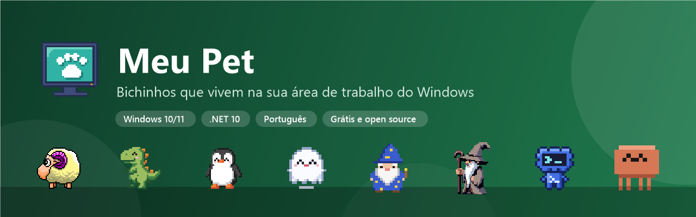
</p>

<p align="center">
  <a href="https://github.com/lfeliipeadv-stack/meu-pet/releases/latest"></a>
  <a href="https://github.com/lfeliipeadv-stack/meu-pet/releases"></a>
  
  <a href="LICENSE.md"></a>
</p>

<p align="center">
  Um bichinho que anda pelas suas janelas, cai na barra de tarefas, dorme, dança, faz bagunça<br>
  e pode ser arrastado e arremessado com o mouse. Escolha o seu no painel de pets e adote.
</p>

<p align="center">
  <a href="https://github.com/lfeliipeadv-stack/meu-pet/releases/latest/download/DesktopPet.exe"><b>⬇️ Baixar o DesktopPet.exe</b></a>
  &nbsp;·&nbsp;
  <a href="https://github.com/lfeliipeadv-stack/meu-pet/releases/latest">Todas as versões</a>
</p>

---

## Os pets

Feitos para o Meu Pet, em pixel art, com dezenas de animações e sons próprios.

<table>
  <tr>
    <td align="center" width="25%">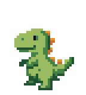<br><b>Rex</b><br><sub>Dinossauro que ruge, joga bola, toca guitarra e vira super-herói. 107 animações.</sub></td>
    <td align="center" width="25%">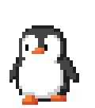<br><b>Pingo</b><br><sub>Pinguim que desliza de barriga, patina, toca trompete e faz boneco de neve. 104 animações.</sub></td>
    <td align="center" width="25%"><br><b>Boo</b><br><sub>Fantasminha que voa pela tela, dá sustos, some e reaparece. 86 animações.</sub></td>
    <td align="center" width="25%">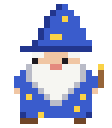<br><b>Mago</b><br><sub>Faz feitiços, se teletransporta, voa de vassoura e é engolido pelo chapéu. 49 animações.</sub></td>
  </tr>
  <tr>
    <td align="center">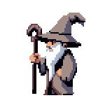<br><b>Sábio</b><br><sub>Velho mago cinzento que lança feitiços com o cajado e invoca um gato.</sub></td>
    <td align="center">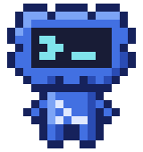<br><b>Nuvi</b><br><sub>Nuvem-terminal que programa, dá erro, compila e faz trovão. 45 animações.</sub></td>
    <td align="center">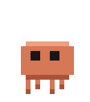<br><b>Claude</b><br><sub>Homenagem de fã ao mascote do Claude Code (sem vínculo com a Anthropic). 45 animações.</sub></td>
    <td align="center">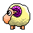<br><b>eSheep</b><br><sub>A ovelhinha clássica. Vem dentro do programa e funciona sem internet.</sub></td>
  </tr>
</table>

Na galeria também estão pets da comunidade do eSheep, como as ovelhas coloridas (gSheep), Neko, Pingus e outros.

## O que ele faz

**Painel de pets**
- Abas **Meus pets** e **Baixar pets**: o tamanho de cada pet aparece antes de baixar
- O botão vira barra de progresso durante o download, que pode ser cancelado ou repetido
- Cada pet vem com descrição em português, número de animações e sons
- Aviso na bandeja quando um pet baixado ganha versão nova
- Remover pets do computador, exportar e importar seus pets para levar a outro PC
- Sem internet, mostra só os pets que já estão no computador

**No dia a dia**
- Arraste o pet com o mouse e solte: ele cai, quica e volta a andar
- Clique com o botão do meio no pet para escolher uma animação
- Clique duplo no ícone da bandeja adiciona mais um pet
- **Ctrl + Alt + P** esconde todos os pets (e os sons) e mostra de novo, ótimo em reuniões
- Som ligado ou desligado para cada pet e volume geral
- Tema claro, escuro ou automático, vários monitores e tamanho 1×, 2× ou 4×
- Opção de iniciar com o Windows

**Por baixo**
- Executável de cerca de 1 MB, atualização automática com verificação SHA-256
- Os pets vêm direto deste repositório (pasta [`Pets`](Pets)), sem precisar de um exe novo
- Tradução em arquivos simples (`src/lang`), fácil de editar

## Telas

<table>
  <tr>
    <td width="50%">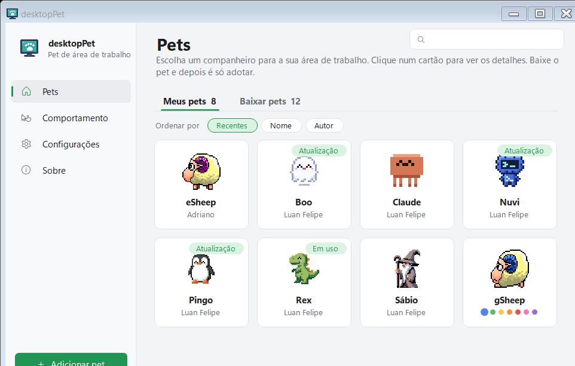<br><sub>Meus pets</sub></td>
    <td width="50%">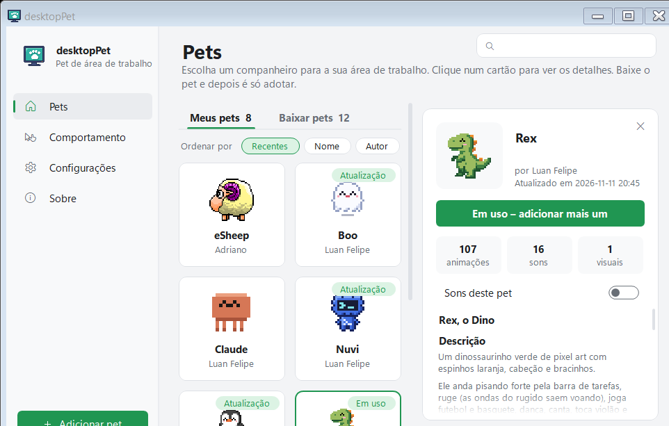<br><sub>Detalhe do pet, com sons e descrição</sub></td>
  </tr>
  <tr>
    <td>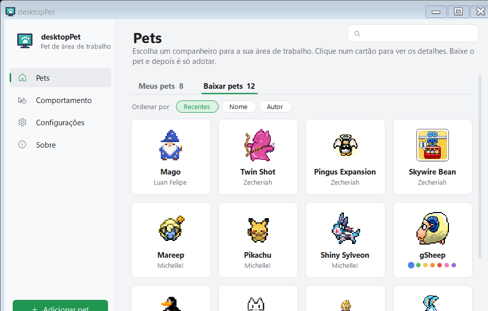<br><sub>Baixar pets</sub></td>
    <td>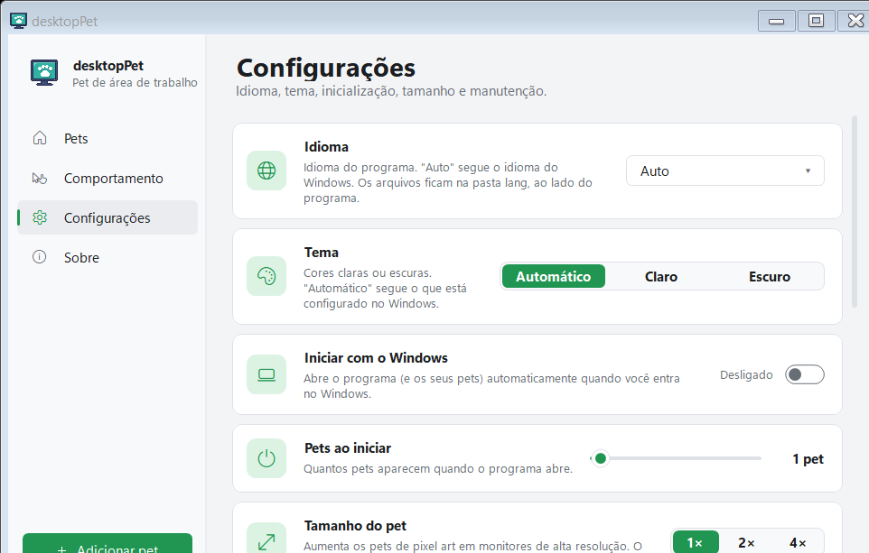<br><sub>Configurações</sub></td>
  </tr>
</table>

## Instalar

1. Instale o [.NET 10 Desktop Runtime](https://dotnet.microsoft.com/download/dotnet/10.0), se ainda não tiver.
2. Baixe o [`DesktopPet.exe`](https://github.com/lfeliipeadv-stack/meu-pet/releases/latest/download/DesktopPet.exe) e abra.
3. O ícone aparece perto do relógio: clique com o botão direito e escolha **Abrir Painel** para adotar um pet.

Para deixar instalado (atalhos no menu Iniciar e atualização automática), use **Instalar** no menu da bandeja.

## Para desenvolvedores

<details>
<summary>Compilar, criar pets e publicar</summary>

<br>

Compilar:

```bash
dotnet build src/DesktopPet.Net.csproj -c Release
```

Os pets próprios são gerados por estas ferramentas:

| Ferramenta | O que faz |
| --- | --- |
| [`Tools/PetGen`](Tools/PetGen) | Desenha Rex, Pingo, Boo, Mago, Nuvi e Claude pixel a pixel e sintetiza os sons (`Sfx.cs`) |
| [`Tools/PetPack`](Tools/PetPack) | Monta pets a partir de quadros PNG (Sábio) |
| [`Tools/update-pets-json.ps1`](Tools/update-pets-json.ps1) | Atualiza tamanho, animações e sons de cada pet no `Pets/pets.json` |
| [`Tools/release.ps1`](Tools/release.ps1) | Gera versão, exe, `lang.zip` e `SHA256SUMS` e publica o release |

```bash
dotnet run --project Tools/PetGen/PetGen.csproj -- Pets
pwsh Tools/release.ps1 -Version 2.2.0 -NoUpload
```

Segure **CTRL** ao abrir o programa (ou use Configurações → Janela de depuração) para ver ao vivo o que o pet está fazendo.

</details>

## Créditos

Baseado no [desktopPet](https://github.com/Adrianotiger/desktopPet) de Adriano Petrucci, a versão para Windows moderno da ovelhinha clássica do eSheep.
Os pets da comunidade pertencem aos seus autores, indicados no painel.
O Claude é uma homenagem de fã: o mascote e o nome pertencem à Anthropic PBC, que não tem vínculo com este projeto.

## Licença

MIT, veja [LICENSE.md](LICENSE.md).
