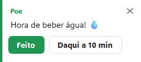

# Agenda e e-mails

[Home](Home.md) · [Instalação](Instalacao.md) · [Primeiros passos](Primeiros-passos.md) · [Painel de pets](Painel-de-pets.md) · [Pergunte ao pet](Pergunte-ao-pet.md) · [Lembretes e pomodoro](Lembretes-e-pomodoro.md) · [Pet virtual e brinquedos](Pet-virtual-e-brinquedos.md) · [Plugins e integrações](Plugins-e-integracoes.md) · [Crie o seu pet](Crie-o-seu-pet.md) · [Atalhos e comandos](Atalhos-e-comandos.md) · [Para desenvolvedores](Para-desenvolvedores.md) · [Perguntas frequentes](Perguntas-frequentes.md) · [Changelog](Changelog.md)

O pet tem dois plugins que olham a sua rotina de trabalho: a **agenda** (Google Agenda ou Outlook.com, pelo link iCal secreto) e os **e-mails novos** (Outlook clássico de desktop). Os dois ficam na página **Plugins**, na categoria **Meu dia**, ao lado do clima e dos lembretes.

| Recurso | O que o pet faz | Precisa de internet | Ligado por padrão |
|---|---|---|---|
| Agenda (Google ou Outlook) | Avisa antes de cada reunião e mostra a próxima | Sim, para reler a agenda | Não (fica ligado depois que você cola o link) |
| E-mails novos (Outlook) | Avisa quantos e-mails novos chegaram na Caixa de Entrada | Não (fal com o Outlook local) | Não em instalação nova |

*Os dois cartões ficam na categoria "Meu dia" da página Plugins. O cartão da agenda tem o botão "Configurar…"; o de e-mails é só um interruptor.*

## Conectar a agenda pelo link iCal

O pet não faz login em lugar nenhum. Ele lê um arquivo de calendário (iCal/.ics) por HTTPS, do mesmo jeito que você abriria o link no navegador.

### Onde fica o botão

**Painel → Plugins → "Agenda (Google ou Outlook)" → "Configurar…"**. Abrir o painel dá-se pelo botão **Abrir Painel** no menu do pet (botão direito no pet) ou pelo item **Abrir &Painel** do ícone da bandeja.

Ligar o interruptor do cartão também abre a mesma caixa de link — é por ali que a agenda é conectada.

### Como pegar o link

A caixa que abre (`agenda.ask`) explica os dois caminhos, com os textos exatos do programa:

- **Google Agenda**: Configurações → sua agenda → "Endereço secreto no formato iCal".
- **Outlook.com**: Configurações → Calendário → Calendários compartilhados → Publicar um calendário → link ICS.

### Regras do link

| Regra | Comportamento |
|---|---|
| Só `https://` ou `webcal://` | `webcal://` é trocado por `https://` antes do download; um link `http://` é recusado com a mensagem "o link precisa começar com https:// ou webcal://" |
| Tem que ser uma agenda | Se o conteúdo não tiver `BEGIN:VCALENDAR`, o erro é "o link não é uma agenda iCal" |
| Sem login | O programa só pede o arquivo pelo link; nenhuma senha sua é pedida ou guardada |
| Fica neste computador | O link é gravado no `DesktopPet.config` (chave `AgendaUrl`), ao lado do executável quando portátil e em `%LocalAppData%\DesktopPet` quando instalado |

Atenção: o link da agenda também entra no arquivo de backup do programa (`.desktoppet`, junto com `AgendaUrl` e `AgendaLead`). Se você exporta o backup para outro computador, o link vai junto.

### Ligar e desligar

- Ao colar um link válido, o programa lê a agenda na hora e mostra na barra de status **"Agenda conectada: {0} evento(s) nas próximas 24 horas."**. O pet também fala: "Agenda conectada! Próximo: {0} às {1}." ou "Agenda conectada! Nada nas próximas 24 horas."
- Se a leitura falhar, a barra de status mostra **"Não foi possível ler a agenda: {0}"**, com o motivo.
- Para remover, basta deixar o campo do link vazio: o programa apaga o link e responde **"Agenda removida."** O mesmo acontece se você desligar o interruptor do cartão.
- O cartão fica "Ligado" enquanto houver link guardado.

## O que o pet entende da agenda

O leitor de iCal (`src/Portable/Agenda.cs`) é um interpretador de RFC 5545 feito para os casos que aparecem nas agendas de verdade:

| Caso | Tratamento |
|---|---|
| Janela lida | Só os eventos que começam nas **próximas 24 horas** |
| Fuso horário | Aceita UTC (`...Z`), horário com `TZID` (nome do Windows ou IANA) e horário solto (local) |
| Evento de dia inteiro | Ignorado (não vira aviso de reunião) |
| Repetição | Diária, semanal (com `BYDAY`) e mensal, com `INTERVAL`, `COUNT` e `UNTIL` |
| Evento removido da série | `EXDATE` tira a ocorrência |
| Evento mudado de hora | `RECURRENCE-ID` substitui a ocorrência original |
| Evento cancelado | `STATUS:CANCELLED` é ignorado |
| Evento sem título | Vira "(sem título)" |

A agenda é **releitura a cada 15 minutos** (o relógio do plugin bate a cada 30 segundos, mas o download só acontece quando já se passaram 15 minutos).

## O aviso antes da reunião

### Quanto tempo antes

Na janela de configuração do plugin (**Configurar…**) há a opção **"Aviso de reunião"**, com os valores **5 min**, **10 min** e **15 min**. O padrão é **10 minutos**.

### O que aparece

- **Antes da hora**: o balão do pet escreve `Daqui a {0} min: {1} ({2}) 📅` — por exemplo, *"Daqui a 10 min: Reunião do time (14:30) 📅"*.
- **Na hora**: o balão escreve `Está na hora: {0} 📅` — por exemplo, *"Está na hora: Reunião do time 📅"*.
- O balão da agenda **fica na tela até você clicar em "OK"** (ou no ✕). O do e-mail fica 15 segundos.

Enquanto isso, o pet faz uma reação: **acena, olha em volta e pensa** (toca a primeira dessas animações que ele tiver — "wave", "look around" ou "think").

Cada reunião é anunciada **uma única vez**, mesmo que a agenda seja relida várias vezes.

*O balão do pet é o mesmo nos avisos de agenda, de e-mail e de lembrete: nome do pet no topo, o recado e até dois botões.*

### Onde a próxima reunião aparece

- **Painel → Início**, no painel **"O que vem por aí"**, com o ícone 📅 e o horário (ou "amanhã", se for no dia seguinte).
- **Menu do pet** (botão direito no pet): a linha **"Próximo: 14:30 Reunião do time"**. Se não houver nada nas próximas 24 h, ela vira **"Nenhuma reunião nas próximas 24 h"**. Essa linha é apenas informativa: clicar nela não abre nada. Se a agenda não estiver conectada, a linha nem aparece.
- **Conversa com o pet**: o chip **"Quando é minha próxima reunião?"** traz a resposta *"Sua próxima reunião: {0} às {1}. 📅"*. Se a agenda não estiver conectada, a resposta é *"Conecte sua agenda do Google ou do Outlook que eu conto suas reuniões."*, com um botão **"Configurar…"** que abre a página Plugins.

*Na página Início, o painel "O que vem por aí" lista o clima, os lembretes e a próxima reunião, tudo em ordem de horário.*

*No menu do pet, a linha da agenda fica entre "Notas e tarefas" e "Como estou hoje?".*

*A conversa com o pet funciona sem IA: as perguntas sobre a próxima reunião são respondidas pelo próprio programa.*

## E-mails novos (Outlook clássico)

### O que é lido — e o que não é

O pet se conecta ao Outlook clássico de desktop por automação COM (`Outlook.Application` / MAPI) e lê **dois números**:

1. quantas mensagens há na Caixa de Entrada;
2. quantas delas estão não lidas.

**Nada mais.** Nem o remetente, nem o assunto, nem o texto da mensagem. É essa a garantia do plugin: o programa não abre e não guarda o conteúdo dos seus e-mails.

O plugin só funciona com o **Outlook clássico já aberto** no computador. O **novo Outlook** (o processo `olk`) e o Outlook na web não têm interface local para o programa usar, e por isso **não são suportados** — o próprio cartão avisa isso.

### Como avisa

O programa olha a Caixa de Entrada **a cada 30 segundos**. Quando chega mensagem nova **não lida**, o pet reage (toca a primeira animação que ele tiver entre "wave", "hello" e "look around" — normalmente acena) e mostra o balão:

| Situação | Texto do balão |
|---|---|
| Uma mensagem nova | "Você tem um novo e-mail no Outlook. Abrir? ✉️" |
| Várias mensagens novas | "Você tem {0} novos e-mails no Outlook. Abrir? ✉️" |

O balão traz dois botões:

- **"Abrir"** — traz a Caixa de Entrada do Outlook para a frente (se o Outlook não estiver rodando, é essa hora que ele é aberto).
- **"Depois"** — fecha o balão sem fazer nada.

Esse balão fica 15 segundos na tela.

### Detalhes que importam

- O programa **nunca abre o Outlook sozinho** para conferir as caixas. Se o Outlook clássico não estiver rodando, a contagem éignorada e nada é anunciado.
- Se o Outlook for fechado e aberto de novo no meio do caminho, o contador é reiniciado — você não recebe um lote de avisos atrasados.
- O aviso só sai quando chega mensagem **não lida**: e-mail já lido não provoca balão.
- O plugin **não tem janela de configuração**: no cartão da página Plugins há só o interruptor. É ele que liga e desliga a contagem (chave `OutlookMail`).
- Em instalação nova ele começa **desligado**. Num computador que já usava uma versão anterior do programa, em que esse recurso ficava ligado por padrão, ele **continua ligado** depois da atualização.

## Em reunião: como o pet se comporta

O atalho **Ctrl+Alt+P** (opção **"Esconder pets com Ctrl+Alt+P"**) esconde todos os pets e os sons de qualquer programa. A descrição da própria opção diz: *"O atalho esconde todos os pets (e os sons) ou mostra de novo, de qualquer programa. Útil em reuniões."* A apresentação inicial do pet repete a ideia: *"Em reunião? Ctrl+Alt+P me esconde e me deixa em silêncio. Aperte de novo para eu voltar."*

Com os pets escondidos (ou durante o **Foco (Pomodoro)**, no **Não perturbe** de tela cheia, ou no horário de silêncio configurado), o pet **não mostra balão nenhum**. Os avisos ficam guardados — até 30 — e saem quando o silêncio acaba:

- "Durante o silêncio, chegou 1 aviso."
- "Durante o silêncio, chegaram {0} avisos."

Com os botões **"Mostrar"** (mostra um a um, com **"Próximo ({0})"**), **"Dispensar"** e **"OK"**.

Existe ainda o plugin **Avisos**: com a opção **"Notificações quando escondido"** ligada, o recado vira **notificação do Windows** em vez de esperar o fim do silêncio. O mesmo plugin tem o horário de silêncio ("Silêncio a partir de" / "Silêncio até"), em que nada aparece e os avisos esperam a manhã.

Durante o Pomodoro em foco o silêncio é o mesmo: as falas e os sons do pet são cortados e os avisos (de reunião, de e-mail, de lembrete) ficam guardados para depois do bloco de foco.

## Sem internet, ou com a agenda desconectada

### Agenda sem internet

- A agenda é a única parte que precisa de rede: se o download falhar, o erro vai para o arquivo de registro do programa e **a lista que o pet já tinha continua valendo** — ele continua avisando das reuniões que ele conhecia.
- O aviso de erro aparece para você só na hora de **conectar**: "Não foi possível ler a agenda: {0}".
- Se o link colado não for uma agenda (ou for `http://`), nada é gravado e o programa explica o motivo.
- Sem agenda conectada, o pet simplesmente não fala de reuniões: a linha "Próximo: ..." some do menu do pet e a conversa responde que a agenda ainda não foi conectada, com o botão "Configurar…" para resolver.

### E-mail sem internet

O plugin de e-mail **não usa internet**: ele conversa com o Outlook clássico que já está rodando no seu computador, por automação local. Sem Outlook clássico aberto, não há aviso — e nenhum erro é mostrado.

### E as outras telas do programa

A faixa "Sem conexão com a internet" que aparece na aba **Baixar pets** é da galeria de pets do GitHub, não da agenda: as reuniões e os e-mails são lidos de outras fontes.

## Onde aparece cada coisa

| Onde | O que você vê |
|---|---|
| Painel → Plugins → "Meu dia" | Cartões "Agenda (Google ou Outlook)" (📅) e "E-mails novos (Outlook)" (✉️) |
| Painel → Plugins → "Configurar…" do cartão da agenda | Campo do link iCal e a opção "Aviso de reunião" (5, 10 ou 15 min) |
| Painel → Início | "O que vem por aí" com a próxima reunião (📅) |
| Menu do pet (botão direito) | "Próximo: {0} {1}" ou "Nenhuma reunião nas próximas 24 h" |
| Conversa com o pet | Chip "Quando é minha próxima reunião?" e resposta com título e horário |
| Balão do pet | Aviso de reunião ("Daqui a {0} min…", "Está na hora…") e aviso de e-mail novo |
| Arquivos do Windows | "Agenda conectada…", "Agenda removida.", "Não foi possível ler a agenda: {0}" |

## Ver também

- [Lembretes e pomodoro](Lembretes-e-pomodoro.md) — os outros avisos que o pet dá e o silêncio do Pomodoro
- [Plugins e integrações](Plugins-e-integracoes.md) — como a página Plugins funciona
- [Atalhos e comandos](Atalhos-e-comandos.md) — o Ctrl+Alt+P e o resto dos atalhos
- [Pergunte ao pet](Pergunte-ao-pet.md) — a conversa que responde sobre a próxima reunião
- [Perguntas frequentes](Perguntas-frequentes.md) — dúvidas comuns sobre agenda e e-mails

## Onde fica no código

- `src/Portable/Agenda.cs` — leitura do iCal (RFC 5545), fusos, repetições, avisos de reunião
- `src/Portable/OutlookMail.cs` — contagem de e-mails no Outlook clássico por COM/MAPI
- `src/Portable/FormSettings.Plugins.cs` — cartões "Agenda (Google ou Outlook)" e "E-mails novos (Outlook)" e a opção "Aviso de reunião"
- `src/Portable/FormSettings.Extras.cs` — caixa do link iCal (`ConfigureAgenda`) e mensagens de status
- `src/Portable/PetMenu.cs` — linha "Próximo: {0} {1}" / "Nenhuma reunião nas próximas 24 h"
- `src/Portable/Chat.cs` — resposta local para "Quando é minha próxima reunião?"
- `src/Portable/FormSettings.Home.cs` — painel "O que vem por aí" da página Início
- `src/Portable/SpeechBubble.cs` — balão de fala, silêncio e avisos guardados
- `src/Portable/HideHotkey.cs` — atalho Ctrl+Alt+P (esconder os pets)
- `src/Portable/Pomodoro.cs` — silêncio do bloco de foco
- `src/Portable/Weather.cs` — `PluginSwitch` e a lista de plugins que ficavam ligados por padrão
- `src/Portable/PetBackup.cs` — chaves `AgendaUrl` e `AgendaLead` no arquivo de backup
- `src/Portable/LocalData.cs` — leitura e gravação das chaves `AgendaUrl`, `AgendaLead` e `OutlookMail`
- `src/lang/pt-BR.json` — textos `agenda.*`, `mail.*`, `opt.agenda*`, `opt.mail.*` e `quiet.*`
