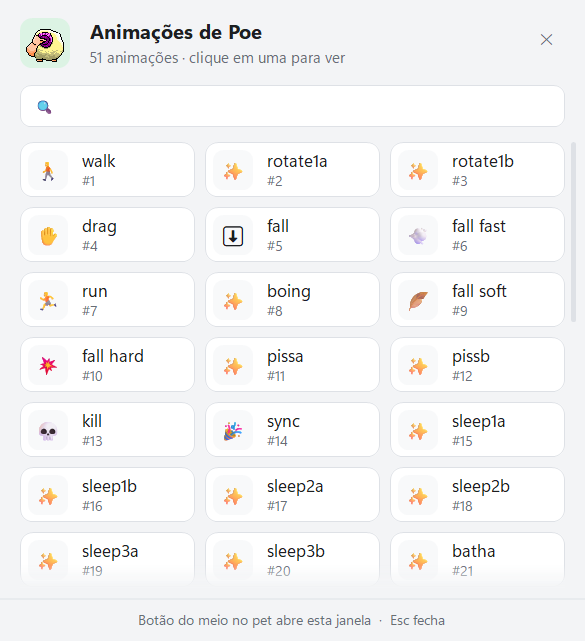

# Atalhos e comandos

[Home](Home.md) · [Instalação](Instalacao.md) · [Primeiros passos](Primeiros-passos.md) · [Painel de pets](Painel-de-pets.md) · [Pergunte ao pet](Pergunte-ao-pet.md) · [Lembretes e Pomodoro](Lembretes-e-pomodoro.md) · [Agenda e e-mails](Agenda-e-e-mails.md) · [Pet virtual e brincadeiras](Pet-virtual-e-brinquedos.md) · [Plugins e integrações](Plugins-e-integracoes.md) · [Crie o seu pet](Crie-o-seu-pet.md) · [Para desenvolvedores](Para-desenvolvedores.md) · [Perguntas frequentes](Perguntas-frequentes.md) · [Changelog](Changelog.md)

Tudo o que dá para apertar, clicar ou digitar no Meu Pet: os atalhos de teclado que funcionam de qualquer programa, os cliques no pet e no ícone da bandeja, onde se muda o idioma e o tema e a lista completa de argumentos que o executável aceita.

## Atalhos de teclado

### Globais (funcionam em qualquer programa)

O Windows registra esses atalhos globalmente, de modo que eles funcionam com o pet na frente ou com outro programa em foco.

| Atalho | O que faz | Onde ligar |
| --- | --- | --- |
| **Ctrl+Alt+P** | Esconde (ou mostra de novo) todos os pets e os sons deles | Configurações › Programa › **Esconder pets com Ctrl+Alt+P** (vem ligado) |
| **Ctrl+Alt+Espaço** | Abre a conversa com o pet de qualquer programa | Assistente › Conversa › **Atalho para perguntar** (vem desligado) |

O item **Esconder pets com Ctrl+Alt+P** fica na seção **Programa** da página **Configurações** e começa ligado. Enquanto o atalho estiver ligado, o item do menu da bandeja mostra o mesmo atalho ao lado do texto: **&Esconder pets** vira **&Mostrar pets** quando os pets já estão escondidos.

O **Atalho para perguntar** fica na seção **Conversa** da página **Assistente** e começa **Desligado**. A lista tem **Desligado** mais quatro atalhos, nesta ordem:

1. `Ctrl+Alt+Espaço`
2. `Ctrl+Shift+Espaço`
3. `Ctrl+Alt+A`
4. `Ctrl+Alt+Q`

Se outro programa já estiver usando o atalho escolhido, a barra de status do painel avisa *"Ctrl+Alt+Espaço já está sendo usado por outro programa."* Cerca de 25 segundos depois de abrir o programa, o pet também fala no balão: *"O atalho {0} já é usado por outro programa, então ele não abre minhas perguntas. Escolher outro?"*, com o botão **Escolher outro**, que leva direto à página **Assistente**.

### Dentro das janelas do programa

| Tecla | Onde | O que faz |
| --- | --- | --- |
| **Esc** | Janela da conversa e balão rápido | Fecha a janela |
| **Esc** | Seletor de animações | Fecha o seletor |
| **Esc** | Painel | Fecha o detalhe do pet aberto; se não houver detalhe, fecha o painel |
| **Esc** | Janela de depuração | Limpa a busca, se a busca estiver com foco |
| **Ctrl+F** | Painel, na página **Pets** | Põe o cursor na busca (**Buscar pet ou autor…**) |
| **Ctrl+F** | Janela de depuração | Põe o cursor na busca do registro |
| **Enter** | Janela da conversa e balão rápido | Envia a mensagem |
| **Enter** | Notas e tarefas, no campo **Nova tarefa…** | Adiciona a tarefa |
| **Ctrl** ou **Shift** (segurado na abertura) | Programa inteiro | Já abre a **Janela de depuração** |

A janela da conversa tem o botão **Falar**: ele usa o reconhecedor de fala do Windows. Quando a escuta não dá certo, o pet oferece **Usar o ditado**, que abre o balão rápido e aperta **Win+H** por você — o ditado do Windows passa a digitar no campo.

*A conversa em balão: digite e aperte Enter para enviar; o botão "Falar" usa a voz.*

### Com o mouse sobre o pet

| Clique | O que faz |
| --- | --- |
| **Botão esquerdo** e arrastar | Pega o pet; ao soltar com força, ele é arremessado, e sem força, apenas cai |
| **Botão do meio** | Abre o seletor de animações (**Animações de {0}**), com busca e o contador de animações do pet |
| **Botão direito** | Abre o menu do pet: **Perguntar ao pet…**, brincadeiras, foco, lembretes, atalhos, Timer, notas e o resto |
| **Botão direito** com a janela de depuração aberta | Abre o menu de depuração de animações (Next, Border, Gravity, Spawns) |
| **Dois cliques com o botão direito** | Tira o pet da tela |
| **Arrastar um arquivo `.xml`** sobre o pet | Troca o pet pelo XML arrastado |
| **Arrastar um texto XML** sobre o pet | O mesmo, com o XML vindo do navegador |

*O seletor de animações, aberto pelo botão do meio: o rodapé avisa "Botão do meio no pet abre esta janela · Esc fecha".*

*O menu do botão direito: é por aqui que se chega ao resto do programa.*

Passar o mouse sobre o pet também faz aparecer dois botões redondos ao lado da cabeça dele: **Mandar mensagem** e **Falar (ditado do Windows)**. Eles somem cerca de 700 milissegundos depois que o mouse sai. O item que liga e desliga esse par de botões é **Botão "Perguntar" no pet**, na seção **Conversa** da página **Assistente**.

### No ícone da bandeja

| Clique | O que faz |
| --- | --- |
| **Botão esquerdo** | Coloca todos os pets por cima das outras janelas |
| **Dois cliques com o botão esquerdo** | Adiciona outro pet |
| **Botão direito** | Abre o menu da bandeja (**Abrir &Painel**, adicionar pet, esconder pets, lembretes, sons, instalar, ajuda, sair) |

## Trocar o idioma e o tema

Os dois ficam na seção **Programa** da página **Configurações**, e a mudança vale na hora, sem reiniciar o programa.

*A página "Configurações" do painel: logo abaixo da dobra, na seção "Programa", ficam idioma, tema e o atalho de esconder os pets.*

### Idioma

O item **Idioma** é uma lista com **Auto** mais todas as línguas disponíveis: o inglês embutido no executável e cada arquivo `lang\*.json` que estiver na pasta `lang` ao lado do programa. Hoje são **Português (Brasil)** (`pt-BR.json`) e **Español** (`es.json`) — os dois vêm também embutidos dentro do executável, então aparecem mesmo de você baixar só o `.exe`.

- **Auto** segue o idioma de exibição do Windows. O programa procura o arquivo com o mesmo nome do idioma do Windows (por exemplo `pt-BR`) e, se não achar, tenta o idioma sem a região (`pt`).
- Escolher outro idioma troca os textos de todas as janelas na hora.
- Para acrescentar uma língua, basta colocar um arquivo novo na pasta `lang`: o nome que aparece na lista vem da chave `language.name` do próprio arquivo.

### Tema

O item **Tema** tem três valores: **Automático**, **Claro** e **Escuro**.

- **Automático** segue o Windows, lendo a chave `AppsUseLightTheme` do registro.
- A escolha vale na hora em todas as janelas abertas.
- Para testar sem mexer na configuração, a variável de ambiente `DESKTOPPET_THEME` com `dark` ou `light` força um dos dois temas.

As cores são as mesmas nos dois temas: fundo `#F3F4F6` no claro e `#202022` no escuro, com destaque `#209652` (claro) e `#4CC278` (escuro). A fonte é **Segoe UI Variable Text**, com **Segoe UI** como reserva, e os ícones usam **Segoe Fluent Icons** (ou **Segoe MDL2 Assets** no Windows 10).

## Argumentos de linha de comando

O executável aceita argumentos na linha de comando. A maioria é para desenvolvimento; os que importam para o uso comum estão em cima.

| Argumento | O que faz |
| --- | --- |
| `--mcp` | Sobe o servidor MCP do Claude Code em stdin/stdout, sem janela e sem pet. Precisa ser o **primeiro** argumento. |
| `--agent=<evento>` | Avisa o pet em execução de que outro agente de IA está trabalhando. Precisa ser o **primeiro** argumento. Eventos: `done`, `stop`, `thinking`, `start`, `waiting`, `input`, `error`, `edit`, `run`, `read`. |
| `--agent=<evento> --then <programa> <args>` | O mesmo aviso e, depois, roda o programa informado (espera até 60 segundos por ele). |
| `--export-lang=<arquivo>` | Grava o modelo em inglês de todas as traduções no arquivo e sai. |
| `--clean-memory=<arquivo>` | Faz a arrumada completa de memória e grava o resultado no arquivo (é o que a cópia elevada do programa executa) |
| `--write-hooks=<arquivo>` | Escreve os hooks do Claude Code num `settings.json` diferente do seu e sai. |
| `--listen` | Só para desenvolvimento: escuta os eventos do Claude Code sem mudar a opção salva; cada requisição fica registrada em `%TEMP%\desktoppet-agent.log`. |
| `--gallery=<url>` | Aponta a galeria para outro endereço (serve para testar o painel sem internet). |
| `--ai-check=<arquivo>` | Testa os provedores de IA de verdade — a chave vem da variável `DESKTOPPET_AI_KEY` e o serviço da `DESKTOPPET_AI_PROVIDER` (padrão `gemini`) — e grava o resultado. |
| `--only=<nome>` | Junto com o `--selftest`, roda só os grupos de verificação cujo nome contém aquele texto. |
| `--selftest=<arquivo>` | Roda as 50 verificações e grava linhas `PASS`/`FAIL`; o código de saída é o número de falhas. |
| `--snapshot=<pasta>` | Grava as capturas das janelas do painel em PNG na pasta (é o que gera as imagens do Wiki). |
| `settings[=página]` | Abre o painel já numa página (sem a página, abre a dos **Pets**): `pets`, `home`, `reminders`, `ai`, `plugins`, `integrations`, `application`, `about` (sem diferenciar maiúsculas). Os nomes antigos `behaviour` caem em `application` e `extras` em `plugins`. |

### Argumentos antigos do eSheep

O programa ainda aceita três argumentos do eSheep original, que provocam a recarga do XML de animação do pet na abertura:

| Argumento | O que faz |
| --- | --- |
| `localxml=<arquivo>` | Lê o XML de animação de um arquivo local |
| `webxml=<url>` | Baixa o XML de animação de um endereço |
| `install=<nome>` | Argumento antigo do instalador: nesta versão o nome é ignorado e o programa só recarrega o XML do pet |

Nessa recarga, a ordem de leitura é: um `installpet.xml` deixado ao lado do executável tem a preferência, depois o `localxml`, depois o `webxml` e, por último, o XML já salvo nas configurações.

Só duas cópias do programa podem ficar abertas ao mesmo tempo; a terceira mostra a mensagem *"O programa já está aberto! Só é possível abrir duas cópias ao mesmo tempo."*

## Ver também

- [Primeiros passos](Primeiros-passos.md) — o que fazer logo depois de instalar
- [Pergunte ao pet](Pergunte-ao-pet.md) — a conversa, a voz e o atalho de perguntar
- [Painel de pets](Painel-de-pets.md) — a página **Pets** do painel e a busca com Ctrl+F
- [Para desenvolvedores](Para-desenvolvedores.md) — compilar, publicar uma release e rodar o autoteste
- [Plugins e integrações](Plugins-e-integracoes.md) — ligar o pet ao Claude Code

## Onde fica no código

- `src/Portable/HideHotkey.cs` — o Ctrl+Alt+P, as quatro opções do atalho de perguntar e o registro global (`RegisterHotKey`)
- `src/Portable/LocalData.cs` — as chaves `HideHotkey`, `AskHotkey`, `AskKey`, `HoverAsk`, `Language` e `Theme` do `DesktopPet.config`
- `src/dotNet/FormPet.cs` — os cliques no pet (arrastar, botão do meio, botão direito, duplo clique) e o arrastar-e-soltar de XML
- `src/dotNet/FormAnimPicker.cs` — o seletor de animações e o Esc que fecha
- `src/dotNet/ProcessIcon.cs` — os cliques no ícone da bandeja
- `src/dotNet/ContextMenus.cs` — o menu da bandeja e o item **&Esconder pets**
- `src/Portable/Chat.cs` — a janela da conversa, o balão rápido, o Enter que envia e o **Usar o ditado** (Win+H)
- `src/Portable/FormAi.cs` — o botão **Falar** e a simulação de Win+H
- `src/Portable/FormSettings.cs` — o Esc e o Ctrl+F do painel
- `src/Portable/FormSettings.Options.cs` — a seção **Programa** (idioma, tema, atalho de esconder pets)
- `src/Portable/FormSettings.Extras.cs` — a seção **Conversa** da página **Assistente** (atalho de perguntar, botão "Perguntar" no pet)
- `src/Portable/HoverAsk.cs` — os dois botões que aparecem ao passar o mouse no pet
- `src/Portable/PetMenu.cs` — o menu do botão direito
- `src/Portable/Notes.cs` — o Enter que adiciona tarefa
- `src/Portable/FormDebugModern.cs` — a janela de depuração e o Ctrl+F dela
- `src/dotNet/StartUp.cs` — a janela de depuração que abre com Ctrl ou Shift na inicialização
- `src/Portable/Lang.cs` — a lista de idiomas e o **Auto** que segue o Windows
- `src/Portable/Theme.cs` — os três temas e a variável `DESKTOPPET_THEME`
- `src/dotNet/Program.cs` — a leitura de todos os argumentos de linha de comando
- `src/Portable/MorePlugins.cs` — o `--agent=` e os eventos de outros agentes de IA
- `src/Portable/SelfTest.cs` — o `--selftest`, o `--only=` e o `--ai-check=`
- `src/Portable/FormSettings.Snapshots.cs` — o `--snapshot=`
- `src/Portable/McpServer.cs` — o `--mcp`
- `src/Portable/ClaudeHooks.cs` — o `--write-hooks=`
- `src/Portable/AgentBridge.cs` — o `--listen` e o registro em `%TEMP%\desktoppet-agent.log`
- `src/lang/pt-BR.json` — os textos da interface citados nesta página
