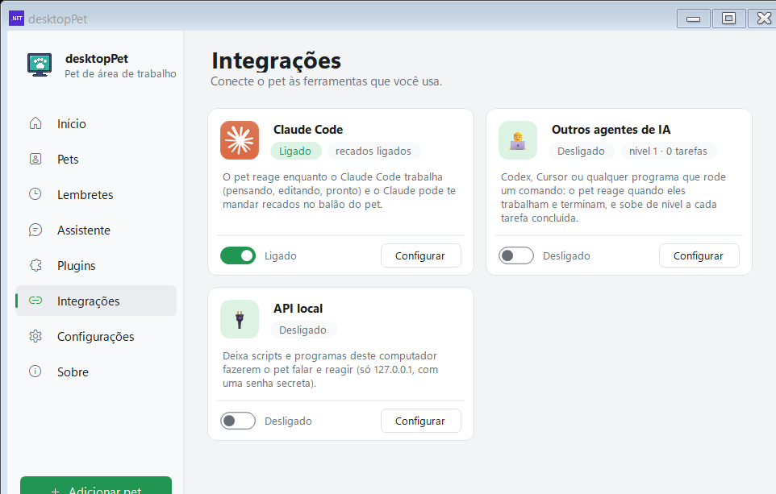

# Changelog

[Home](Home.md) · [Instalação](Instalacao.md) · [Primeiros passos](Primeiros-passos.md) · [Painel de pets](Painel-de-pets.md) · [Pergunte ao pet](Pergunte-ao-pet.md) · [Lembretes e Pomodoro](Lembretes-e-pomodoro.md) · [Agenda e e-mails](Agenda-e-e-mails.md) · [Pet virtual e brincadeiras](Pet-virtual-e-brinquedos.md) · [Plugins e integrações](Plugins-e-integracoes.md) · [Crie o seu pet](Crie-o-seu-pet.md) · [Atalhos e comandos](Atalhos-e-comandos.md) · [Para desenvolvedores](Para-desenvolvedores.md) · [Perguntas frequentes](Perguntas-frequentes.md)

Esta página reúne as versões do **Meu Pet** em ordem decrescente, com a data de cada uma e o que ela trouxe. As versões publicadas também ficam na página de releases do repositório: <https://github.com/lfeliipeadv-stack/meu-pet/releases>.

## Como as versões são publicadas

- A versão do programa está no arquivo `src/Properties/AssemblyInfoPortable.cs`, nas linhas `AssemblyVersion` e `AssemblyFileVersion` (hoje `2.6.2.0`).
- Cada versão publicada vira uma *release* no GitHub com a tag `vX.Y.Z`. O script `Tools/release.ps1` compila, gera o instalador, empacota os idiomas, escreve o `SHA256SUMS` e publica a tag.
- Toda release traz os mesmos arquivos:

| Arquivo | Para que serve | Tamanho na 2.6.2 |
| --- | --- | --- |
| `DesktopPet.exe` | Só o programa. Precisa do .NET 10 Desktop Runtime instalado. | 2.750.643 bytes (2,6 MB) |
| `DesktopPet-completo.exe` | O mesmo programa com o runtime dentro. Abre em qualquer Windows 10/11. | 52.672.112 bytes (50 MB) |
| `DesktopPet-Instalador.exe` | Instalador em .NET Framework 4.8: confere o runtime, instala e cria os atalhos. | 3.150.336 bytes (3 MB) |
| `lang.zip` | Os arquivos de idioma (`pt-BR.json`, `es.json`). | — |
| `SHA256SUMS` | O hash de cada arquivo, conferido antes de o atualizador substituir o executável. | — |

- Depois de uma atualização, o próprio pet conta o que mudou: o balão "Novidades da versão {0}:" sai da chave `whatsnew.<versão>` em `src/lang/pt-BR.json`, e o botão "Ver tudo" abre a página da release no GitHub.

## Versão 2.6.2 — 14 de novembro de 2026 (tag `v2.6.2`)

A versão mais recente. É a que traz a conversa por texto e por voz sobre o pet, os plugins novos (todos desligados por padrão) e o conjunto de correções dos banhos e das ovelhas coloridas. As notas publicadas no GitHub dizem "Novidades desde a 2.5.1", porque as versões 2.6.0 e 2.6.1 não chegaram a ser publicadas.

- **Conversa sobre o pet**: ao passar o mouse aparecem dois botões redondos ao lado do pet — um de mensagem e um de microfone. O balão "Chat" abre sobre a cabeça dele e leva à conversa completa.
- **Voz**: o pet ouve pelo reconhecedor de fala do Windows, sem abrir janela. Se o "Reconhecimento de fala online" estiver desligado, ele oferece o ditado do Windows (Win+H).
- **Plugins novos**: Timer, Memória (arruma a RAM), Tela cheia e Não perturbe, Notas e tarefas, Área de transferência, Codex e Cursor, Visitas (borboleta, passarinho, abelha e joaninha), Música e jogos e Empurrar janelas. Numa instalação nova, todos vêm desligados.
- **Pets**: o banho das ovelhas voltou com respingo de água e a banheira fica um pouco depois de ela sair; o banho sem fogo das ovelhas coloridas voltou a funcionar; o Rex faz malabarismo de verdade, com as bolinhas andando; as animações que estavam paradas agora se mexem; o Pingus passou a ser um só (Adriano Petrucci + Zecheriah).
- **Correções**: ovelhas coloridas baixadas na cor errada, a apresentação do pet novo por cima do pet que estava indo embora, o painel de animações fechando sozinho e erros da plaquinha do monitor do PC.
- **Pets removidos da galeria**: Sábio, Twin Shot, Skywire Bean, Mareep, Pikachu, Shiny Sylveon, Neko, Buster Bunny e SSJ Goku.

*O balão de conversa que abre sobre o pet.*

*Os plugins em cartões, com o filtro por categoria no topo.*

## Versão 2.6.1 — 13 de novembro de 2026 (build interna)

Não chegou a ser publicada: a tag `v2.6.1` não existe no repositório, e o commit da versão registra que as novidades da 2.6.0 "não chegaram a ser publicadas". O que ela resolveu:

- A janela-filha que um pet abre (a jukebox, a banheira do eSheep) passa a seguir a própria sequência até o fim. Antes, um balão ou uma janela aberta transformava a cena numa cópia do pet.
- Um pet parado numa cena com acessório (dançando na frente de uma jukebox) não é mais interrompido por balões nem por reações. Um pet que anda com acessório (o banho do eSheep) continua parando como antes.
- O cartão do Claude Code na página Integrações passa a usar o ícone oficial, embutido no executável; o desenho antigo fica só como reserva.
- Os testes de movimento passam a compilar contra o projeto do .NET 10 e a rodar no CI.
- `SkinOffset` não quebra mais quando o XML ainda não foi carregado, e os `catch` vazios passam a registrar o erro no log.

*O cartão do Claude Code, que recebeu o ícone oficial nesta versão.*

## Versão 2.6.0 — 12 e 13 de novembro de 2026 (build interna)

Também não publicada. Reorganizou o painel e trouxe a conversa por escrito, o clima, os lembretes por frase e os pets que conversam entre si.

- **Painel novo**: a janela de Configurações foi dividida em arquivos por página, com a página **Início** (cartão do pet e os números do dia) e a página **Plugins** em cartões, com filtro por categoria. São 22 cartões.
- **Caixinha de conversa sobre o pet**: a conversa passa a abrir em balão em cima do pet, em vez de uma janela separada.
- **Clima**: plugin novo com a previsão do Open-Meteo (gratuito, sem chave), aviso de chuva e a opção de escolher a cidade.
- **Lembretes por texto**: frases como "me lembra de ligar para a Ana às 15h" ou "daqui a 20 minutos" são lidas no próprio computador, em português, inglês e espanhol. A IA só reescreve as frases que o programa não entende — o horário é sempre decidido localmente.
- **Cuidar de você**: o pet sugere pausa depois de 1h30 sem parar, recepciona quem volta de 30 minutos fora e comemora quando um programa usado por horas é fechado.
- **Pets que conversam**: dois pets que se encontram lado a lado acenam, dançam, trocam carinho ou conversam em duas falas.
- **Agenda pelo link iCal** do Google ou do Outlook, sem login, com aviso antes de cada reunião — e com fusos, repetições, exceções, remarcações e cancelamentos tratados.
- **Atalho de perguntar** passou a ser escolhível: Ctrl+Alt+Espaço, Ctrl+Shift+Espaço, Ctrl+Alt+A ou Ctrl+Alt+Q. O pet avisa quando o atalho já está em uso por outro programa.
- **Página de download** no site, publicada no GitHub Pages.
- Autoteste ampliado: o `--only=nome` para rodar só um teste e novas verificações.

*A página Início, nova nesta versão.*

## Versão 2.5.1 — 12 de novembro de 2026 (tag `v2.5.1`)

Correções de apresentação. O pet ganhou os emojis coloridos e passou a chegar pelo céu na primeira execução.

- **Emojis coloridos** nos balões, nos botões, no painel, no botão Perguntar e nos menus (inclusive nas respostas da IA).
- **Primeira vez**: o pet chega caindo do céu, e a apresentação só começa depois que ele pousa.
- **O carneiro olha para você enquanto fala**: vira de frente com o balão aberto e desvira depois.
- Durante a apresentação os pets ficam parados do começo ao fim e não somem atrás da barra de tarefas.
- Um pet que estava entrando pela borda da tela não para mais meio fora dela quando um balão ou menu abre.
- O carneiro salvo na primeira execução agora recebe as atualizações que vêm dentro do programa.

## Versão 2.5.0 — 12 de novembro de 2026 (tag `v2.5.0`)

A versão que abriu a conversa com o pet e o criador de pets, além do instalador que confere o .NET.

**Pergunte ao pet (IA)**

- Passe o mouse sobre o pet e clique em **Perguntar**, ou aperte **Ctrl+Alt+Espaço**: a resposta aparece no balão.
- Serviços gratuitos: Ollama (no seu computador), Google Gemini, Groq, OpenRouter ou outro compatível com o formato da OpenAI.
- O pet lembra a conversa, tem personalidade (simpático, direto, para crianças, divertido) e aceita ditado por voz.

**Crie o seu pet**

- Configurações → **Criar meu pet**: escolha as imagens de andar, ficar parado, dormir, cair e ser arrastado.
- O painel de pets passou a mostrar uma prévia animada de cada pet.

**Mais tranquilo**

- O pet para de andar sempre que fala ou que uma janela dele está aberta (perguntas, lembretes, atalhos…).
- Durante o foco (Pomodoro) e com os pets escondidos (Ctrl+Alt+P), ele fica em silêncio e guarda os avisos para depois.
- CPU e memória aparecem só ao passar o mouse.
- Aviso de e-mails novos no Outlook clássico.

**Também**

- Idioma espanhol.
- Apresentação na primeira vez e novidades depois de cada atualização.
- Novo **DesktopPet-Instalador.exe**: confere se o .NET 10 está instalado e oferece o instalador oficial quando falta.
- **DesktopPet-completo.exe**: já vem com o .NET dentro.
- Desinstalar agora pergunta se você quer apagar seus pets e configurações (sem resposta, eles ficam guardados).
- Backup completo: pets, lembretes, atalhos, humor e configurações.
- Correção: o balão que aparece depois de uma animação não se perde mais quando o pet cai.

## Versão 2.4.0 — 12 de novembro de 2026 (tag `v2.4.0`)

Uma única novidade, a integração com o Claude Code.

- **O pet reage ao Claude Code**: ele pensa quando você manda uma mensagem, digita quando o Claude edita arquivos, "compila" quando roda comandos, fica triste quando algo falha, te chama quando o Claude precisa de você e comemora quando ele termina.
- Ligue a opção **Reagir ao Claude Code** e abra uma nova sessão do Claude Code. Na 2.4.0 a opção ficava em Configurações → Extras; hoje ela está no cartão "Claude Code" da página **Integrações**.
- Funciona só no seu computador, com uma senha aleatória; nada do seu código ou das suas mensagens é lido ou mostrado.
- Uma cópia do seu `settings.json` é guardada antes da mudança, e desligar remove só o que o pet adicionou.
- Balões de progresso opcionais e botão "Testar".

## Versão 2.3.1 — 12 de novembro de 2026 (tag `v2.3.1`)

Correções de foco de janela e o começo do autoteste.

- O balão de fala e a plaquinha do monitor não roubam mais o foco da janela em que você está digitando.
- Balões, aviões e outras janelas soltas pelo pet continuam escondidos com Ctrl+Alt+P.
- Textos antigos sem tradução removidos.
- Para quem desenvolve: o programa ganhou um autoteste (`DesktopPet.exe --selftest=arquivo.txt`), que roda as conferências com o código de verdade, escreve linhas PASS/FAIL e fecha o programa com o número de falhas como código de saída. O `src/Portable/SelfTest.cs` tem hoje 50 grupos de teste e mais de 300 conferências.

## Versão 2.3.0 — 12 de novembro de 2026 (tag `v2.3.0`)

O mês do menu do pet: quase tudo que o programa faz hoje aparece aqui pela primeira vez.

- **Menu do pet**: clique com o botão direito no pet para ver tudo o que ele faz.
- **Brincadeiras**: biscoito da sorte, bola 8 mágica e piadas.
- **Foco (Pomodoro)**: blocos de foco com pausas curtas e longas; o pet avisa e comemora.
- **Atalhos**: abra pastas, programas e sites pelo menu do pet.
- **Pet virtual**: fome, carinho e energia (ligue em Configurações → Extras).
- **Monitor do PC**: CPU, memória e disco ao lado do pet.
- **Como estou hoje?**: o pet pergunta como você está e guarda um histórico.
- Nova página **Extras** nas configurações.

*O menu do pet, montado em tempo real conforme os plugins ligados.*

## Versão 2.2.0 — 12 de novembro de 2026 (tag `v2.2.0`)

A versão do painel de pets com abas, dos lembretes e do Ctrl+Alt+P.

- **Balões de fala e lembretes**: o pet lembra você de beber água, alongar, fazer pausas, ou avisa quando um tempo acabar (Lembretes → Lembrar daqui a 5/10/15/30/60 min).
- **Painel com abas** "Meus pets" e "Baixar pets", o tamanho de cada pet antes de baixar e a barra de progresso no download (com cancelar e tentar de novo).
- **Sons** novos para Rex, Pingo, Boo, Mago, Sábio, Nuvi e Claude, com som ligado/desligado por pet.
- **Novo pet Sábio**.
- **Ctrl+Alt+P** esconde e mostra todos os pets.
- Aviso quando um pet baixado tem atualização.
- Exportar e importar seus pets para outro computador.
- Iniciar com o Windows.
- Descrições dos pets em português.
- Janela de depuração nova (segure CTRL ao abrir o programa).
- Correção do contorno rosa nos sprites.

*A galeria com as abas "Meus pets" e "Baixar pets", criada nesta versão.*

## Versão 2.1.0 — 11 de novembro de 2026 (tag `v2.1.0`)

A primeira versão do Meu Pet, a partir do desktopPet original.

- Janela de configurações nova, tema claro/escuro e suporte a vários monitores.
- Interface em português.
- Pets embutidos que funcionam sem internet: Capi e Claude. (Hoje vem embutido no executável só o eSheep original — `BuiltInPets.Folders` tem uma entrada só.)
- Galeria de pets e atualização automática a partir deste repositório, com verificação SHA-256.
- Executável de 1.070.771 bytes, cerca de 1 MB.

## Antes do "Meu Pet": o desktopPet original (0.1 → 2.0.0)

O Meu Pet é uma continuação do projeto desktopPet de Adrianotiger, que já tinha 40 versões registradas. O histórico completo está no `Changelog.md` da raiz do repositório; o `Changelog.txt` traz o mesmo histórico no formato antigo, até a 1.0.6. As versões que mais marcaram:

| Versão | Data | O que trouxe |
| --- | --- | --- |
| 2.0.0 | 08 nov 2026 | Suporte a skins de pet, interação entre pets e detecção de colisão com janelas; correções na transição de animações e nos movimentos suaves |
| 1.6.0 | 09 out 2026 | Option Window dentro de uma janela, como o Painel de Controle do Windows 95; a versão da loja do Windows passa a ser igual à portátil, com a inicialização automática no menu |
| 1.5.0 | 01 out 2026 | Movimentos mais suaves, melhorias nos sons e Option Window redesenhada |
| 1.4.0 | 09 set 2026 | Arremesso do pet, com código de ZechsVariety; versão para a Play Store |
| 1.3.2 | 08 ago 2025 | Correção: não era possível carregar um XML local |
| 1.3.1 | 30 ago 2022 | Escala na versão portátil; pets baixáveis filtrados por data; o editor cria o ícone sem conversor |
| 1.2.6 | 05 mai 2021 | Mais estabilidade; o pet não rouba mais o foco da barra de tarefas (mas dá para reativar nas opções); gSheep com mais de 250 animações |
| 1.2.0 | 12 jun 2019 | Versão portátil do app do Windows 10, multimonitor e novo editor offline de XML |
| 1.0.0 | 01 jan 2017 | Detecção de tela cheia e "trazer para o topo" pelo clique no ícone da bandeja |
| 0.5 | 23 dez 2015 | Código reescrito para ser aberto; banheira, sono e queda |

## Onde está o changelog completo

- `Changelog.md` (raiz do repositório) — o changelog completo, do 0.1 (dezembro de 2015) ao 2.0.0 (novembro de 2026), com as 40 versões do projeto original.
- `Changelog.txt` (raiz do repositório) — o mesmo histórico no formato antigo, até a 1.0.6.
- As notas completas de cada versão do Meu Pet estão nas *releases* do GitHub: <https://github.com/lfeliipeadv-stack/meu-pet/releases>.

## Ver também

- [Instalação](Instalacao.md) — qual arquivo baixar, o que é preciso ter instalado e como atualizar.
- [Para desenvolvedores](Para-desenvolvedores.md) — como compilar, rodar o autoteste e publicar uma release.
- [Perguntas frequentes](Perguntas-frequentes.md) — dúvidas sobre versões, atualização e compatibilidade.
- [Plugins e integrações](Plugins-e-integracoes.md) — o que cada plugin faz em detalhe.
- [Home](Home.md) — a visão geral do programa.

## Onde fica no código

- `src/Properties/AssemblyInfoPortable.cs` — a versão do programa (`AssemblyVersion` e `AssemblyFileVersion`).
- `Tools/release.ps1` — o script que compila, gera o instalador, empacota o `lang.zip`, escreve o `SHA256SUMS` e publica a release.
- `src/Portable/Updater.cs` — a consulta à API de releases, a conferência do SHA-256 e a troca do executável.
- `src/Portable/Onboarding.cs` — o balão "Novidades da versão {0}:" e o link "Ver tudo" para as notas da release.
- `src/lang/pt-BR.json` — o texto de novidades de cada versão (`whatsnew.2.5.0` até `whatsnew.2.6.2`).
- `src/Portable/SelfTest.cs` — o autoteste (`--selftest`), rodado em cada build pelo workflow.
- `src/Portable/BuiltInPets.cs` — a lista de pets que vêm embutidos no executável.
- `Pets/pets.json` — a galeria de pets que o painel lê do repositório.
- `Changelog.md` e `Changelog.txt` — o histórico do projeto original, na raiz do repositório.
