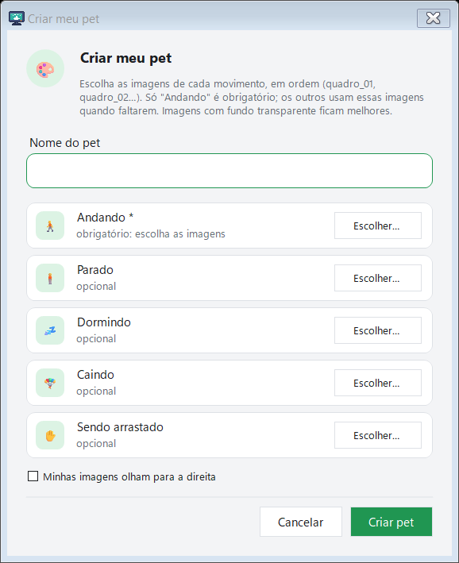
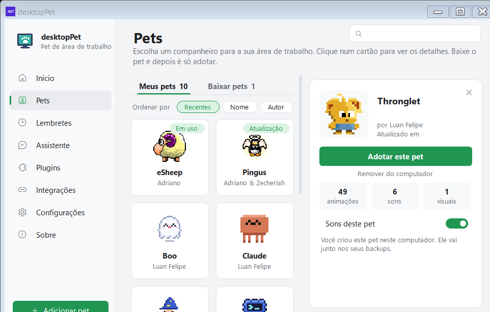
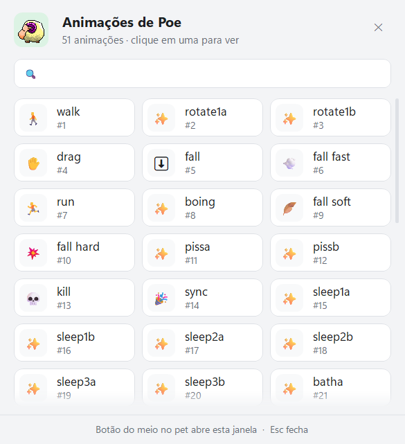

# Crie o seu pet

O programa vem com um criador de pet: você escolhe algumas imagens e elas viram um bichinho que anda, vira, dorme, cai e pode ser arremessado como os outros. Ele fica guardado só neste computador e vai junto nos seus backups.

[Home](Home.md) · [Instalação](Instalacao.md) · [Primeiros passos](Primeiros-passos.md) · [Painel de pets](Painel-de-pets.md) · [Pergunte ao pet](Pergunte-ao-pet.md) · [Lembretes e pomodoro](Lembretes-e-pomodoro.md) · [Agenda e e-mails](Agenda-e-e-mails.md) · [Pet virtual e brinquedos](Pet-virtual-e-brinquedos.md) · [Plugins e integrações](Plugins-e-integracoes.md) · [Atalhos e comandos](Atalhos-e-comandos.md) · [Para desenvolvedores](Para-desenvolvedores.md) · [Perguntas frequentes](Perguntas-frequentes.md) · [Changelog](Changelog.md)

## O caminho até o criador

O criador fica no painel, em **Configurações › Programa › Criar meu pet**, no botão **Criar…**. É a mesma seção onde ficam o backup, a importação de pets, a janela de depuração e a apresentação.


*A página de Configurações do painel; o botão "Criar…" fica na seção "Programa", mais abaixo da dobra.*

Ao clicar, abre a janela **Criar meu pet**:



*A janela "Criar meu pet": o nome em cima e um cartão por movimento, cada um com o botão "Escolher…".*

## O que preencher

### O nome do pet

Campo **Nome do pet**, com limite de 40 caracteres. O nome aparece no menu do pet e no painel — mas o programa corta o nome do pet em 16 caracteres quando carrega o XML, que é o que aparece no menu.

### As imagens de cada movimento

São cinco cartões, e só o primeiro é obrigatório:

| Cartão | Obrigatório | Para que serve |
| --- | --- | --- |
| **Andando** | sim (`*`) | Os quadros do pet andando pela área de trabalho |
| **Parado** | não | O pet parado, também usado como "virar" e como quadro de pouso |
| **Dormindo** | não | O pet dormindo e acordando |
| **Caindo** | não | O pet caindo, arremessado e pousando |
| **Sendo arrastado** | não | O pet enquanto você arrasta ele com o mouse |

Em cada cartão, o botão **Escolher…** abre o seletor de arquivos com o filtro `Imagens|*.png;*.gif;*.jpg;*.jpeg;*.bmp`. Você pode escolher vários arquivos de uma vez; eles entram na ordem do nome (quadro_01, quadro_02…), que é a ordem em que vão tocar.

O cartão mostra quantas imagens já foram escolhidas (`✓ 4 imagens`) e, enquanto estiver vazio, se o movimento é `obrigatório: escolha as imagens` ou `opcional`.

Dois detalhes que valem conferir antes de criar:

- **Se a imagem for maior que o resto, ela é reduzida** para caber numa faixa de 160 pixels de altura. As demais são reamostradas juntas, então use imagens do mesmo tamanho para o pet não ficar torto.
- **A caixa "Minhas imagens olham para a direita"** espelha os desenhos na hora de montar a folha de sprites. O programa anda para a esquerda por padrão, então marque a caixa se os seus desenhos já olham para a direita: o pet fica com a cara virada para o lado em que ele anda.

Se o movimento "Andando" não tiver imagem, o criador avisa: `Escolha pelo menos uma imagem para "Andando".` — e o mesmo vale para o nome: `Dê um nome ao seu pet.`

## O que o pet criado sabe fazer

O pet criado não é só um desenho parado: o criador gera um arquivo de animações completo, com 12 animações. O que cada uma faz:

| Animação | Comportamento |
| --- | --- |
| `walk` | Anda pela área de trabalho e pela barra de tarefas, quadro a quadro |
| `turn` | Vira de direção, espelhando o desenho |
| `drag` | O pet enquanto você arrasta com o botão esquerdo |
| `toss` | O pet arremessado |
| `fall` | A queda depois de ser solto |
| `fall fast` | A queda rápida |
| `fall soft` | O pouso leve depois de um arremesso |
| `idle` | O pet parado, respirando entre um quadro e outro |
| `sleep` | O pet dormindo |
| `wake up` | O pet acordando |
| `sync` | O pet quando todos os pets são sincronizados |
| `kill` | A despedida quando o pet é removido |

Se você não escolheu imagens para "Dormindo", as animações `sleep` e `wake up` não são geradas — e o resto continua funcionando.

Depois de criado, o pet entra na aba **Meus pets** do painel e o programa pergunta `"{0}" está pronto. Adotar agora?`. Ele aparece no painel com a descrição **"Você criou este pet neste computador. Ele vai junto nos seus backups."**.



*Um pet criado neste computador, na aba "Meus pets": o botão de adotar, as três contagens (animações, sons e visuais) e a descrição de que ele vai junto nos backups.*

O seletor de animações (botão do meio do mouse sobre o pet) mostra todas elas, com o nome e um emoji:



*O seletor de animações: cada animação do pet em um bloco, com o nome e um emoji.*

## Onde o pet fica guardado

O pet criado é salvo em `%LocalAppData%\DesktopPet\pets\meu-<nome>\`, com dois arquivos: `animations.xml` (o pet inteiro) e `version.txt`. O prefixo `meu-` é o que separa os pets criados aqui dos pets baixados da galeria, e o nome vem do que você digitou, em minúsculas, sem acentos e sem caracteres especiais (`Teste Ção!` vira `meu-teste-cao`).

O nome da pasta tem no máximo 30 caracteres depois do prefixo, então nomes muito longos são cortados.

### O backup

O pet criado entra sozinho no arquivo de backup. Em **Configurações › Programa › Backup dos meus pets e configurações › Exportar…**, o arquivo `.desktoppet` gerado (salvo em Documentos, com o nome `meus-pets`) leva `pets/<pasta>/animations.xml` e `version.txt` de cada pet do computador, incluindo os que você criou. Na volta, **Importar pets** traz o arquivo de volta: só entram entradas `pets/<nome>/animations.xml` com nome de pasta simples e até 50 MB, e um arquivo corrompido nunca substitui um bom.

O backup leva também os lembretes, os atalhos, o histórico de humor, as necessidades do pet virtual e as configurações. A chave do serviço de IA e a senha da API local nunca entram nele.

## Para ir além: PetGen, PetPack e o animations.xml

O criador do programa serve para um pet rápido, com as animações que o programa já conhece. Quem quiser um pet com muitas animações, sons e cenas próprio vai para as ferramentas de linha de comando e para o formato do arquivo.

### O formato animations.xml

O arquivo que descreve o pet inteiro é o `animations.xml`, e o programa usa o mesmo esquema do eSheep original, com o namespace `https://esheep.petrucci.ch/`. O esquema completo está em `Resources/animations.xsd`, e há um editor de XML online em <https://adrianotiger.github.io/desktopPet-Editor/>.

A raiz é `<animations>` e, dentro dela, esta ordem:

| Bloco | O que guarda |
| --- | --- |
| `<header>` | `author`, `title`, `petname` (máximo 16 caracteres, o programa corta o que sobrar), `version`, `info`, `application` e `icon` (ícone `.ico` em base64) |
| `<image>` | `tilesx` e `tilesy` (como a folha de sprites é cortada), `skins` (opcional), `png` (a folha de sprites em base64) e `transparency` |
| `<spawns>` | Os pontos de entrada do pet na tela, cada `<spawn>` com `probability`, `<x>`, `<y>` e `<next>` |
| `<animations>` | Cada `<animation>` com `id`, `<name>`, `<start>`, `<end>`, `<sequence>`, e opcionalmente `<border>` e `<gravity>` |
| `<childs>` | As janelas extras que uma animação pode abrir (uma banheira, um balão) |
| `<sounds>` | Os MP3 em base64, cada `<sound>` com `animationid`, `probability`, `loop` e `base64>` |

Um cabeçalho mínimo:

```xml
<?xml version="1.0" encoding="utf-8"?>
<animations xmlns="https://esheep.petrucci.ch/">
  <header>
    <author>Luan Felipe</author>
    <title>Meu pet</title>
    <petname>Meu pet</petname>
    <version>1.0</version>
    <info>Um bichinho que anda pela sua area de trabalho.</info>
    <application>1</application>
    <icon><![CDATA[AAABAAQAEBAAAAEAI...]]></icon>
  </header>
  <image>
    <tilesx>8</tilesx>
    <tilesy>3</tilesy>
    <png><![CDATA[iVBORw0KGgoAAAANSUhEUg...]]></png>
    <transparency>Magenta</transparency>
  </image>
  <spawns>
    <spawn id="1" probability="60">
      <x>screenW+10</x>
      <y>areaH-imageH</y>
      <next>1</next>
    </spawn>
  </spawns>
  <animations>
    <!-- as animacoes vao aqui -->
  </animations>
  <childs />
  <sounds />
</animations>
```

Uma animação completa, com o bloco de borda e o de gravidade:

```xml
<animation id="1">
  <name>walk</name>
  <start>
    <x>-3</x>
    <y>0</y>
    <offsety>0</offsety>
    <opacity>1</opacity>
    <interval>150</interval>
  </start>
  <end>
    <x>-3</x>
    <y>0</y>
    <offsety>0</offsety>
    <opacity>1</opacity>
    <interval>150</interval>
  </end>
  <sequence repeatfrom="0" repeat="random/4+8">
    <frame>7</frame>
    <frame>8</frame>
    <frame>9</frame>
    <frame>8</frame>
    <next probability="50" only="none">1</next>
    <next probability="8" only="none">2</next>
    <next probability="10" only="none">11</next>
  </sequence>
  <border>
    <next probability="100" only="none">2</next>
  </border>
  <gravity>
    <next probability="100" only="none">5</next>
  </gravity>
</animation>
```

Como ler isso:

- `<start>` e `<end>` são os dois extremos do movimento (x, y, offsety, opacity, interval). Tudo entre eles é interpolado ao longo dos passos da sequência. Um `<x>` negativo anda para a esquerda.
- `<interval>` é o tempo de cada quadro em milissegundos, e é ele que define a velocidade.
- `<sequence>` traz a lista de `<frame>` — os índices dos quadros na folha de sprites. `repeat` é quantas vezes a sequência repete (`0` ou `1` = não repete; `"random/4+8"` sorteia). `<action>flip</action>` inverte a direção e espelha o sprite.
- `<next probability="N" only="FLAG">ID</next>` é o sucessor. O `only` filtra por tipo de colisão: `none`, `taskbar`, `window`, `windowSide`, `horizontal`, `horizontal+`, `vertical`, `vertical+`, `petSide`. Com vários sucessors, o motor sorteia entre os que combinam com o contexto.
- `<border>` dispara quando o pet encosta numa borda; `<gravity>` dispara quando ele perde o chão. É o bloco `<gravity>` que faz o pet cair quando não há janela embaixo dele.

Sete nomes de animação são reservados e ligados ao motor de verdade: `fall`, `drag`, `kill`, `sync`, `toss`, `fall soft` e `fall hard`. Qualquer outro nome é livre e aparece no seletor de animações.

Os valores de `x`, `y`, `interval` e `repeat` podem ser expressões, avaliadas na hora em que a animação começa: `screenW`, `screenH`, `areaW`, `areaH`, `imageW`, `imageH`, `imageX`, `imageY`, `random`, `randS` e `scale`, com os operadores `+ - * / %` e `iif(condicao, a, b)`.

Para testar um XML seu, basta arrastar o arquivo `.xml` para cima do pet: o programa troca o pet carregado por ele.

### PetGen

`Tools/PetGen` desenha os pets oficiais do programa — Rex, Pingo, Boo, Mago, Nuvi e Claude — pixel a pixel, em código, e grava cada um como pasta de pet:

```bash
dotnet run --project Tools/PetGen/PetGen.csproj -- Pets
```

O primeiro argumento é a pasta de saída (padrão `pets`) e o segundo, opcional, é onde os quadros de prévia são gravados. Cada pet sai com `animations.xml` (a folha de sprites e o ícone embutidos em base64), `icon.png`, `README.md` e `README.pt-BR.md`. Os sons são sintetizados em `PetSounds.cs` e `Sfx.cs`.

### PetPack

`Tools/PetPack` monta pets a partir de quadros PNG prontos, usando o mesmo modelo de XML do PetGen:

```bash
dotnet run --project Tools/PetPack/PetPack.csproj -- Pets
```

Os quadros ficam em `Tools/PetPack/art/<pet>/<animacao>/frame_000.png`, e o primeiro argumento é a pasta de saída (padrão `Pets`). O exemplo que vem no repositório é o `sabio`, em uma tela de 92 pixels.

### Publicar na galeria

Para um pet entrar na galeria pública do GitHub, a pasta dele precisa ficar em `Pets/` com `animations.xml`, `icon.png`, `preview.gif`, `README.md` e `README.pt-BR.md`, e o `Pets/pets.json` precisa listar a pasta com `folder`, `name`, `author`, `lastupdate`, `size`, `animations` e `sounds`. Dois scripts cuidam do trabalho mecânico:

```bash
powershell -ExecutionPolicy Bypass -File Tools/update-pets-json.ps1
powershell -ExecutionPolicy Bypass -File Tools/make-previews.ps1
```

O primeiro reescreve tamanho, contagem de animações e contagem de sons no `pets.json`; o segundo gera a prévia animada de cada pet com o `ffmpeg` (precisa do `ffmpeg` no PATH).

## Ver também

- [Painel de pets](Painel-de-pets.md) — a galeria, as abas "Meus pets" e "Baixar pets" e o painel de detalhes
- [Para desenvolvedores](Para-desenvolvedores.md) — como compilar o programa e o que cada ferramenta faz
- [Atalhos e comandos](Atalhos-e-comandos.md) — o seletor de animações, arrastar e arremessar o pet
- [Primeiros passos](Primeiros-passos.md) — o que fazer logo depois de instalar

## Onde fica no código

- `src/Portable/PetCreator.cs` — o criador: `PetCreator.Build` monta o `animations.xml`, `PetCreator.FolderFor` define o nome da pasta, `PetCreator.Icon` gera o `.ico` e `FormPetCreator` é a janela
- `src/Portable/FormSettings.Pets.cs` — `CreatePet` (o botão "Criar…"), `AddLocalPet` (os pets com prefixo `meu-`) e a importação
- `src/Portable/FormSettings.Options.cs` — a linha "Criar meu pet" na seção "Programa"
- `src/Portable/PetStore.cs` — onde os pets ficam no disco (`%LocalAppData%\DesktopPet\pets\`) e o `version.txt`
- `src/Portable/PetBackup.cs` — o que entra e o que sai do arquivo `.desktoppet`
- `src/dotNet/Xml.cs` — a leitura do `animations.xml` e os nomes de animação reservados
- `src/dotNet/Animations.cs` — as estruturas de animação, spawn, child e som
- `src/dotNet/FormAnimPicker.cs` — o seletor de animações e a tabela de emojis
- `src/LocalData/AnimationXML.cs` — a desserialização do XML
- `Resources/animations.xsd` — o esquema do arquivo
- `Tools/PetGen/Program.cs` e `Tools/PetGen/PetModel.cs` — o desenho dos pets oficiais
- `Tools/PetPack/Program.cs` e `Tools/PetPack/PngPet.cs` — a montagem de pets a partir de PNG
- `Tools/update-pets-json.ps1` e `Tools/make-previews.ps1` — a galeria e as prévias
- `src/lang/pt-BR.json` — os textos da janela do criador
