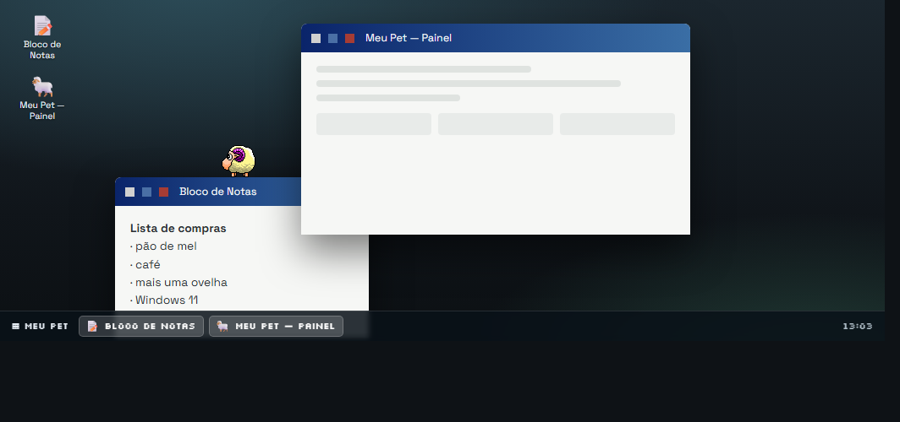

# Demo no navegador

[Home](Home.md) · [Instalação](Instalacao.md) · [Primeiros passos](Primeiros-passos.md) · [Painel de pets](Painel-de-pets.md) · [Pergunte ao pet](Pergunte-ao-pet.md) · [Lembretes e Pomodoro](Lembretes-e-Pomodoro.md) · [Agenda e e-mails](Agenda-e-e-mails.md) · [Plugins e integrações](Plugins-e-integracoes.md) · [Crie o seu pet](Crie-o-seu-pet.md) · [Atalhos e comandos](Atalhos-e-comandos.md) · [Para desenvolvedores](Para-desenvolvedores.md) · [Perguntas frequentes](Perguntas-frequentes.md) · [Changelog](Changelog.md)

Existe uma versão do pet que roda **dentro do navegador**, na página do projeto:

**https://lfeliipeadv-stack.github.io/meu-pet/demo.html**

Não é vídeo nem imagem: é o pet de verdade, desenhado quadro a quadro num `canvas`, usando o mesmo arquivo `animations.xml` que o programa para Windows abre. Você vê o bicho chegar do céu, cair, pousar no topo da janela, andar por ela, descer para a barra de tarefas e virar de frente quando chega na borda.

*A demo no navegador: a ovelha andando no título da janela. Ao fundo, o papel de parede e, embaixo, a barra de tarefas.*

A página principal do site tem um link **Demo** no menu, que leva para esta página.

## O que dá para fazer na demo

| Ação | Como fazer |
| --- | --- |
| Conversar | Clique no pet (o balão responde) ou use o botão **Perguntar ao pet** |
| Brincar | Botão direito no pet: biscoito da sorte, bola 8 mágica, piada e "como você está hoje?" |
| Arremessar | Arraste o pet e solte com força: ele voa, bate na borda e quica |
| Trocar de pet | Os botões embaixo do palco: eSheep 64, Claude, Rex, Boo, Pingo, Mago e Nuvi |
| Ligar e desligar o som | O botão **Som**, ou o item do menu |
| Mexer nas janelas | Arraste a barra de título: o pet acompanha o movimento, como no Windows |

## A área de trabalho da demo

A demo imita uma área de trabalho do Windows, com duas janelas (o painel do programa e um bloco de notas), os ícones no canto da tela e a barra de tarefas embaixo. As janelas se comportam como as de verdade:

- **arrastar o título** move a janela, e o pet anda em cima dela e acompanha o movimento;
- **clicar na janela** a traz para a frente — e, quando uma janela cobre a outra, o pet que estava na de baixo perde o chão e cai;
- **minimizar, maximizar e fechar** funcionam como no Windows: quando a janela some, o pet perde o chão e cai para a barra de tarefas;
- os **ícones da área de trabalho** reabrem as janelas que foram fechadas, e a **barra de tarefas** mostra as que estão abertas (clicar restaura e traz para a frente).

## O que a demo **não** tem

A demo é o mesmo pet com o mesmo motor, mas o mundo em que ele anda é a página, não o Windows. Por isso ela **não** tem:

- IA (o "Perguntar ao pet" da demo responde com as falas guardadas no programa, sem chamar nenhum serviço);
- agenda, e-mails do Outlook, lembretes, Pomodoro e os outros plugins;
- atalhos de teclado e menu da bandeja;
- multi-monitor, tamanhos 1×/2×/4× e o painel de Configurações.

Tudo isso vive dentro do [programa para Windows](Instalacao.md), que é gratuito.

## Como ela foi feita

O motor do pet (`FormPet.cs`, `FormPet.Motion.cs`, `MotionTrack.cs` e `Xml.cs`) foi portado para JavaScript em `site/demo/pet-engine.js`. A porta segue o C# passo a passo:

- as expressões do XML (`screenW`, `areaH`, `random`, `imageX`…) são avaliadas em inteiros, como o `DataTable.Compute` do .NET;
- a escolha da próxima animação respeita o `only` e as probabilidades de cada `<next>`;
- a queda sobre as janelas, o acompanhamento da janela, a borda da tela e o arremesso com quique são os mesmos do programa;
- o `animations.xml` usado é o do próprio pet, sem alteração — é por isso que a demo tem as mesmas animações e os mesmos sons do programa.

A página (`site/demo.html`, `site/demo/demo.js` e `site/demo/demo.css`) desenha o palco, as janelas, os ícones e a barra de tarefas, e cuida do mouse: arrastar o pet, arrastar as janelas, o menu e o balão de fala.

## Ver também

- [Instalação](Instalacao.md) — o programa para Windows, que é a versão completa.
- [Primeiros passos](Primeiros-passos.md) — o primeiro uso do programa e a tela de apresentação.
- [Painel de pets](Painel-de-pets.md) — a galeria de pets e o painel de detalhes de cada um.
- [Pergunte ao pet](Pergunte-ao-pet.md) — a conversa de verdade, com IA.
- [Para desenvolvedores](Para-desenvolvedores.md) — compilar, publicar e a estrutura do repositório.

## Onde fica no código

- `site/demo.html` — a página da demo (com o modo `?embed=1`, que mostra só o palco, e o modo `?shot=1`, usado para a imagem desta página).
- `site/demo/pet-engine.js` — o motor do pet portado do C# para o navegador.
- `site/demo/demo.js` — o palco, as janelas, o desenho, o menu, o balão e as falas.
- `site/demo/demo.css` — o papel de parede, as janelas, os ícones, a barra de tarefas e o modo embutido.
- `site/index.html` — o link "Demo" do menu da página principal, que leva para a demo.
- `.github/workflows/pages.yml` — publica a demo e copia os `animations.xml` dos pets que aparecem nela.
