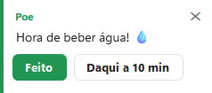

# Meu Pet (desktopPet)

[Instalação](Instalacao.md) · [Primeiros passos](Primeiros-passos.md) · [Painel de pets](Painel-de-pets.md) · [Pergunte ao pet](Pergunte-ao-pet.md) · [Lembretes e Pomodoro](Lembretes-e-pomodoro.md) · [Agenda e e-mails](Agenda-e-e-mails.md) · [Pet virtual e brincadeiras](Pet-virtual-e-brinquedos.md) · [Plugins e integrações](Plugins-e-integracoes.md) · [Crie o seu pet](Crie-o-seu-pet.md) · [Atalhos e comandos](Atalhos-e-comandos.md) · [Para desenvolvedores](Para-desenvolvedores.md) · [Perguntas frequentes](Perguntas-frequentes.md) · [Changelog](Changelog.md)

O **Meu Pet** (o programa se chama **desktopPet**) é um bichinho que vive na sua área de trabalho do Windows: ele anda pelo topo das suas janelas, cai na barra de tarefas, dorme, dança e pode ser arrastado e arremessado com o mouse.

## O que é

Escrito em C# (Windows Forms) sobre .NET 10, o Meu Pet é um executável único para Windows 10 e 11. A versão atual é a **2.6.2**: o `DesktopPet.exe` tem 2.750.643 bytes (cerca de 2,6 MB) e precisa do .NET 10 Desktop Runtime instalado; o `DesktopPet-completo.exe` (52.672.112 bytes, cerca de 50 MB) traz o runtime dentro e abre em qualquer Windows 10/11; e o `DesktopPet-Instalador.exe` (3.150.336 bytes) é o instalador em .NET Framework 4.8, que confere o runtime e cria os atalhos.

O programa tem duas partes:

- **O pet** — uma janela sem borda, sempre no topo e transparente, que se move quadro a quadro guiado por um arquivo XML de animações, com os sons embutidos no próprio arquivo.
- **O painel** — a janela de Configurações, com barra lateral e oito páginas: **Início**, **Pets**, **Lembretes**, **Assistente**, **Plugins**, **Integrações**, **Configurações** e **Sobre**.

## O que ele faz

### Na tela

- O pet anda sobre o topo das janelas e pela barra de tarefas, cai, quica nas bordas e perde o chão quando a janela em que estava é fechada ou coberta.
- Você o arrasta com o botão esquerdo: ao soltar com força, ele é arremessado e volta a andar sozinho.
- **Botão do meio** sobre o pet abre o seletor de animações ("Animações de {0}"), com busca e o contador de animações do pet.
- **Botão direito** sobre o pet abre o menu dele: brincadeiras, Foco (Pomodoro), lembretes, atalhos, Timer, notas, agenda e o resto.
- **Ctrl+Alt+P** (a opção "Esconder pets com Ctrl+Alt+P") esconde todos os pets e os sons, de qualquer programa, e mostra de novo.
- Os sons são MP3 que já vêm dentro do arquivo do pet e tocam pela API de multimídia do Windows.

### No painel

- A galeria tem duas abas: **Meus pets** (o que já está no computador) e **Baixar pets** (o que está publicado no repositório). O `Pets/pets.json` do repositório lista hoje 16 pets, entre eles o eSheep original, o Pingus, as sete ovelhas coloridas e os pets criados pelo autor.
- Antes de baixar, o programa mostra o tamanho do arquivo; durante o download, o botão vira barra de progresso e pode ser cancelado ou repetido.
- O botão **Criar meu pet** transforma as suas imagens (PNG, GIF, JPG) em um pet que anda, dorme e cai como os outros.
- Exportar e importar pets, tema claro/escuro/automático, idioma, inicialização com o Windows e tamanho 1×, 2× ou 4×.

### Na sua rotina

- **22 plugins** na página Plugins, todos desligados até você ligar: Clima, Lembretes, Agenda, E-mails do Outlook, Foco (Pomodoro), Cuidar de você, Como estou hoje, Pet virtual, Pets se cumprimentam, Brincadeiras, Monitor do PC, Reações ao computador, Atalhos, Notas e tarefas, Tela cheia e Não perturbe, Avisos, Área de transferência, Música e jogos, Visitas, Empurrar janelas, Timer e Memória.
- **Lembretes**: quatro prontos (beber água, alongar, descanso dos olhos e pausa do almoço) e outros criados à mão, por frase ("me lembra de ligar para a Ana às 15h"), lidos no próprio computador, sem depender de IA.
- **Foco (Pomodoro)**: durante o bloco de foco o pet cala a voz e os sons e guarda os avisos para depois.

### Conversando com o pet

- O item **Perguntar ao pet…** (botão direito no pet, ou os botões que aparecem ao passar o mouse) abre uma caixinha de conversa em balão sobre o pet.
- O programa responde sozinho as perguntas de rotina — lembretes, clima, próxima reunião, estado do computador — mesmo sem nenhuma IA configurada.
- Para perguntas livres você liga um serviço de IA na página **Assistente**: Ollama (roda no seu computador, sem chave), Google Gemini, Groq, OpenRouter ou outro compatível com o formato da OpenAI. A chave fica gravada com criptografia do Windows (DPAPI), no escopo do seu usuário.
- A página **Integrações** liga o pet ao Claude Code: por *hooks* o pet reage ("pensando", "editando", "pronto") e por MCP o Claude pode falar pelo balão do pet.

## Se você quer… vá para…

| Se você quer… | Vá para |
| --- | --- |
| Instalar o programa no Windows | [Instalação](Instalacao.md) |
| Saber o que fazer depois de instalar | [Primeiros passos](Primeiros-passos.md) |
| Escolher, baixar ou adotar um pet | [Painel de pets](Painel-de-pets.md) |
| Conversar com o pet e configurar a IA | [Pergunte ao pet](Pergunte-ao-pet.md) |
| Criar lembretes, focar com Pomodoro e usar o Timer | [Lembretes e Pomodoro](Lembretes-e-pomodoro.md) |
| Ligar a agenda do Google/Outlook e o e-mail do Outlook | [Agenda e e-mails](Agenda-e-e-mails.md) |
| Dar comida, fazer carinho, brincar e ver as brincadeiras | [Pet virtual e brincadeiras](Pet-virtual-e-brinquedos.md) |
| Saber quais plugins existem e integrar com o Claude Code | [Plugins e integrações](Plugins-e-integracoes.md) |
| Fazer um pet com as suas próprias imagens | [Crie o seu pet](Crie-o-seu-pet.md) |
| Ver todos os atalhos de teclado e de mouse | [Atalhos e comandos](Atalhos-e-comandos.md) |
| Compilar, publicar uma release ou rodar o autoteste | [Para desenvolvedores](Para-desenvolvedores.md) |
| Tirar uma dúvida sobre o programa | [Perguntas frequentes](Perguntas-frequentes.md) |
| Saber o que mudou em cada versão | [Changelog](Changelog.md) |

## Galeria de telas

*Página Início: o pet em uso, o estado dele e os números do dia (foco, pausas, lembretes e humor).*

*Galeria de pets: cada cartão mostra o ícone em pixel art, o autor e o selo ("Em uso", "Novo" ou "Atualização").*

*Os 22 plugins, em cartões, com o botão que liga e desliga cada um.*

*A conversa em balão: as perguntas ficam à direita, as respostas do pet à esquerda.*

*O balão de fala que acompanha o pet pela tela e oferece até dois botões de ação.*

*O menu do botão direito no pet: necessidades do pet virtual, brincadeiras, foco, lembretes, atalhos e Timer.*

## Este Wiki é feito pela comunidade

Este Wiki não é uma documentação oficial da Microsoft nem do autor do programa: **foi escrito pela comunidade**, a partir do código-fonte do repositório [`lfeliipeadv-stack/meu-pet`](https://github.com/lfeliipeadv-stack/meu-pet) e do que dá para ver funcionando no programa. Qualquer pessoa pode corrigir, completar e ampliar.

Como contribuir:

- **Corrigir ou completar uma página** — no topo de cada página do Wiki há o botão *Edit*; a alteração vai como *pull request* no repositório do Wiki e é revisada antes de publicar.
- **Sugerir uma mudança no programa** — abra uma *issue* em [github.com/lfeliipeadv-stack/meu-pet/issues](https://github.com/lfeliipeadv-stack/meu-pet/issues) descrevendo o que você esperava e o que aconteceu.
- **Publicar um pet na galeria** — o pet é uma pasta em `Pets/` com `animations.xml`, `icon.png`, `preview.gif` e o `README.md`; depois rode `Tools/update-pets-json.ps1` para que ele entre no `Pets/pets.json` e apareça na aba "Baixar pets".
- **Traduzir ou ajustar um texto** — os textos vivem em `src/lang/*.json` (`pt-BR.json` e `es.json` hoje); o inglês embutido no código é a reserva para qualquer chave que falte.
- **Ajudar nas capturas de tela** — o comando `DesktopPet.exe --snapshot=<pasta>` grava as telas do programa para uso nas páginas.

Se algo aqui estiver errado ou desatualizado, prefira conferir no código: os caminhos citados na seção "Onde fica no código" são a referência para isso.

## Ver também

- [Primeiros passos](Primeiros-passos.md)
- [Painel de pets](Painel-de-pets.md)
- [Pergunte ao pet](Pergunte-ao-pet.md)
- [Atalhos e comandos](Atalhos-e-comandos.md)
- [Para desenvolvedores](Para-desenvolvedores.md)

## Onde fica no código

- `src/DesktopPet.Net.csproj` — projeto SDK-style .NET 10 (`net10.0-windows`), WinForms, `win-x64`
- `src/Properties/AssemblyInfoPortable.cs` — versão do programa (2.6.2.0)
- `src/lang/pt-BR.json` — todos os textos em português do Brasil
- `src/lang/es.json` — textos em espanhol
- `src/Portable/FormSettings.cs` — janela do painel (barra lateral e páginas)
- `src/Portable/FormSettings.Sidebar.cs` — ordem das páginas da barra lateral
- `src/Portable/FormSettings.Home.cs` — página Início
- `src/Portable/FormSettings.Pets.cs` e `src/Portable/FormSettings.PetsView.cs` — galeria de pets e painel de detalhes
- `src/Portable/FormSettings.Plugins.cs` — página de plugins
- `src/Portable/FormSettings.Options.cs` — página de Configurações (seções "Pet" e "Programa")
- `src/Portable/FormSettings.About.cs` — página Sobre
- `src/Portable/PetMenu.cs` — menu de contexto do pet
- `src/dotNet/ContextMenus.cs` — menu do ícone da bandeja
- `src/dotNet/FormAnimPicker.cs` — seletor de animações (botão do meio)
- `src/dotNet/FormPet.cs` e `src/dotNet/FormPet.Motion.cs` — motor do pet (movimento, bordas, queda, arremesso)
- `src/dotNet/Xml.cs` e `src/LocalData/AnimationXML.cs` — leitura do `animations.xml` do pet
- `src/dotNet/Animations.cs` e `src/dotNet/Mp3Player.cs` — animações e sons (API MCI do Windows)
- `src/Portable/HideHotkey.cs` — atalhos globais (Ctrl+Alt+P e o atalho de perguntar)
- `src/Portable/Chat.cs`, `src/Portable/AiAssistant.cs`, `src/Portable/FormAi.cs` — conversa com o pet e serviços de IA
- `src/Portable/ClaudeHooks.cs`, `src/Portable/ClaudeMcp.cs`, `src/Portable/McpServer.cs`, `src/Portable/AgentBridge.cs` — integração com o Claude Code
- `src/Portable/PetCreator.cs` — criador de pets
- `src/Portable/SelfTest.cs` — autoteste (`--selftest`)
- `Pets/pets.json` — índice da galeria de pets
- `Tools/release.ps1` — publicação das releases
