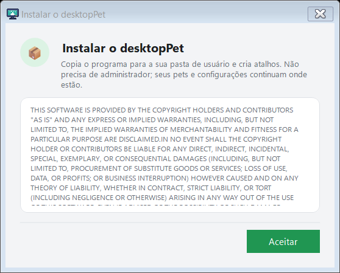
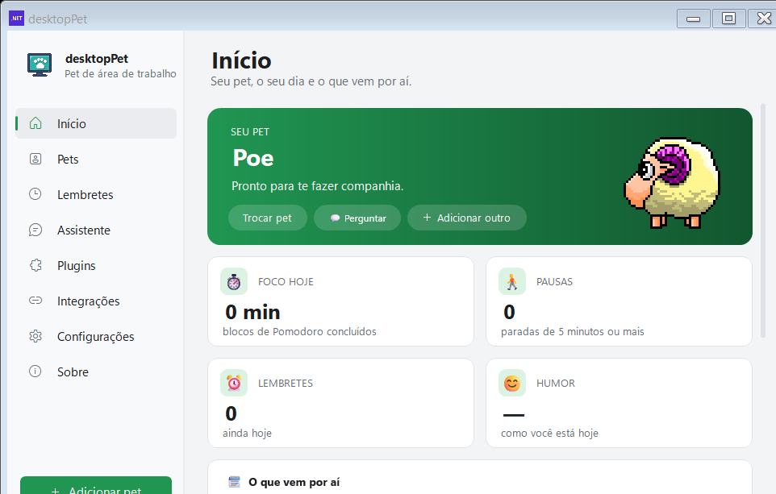
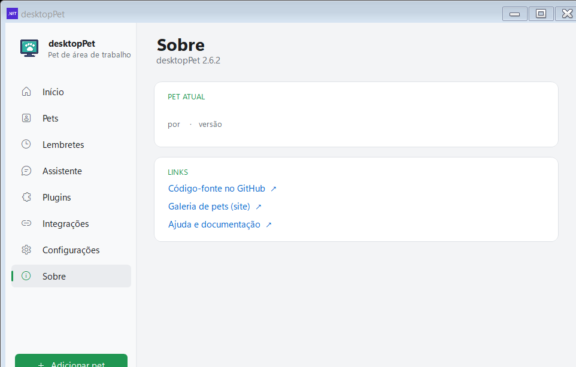

# Instalação

[Home](Home.md) · [Primeiros passos](Primeiros-passos.md) · [Painel de pets](Painel-de-pets.md) · [Pergunte ao pet](Pergunte-ao-pet.md) · [Lembretes e Pomodoro](Lembretes-e-pomodoro.md) · [Agenda e e-mails](Agenda-e-e-mails.md) · [Pet virtual e brincadeiras](Pet-virtual-e-brinquedos.md) · [Plugins e integrações](Plugins-e-integracoes.md) · [Crie o seu pet](Crie-o-seu-pet.md) · [Atalhos e comandos](Atalhos-e-comandos.md) · [Para desenvolvedores](Para-desenvolvedores.md) · [Perguntas frequentes](Perguntas-frequentes.md) · [Changelog](Changelog.md)

O Meu Pet (desktopPet) roda em Windows 10 e 11 de 64 bits. Toda a instalação é feita dentro da sua conta: não é preciso ser administrador e nada é gravado fora da sua pasta de usuário.

## Escolha o download

Os arquivos ficam na aba **Releases** do repositório: <https://github.com/lfeliipeadv-stack/meu-pet/releases>. A página do projeto (<https://lfeliipeadv-stack.github.io/meu-pet/>) tem um botão que aponta sempre para a versão mais recente.

Cada release publica cinco arquivos. Na release 2.6.2:

| Arquivo | Tamanho | O que precisa | Quando usar |
| --- | --- | --- | --- |
| `DesktopPet-Instalador.exe` | 3.150.336 bytes (≈ 3 MB) | Nada: é .NET Framework 4.8, que já vem no Windows 10 e 11 | **Recomendado.** Confere o .NET 10, instala o programa e cria os atalhos |
| `DesktopPet.exe` | 2.750.643 bytes (≈ 2,6 MB) | .NET 10 Desktop Runtime (64 bits) | Só o programa, para quem já tem o runtime instalado |
| `DesktopPet-completo.exe` | 52.672.112 bytes (≈ 50,2 MB) | Nada: o runtime vem embutido dentro do executável | Para abrir em qualquer Windows 10/11 sem instalar nada antes |
| `lang.zip` | 36.374 bytes | — | Idiomas extras. Português e espanhol já vêm embutidos no executável |
| `SHA256SUMS` | 338 bytes | — | Conferência do download (veja [Conferir o download](#conferir-o-download)) |

## Instalar com o instalador (recomendado)

1. Baixe o `DesktopPet-Instalador.exe` e abra com dois cliques.
2. **Passo 1 — ".NET 10 Desktop Runtime".** O instalador procura o runtime no computador. Se achar, aparece *"O .NET 10 já está instalado neste computador. Tudo pronto!"*. Se faltar, o botão **"Instalar o .NET 10"** baixa o instalador oficial da Microsoft e o abre; o botão **"Instalar"** continua desabilitado até o runtime ser encontrado, e o instalador reconfere a cada 3 segundos.
3. **Passo 2 — "Atalhos".** Três caixas: **"Menu Iniciar"** e **"Área de trabalho"** já vêm marcadas, **"Iniciar com o Windows"** vem desmarcada.
4. **"Instalar".** O programa é copiado para `%LocalAppData%\DesktopPet`, os atalhos `.url` são criados, o `uninstall.cmd` e a entrada de desinstalação no registro (`HKCU\Software\Microsoft\Windows\CurrentVersion\Uninstall\DesktopPet`) são gravados, e o programa é aberto. A confirmação é: *"Pronto! O desktopPet foi instalado e já está aberto. Procure o ícone perto do relógio."*

Nada disso pede privilégio de administrador: a dica da própria tela é *"Instala só para você, sem precisar de administrador."*

## Aviso do Windows sobre editor desconhecido

As releases **não são assinadas digitalmente** — a garantia de integridade é o hash SHA-256 publicado junto dos arquivos. Por isso o Windows pode mostrar o aviso de que o editor é desconhecido (*"O Windows protegeu seu PC"*). O caminho é: clique em **"Mais informações"** e depois em **"Executar assim mesmo"**.

### Conferir o download

O arquivo `SHA256SUMS` da release traz uma linha por artefato, no formato `hash  nome`. Para conferir, abra um Prompt de Comando na pasta do download e rode `certutil -hashfile DesktopPet.exe SHA256` — o resultado tem que ser igual ao hash da linha correspondente do `SHA256SUMS`. É a mesma conferência que o próprio programa faz antes de trocar o executável por uma versão nova.

## Instalar o .exe que precisa do .NET 10

1. Instale o **.NET 10 Desktop Runtime** (64 bits) da Microsoft: <https://dotnet.microsoft.com/download/dotnet/10.0>.
2. Baixe o `DesktopPet.exe` e abra com dois cliques.

O programa abre direto, sem instalar nada, e mostra o pet na tela. Para criar os atalhos e a entrada de desinstalação, use **"Instalar o programa..."** no menu do ícone da bandeja (veja [Instalar a partir do próprio programa](#instalar-a-partir-do-pr%C3%B3prio-programa)).

## Usar a versão completa

O `DesktopPet-completo.exe` traz o runtime do .NET dentro dele (build *self-contained*): é bem maior, mas abre em qualquer Windows 10/11, sem instalar o .NET e sem precisar de internet para isso. Ele também não cria atalhos sozinho — para isso, use **"Instalar o programa..."** na bandeja.

## Instalar a partir do próprio programa

Quem baixou apenas o executável pode instalar pelo próprio programa, sem baixar o instalador separado:

- **Menu do ícone da bandeja** → **"Instalar o programa..."** — ou **"Reparar ou desinstalar..."**, quando o programa já está instalado.
- **Painel** → **Configurações** → seção "Programa" → **"Instalar neste computador"** (o rótulo vira **"Reparar ou desinstalar"** depois de instalado) → botão **"Abrir…"**.

*A tela de instalação do próprio programa começa pelo texto da licença e o botão "Aceitar". O texto legal fica em inglês de propósito, mesmo com o programa em português.*

Na segunda etapa aparecem as três caixas — **"Criar atalho no Menu Iniciar"**, **"Criar atalho na Área de Trabalho"** e **"Abrir junto com o Windows"** — e uma barra de progresso. Já instalado, a tela mostra **"Atualizar"** (recria ou apaga os atalhos conforme as caixas) e **"Desinstalar"**.

*Na página "Configurações" do painel ficam as opções do pet e do programa, entre elas "Instalar neste computador".*

## O que o instalador confere

O instalador (`Tools/Setup`, em .NET Framework 4.8) procura o **.NET 10 Desktop Runtime de 64 bits** — o `Microsoft.WindowsDesktop.App` versão 10.x — em quatro lugares:

1. a pasta `shared\Microsoft.WindowsDesktop.App` dentro de `DOTNET_ROOT`;
2. `%ProgramFiles%\dotnet`;
3. `C:\Program Files\dotnet`;
4. o registro `HKLM\SOFTWARE\dotnet\Setup\InstalledVersions\x64\sharedfx\Microsoft.WindowsDesktop.App`, procurando uma chave que comece com `10.`.

Enquanto o runtime não for encontrado, o botão **"Instalar"** fica desabilitado. Se a leitura do registro ou das pastas falhar, o instalador simplesmente trata como "não encontrado" e mostra o botão de baixar o runtime da Microsoft.

Antes de copiar o executável, o instalador fecha qualquer `DesktopPet.exe` que já estiver rodando.

## Requisitos mínimos

- **Windows 10 ou 11, 64 bits.** O projeto é compilado como `net10.0-windows` com `RuntimeIdentifier` `win-x64` e `PlatformTarget` `x64`.
- **.NET 10 Desktop Runtime** — só para o `DesktopPet.exe` e para o `DesktopPet-Instalador.exe`; a versão completa não precisa.
- **Espaço em disco:** o programa instalado ocupa poucos MB; a versão completa ocupa cerca de 50 MB.
- **Nenhuma conta e nenhum privilégio de administrador.**
- **Internet é opcional.** Ela é usada para baixar pets da galeria, procurar versão nova do programa e talking com um serviço de IA. Todo o resto funciona sem rede.

## Abrir o painel pela bandeja

Depois de instalar, o programa fica na **bandeja do sistema**, perto do relógio. Clique com o botão direito no ícone e escolha **"Abrir &Painel"** (o item vira *"Abrir Painel (1 atualização)"* quando há atualização de pet pendente). O mesmo painel abre pelo menu do próprio pet, em **"Abrir Painel"**.

*Na página "Início" fica o pet em uso, os botões "Trocar pet", "Perguntar" e "Adicionar outro" e os números do dia.*

*Na aba "Meus pets" você vê o que já está no computador. O eSheep vem embutido no executável; os outros são baixados da galeria.*

Na primeira execução o pet cai do céu e se apresenta em cinco balões (menu do botão direito, arrastar, foco, esconder com Ctrl+Alt+P e como perguntar). Dá para repetir a apresentação em **Configurações** → **"Apresentação"** → **"Mostrar"**. Por padrão abre **1 pet** ("Pets ao iniciar"), ajustável na mesma página.

*A página "Sobre" mostra a versão instalada e os links para o código-fonte, a galeria e a ajuda.*

## Desinstalar

Duas formas, as duas usam o mesmo script (`uninstall.cmd`):

- **Windows** → *Configurações* → *Aplicativos* → **desktopPet** → **Desinstalar**.
- **Pelo programa:** bandeja → **"Reparar ou desinstalar..."** → **"Desinstalar"**.

O script fecha o `DesktopPet.exe`, apaga os atalhos, remove a chave de registro de desinstalação e a de inicialização automática, e depois pergunta:

> Apagar tambem seus pets, lembretes, humor, atalhos e configuracoes? [S]im / [N]ao (em 30 s: Nao)

- **S**im: apaga também a pasta `%LocalAppData%\DesktopPet`, onde ficam os pets baixados (`pets\`), os lembretes (`reminders.json`), o humor (`mood.json`), as notas (`notes.json`), os atalhos do menu (`launchers.json`), as necessidades do pet (`needs.json`), a chave da API local (`agent.json`) e os logs.
- **N**ão (ou sem resposta em 30 segundos): só os arquivos do programa são removidos. Os seus dados ficam guardados e **voltam intactos se você instalar de novo**.

## Sem internet

O programa continua funcionando; o que muda é apenas a galeria:

- A aba **"Baixar pets"** mostra a faixa *"Sem conexão com a internet. Aparecem só os pets que já estão no computador: conecte-se para ver os pets para baixar."*, com o botão **"Tentar de novo"** para refazer a busca quando a rede voltar.
- A lista passa a mostrar só os pets já baixados, e o **eSheep continua disponível** — ele vem embutido dentro do executável, então existe um pet funcionando mesmo nunca tendo conectado.
- Os pets que você já baixado continuam rodando normalmente.
- A conversa por texto continua respondendo o que o próprio programa sabe: lembretes, próxima reunião, estado do computador (CPU e memória) e ajuda.
- O instalador só precisa de internet no caso específico de o .NET 10 estar faltando — é quando ele baixa o instalador oficial da Microsoft.

## Ver também

- [Primeiros passos](Primeiros-passos.md) — o que fazer logo depois de instalar
- [Painel de pets](Painel-de-pets.md) — adotar e trocar de bichinho
- [Perguntas frequentes](Perguntas-frequentes.md) — dúvidas comuns sobre instalação e execução
- [Plugins e integrações](Plugins-e-integracoes.md) — o que dá para ligar depois de instalar
- [Para desenvolvedores](Para-desenvolvedores.md) — compilar e publicar uma release

## Onde fica no código

- `Tools/Setup/SetupForm.cs` — o instalador: conferência do .NET 10, atalhos, cópia do programa, registro e `uninstall.cmd`
- `Tools/Setup/Setup.csproj` — projeto do instalador em .NET Framework 4.8 (`net48`)
- `src/Portable/Install.cs` — tela de instalação do próprio programa (licença, atalhos, Atualizar, Desinstalar)
- `src/Portable/UninstallScript.cs` — texto do `uninstall.cmd` e a pergunta sobre apagar os dados
- `src/dotNet/ContextMenus.cs` — item "Instalar o programa..." / "Reparar ou desinstalar..." da bandeja
- `src/dotNet/Program.cs` — `IsApplicationInstalled()` e o `--snapshot` usado nas capturas
- `src/Portable/Onboarding.cs` — apresentação da primeira execução
- `src/Portable/BuiltInPets.cs` — o eSheep embutido no executável
- `src/Portable/PetStore.cs` — pasta `%LocalAppData%\DesktopPet\pets` dos pets baixados
- `src/Portable/AppInfo.cs` — endereços do repositório, da galeria e da API de releases
- `src/DesktopPet.Net.csproj` — `net10.0-windows`, `win-x64`, `PublishSingleFile` e a build `SelfContained`
- `src/lang/pt-BR.json` — textos da interface (`inst.*`, `opt.install.*`, `tray.install`, `tray.repair`)
- `site/index.html` — página do projeto, com os links de download e o aviso do editor desconhecido
- `release/2.6.2/SHA256SUMS` — hashes publicados de cada artefato
