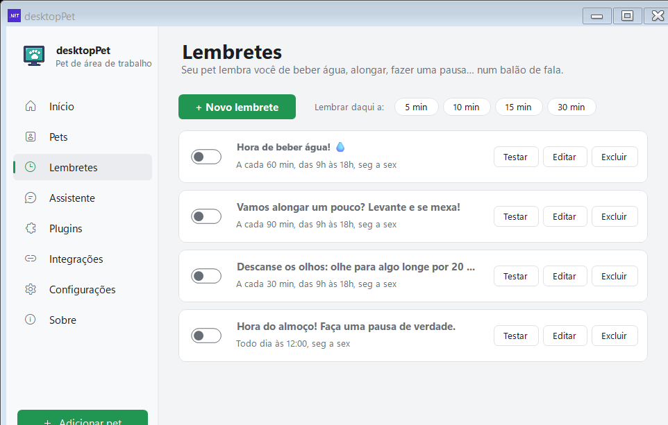
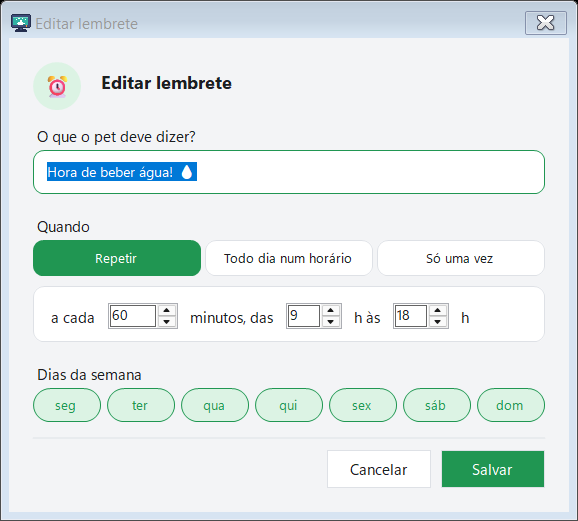
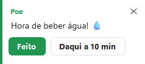

# Lembretes e Pomodoro

[Home](Home.md) · [Instalação](Instalacao.md) · [Primeiros passos](Primeiros-passos.md) · [Painel de pets](Painel-de-pets.md) · [Pergunte ao pet](Pergunte-ao-pet.md) · [Agenda e e-mails](Agenda-e-e-mails.md) · [Pet virtual e brinquedos](Pet-virtual-e-brinquedos.md) · [Plugins e integrações](Plugins-e-integracoes.md) · [Crie o seu pet](Crie-o-seu-pet.md) · [Atalhos e comandos](Atalhos-e-comandos.md) · [Para desenvolvedores](Para-desenvolvedores.md) · [Perguntas frequentes](Perguntas-frequentes.md) · [Changelog](Changelog.md)

O "Meu Pet" tem duas funções que servem para a mesma coisa: ele avisa você no momento certo e some da frente enquanto você trabalha. São os **lembretes** (avisos de água, alongamento, descanso dos olhos, pausa do almoço e lembretes que você mesmo escreve) e o **Foco (Pomodoro)**, que segura a fala e os sons do pet durante o bloco de foco e guarda o que ele queria dizer.

Tudo isso roda dentro do Windows, sem internet. A IA é opcional e, quando existe, só entra como reforço para reescrever uma frase de lembrete que o programa não entendeu — quem decide o horário é sempre o programa.

---

## Lembretes

### Os quatro lembretes prontos

Na primeira execução o pet já cria quatro lembretes, **todos desligados** para você escolher o que quer:

| Lembrete | Quando toca | Dias |
|---|---|---|
| "Hora de beber água! 💧" | a cada 60 min, das 9h às 18h | seg a sex |
| "Vamos alongar um pouco? Levante e se mexa!" | a cada 90 min, das 9h às 18h | seg a sex |
| "Descanse os olhos: olhe para algo longe por 20 segundos." | a cada 30 min, das 9h às 18h | seg a sex |
| "Hora do almoço! Faça uma pausa de verdade." | todo dia às 12:00 | seg a sex |

Para ligar um, abra a página **Lembretes** e ligue a chave do lembrete. Nenhum deles toca antes de você ligar.

### Onde ficam os lembretes

Todos os lembretes ficam na página **Lembretes** da janela de Configurações (o item "Lembretes" na barra lateral do painel). É a mesma página para os lembretes prontos e para os que você cria.

No alto dela ficam o botão **"+ Novo lembrete"** e a fileira **"Lembrar daqui a:"** com os atalhos de 5, 10, 15, 30 e 60 minutos — cada clique cria um lembrete único ("O tempo acabou! Já se passaram {0} minutos.").

Cada lembrete da lista é um cartão com:

- a chave de liga/desliga;
- o texto que o pet vai falar;
- o resumo da regra, por exemplo `A cada 60 min, das 9h às 18h, seg a sex`, `Todo dia às 12:00, seg a sex` ou `Uma vez, 14/11/2026 15:00`;
- a linha `próximo: hoje 14:30` com o horário em que ele vai tocar;
- os botões **"Testar"** (fala na hora), **"Editar"** e **"Excluir"**.

Duplo clique no cartão abre o editor.

*Página "Lembretes" do painel: no alto, "+ Novo lembrete" e os chips de 5 a 60 minutos; abaixo, os cartões de cada lembrete com chave, resumo, próximo horário e os botões Testar, Editar e Excluir.*

### Criar um lembrete à mão

O botão "+ Novo lembrete" abre o editor, com três campos:

- **"O que o pet deve dizer?"** — campo de texto livre, até 200 caracteres. O texto é o que aparece no balão quando o lembrete toca.
- **"Quando"** — uma escolha entre três modos:
  - **"Repetir"**: `a cada [1 a 1440] minutos, das [0 a 23] h às [0 a 24] h`. O fim da faixa é exclusivo: às 18h o lembrete já não toca.
  - **"Todo dia num horário"**: `às [HH:mm]`. O relógio começa em 09:00.
  - **"Só uma vez"**: `em [dd/MM/yyyy HH:mm]`. A data começa em "agora + 10 minutos".
- **"Dias da semana"** — sete bolinhas, segunda-feira primeiro. Nos lembretes de "Só uma vez" esse bloco fica esmaecido, porque não se aplica.

No fim, **"Salvar"** e **"Cancelar"**.

*Editor de lembrete: "O que o pet deve dizer?", a escolha do tipo ("Repetir", "Todo dia num horário", "Só uma vez") e o bloco "Dias da semana".*

### Lembrete por texto… (escrevendo do jeito que você falaria)

O item **"Lembrete por texto…"** aparece no menu do pet (botão direito) e no submenu "Lembretes" do ícone da bandeja. Ele abre uma caixinha com exemplos prontos e você escreve o pedido como falaria.

O programa entende a frase **no computador, sem internet**, usando expressões regulares — em português, inglês e espanhol.

| O que você escreve | O que o pet entende |
|---|---|
| "me lembra de ligar para a Ana às 15h" | uma vez, hoje às 15:00 — o texto fica "Ligar para a Ana" |
| "daqui a 20 minutos beber água" | uma vez, 20 minutos a partir de agora |
| "em meia hora de beber água" | uma vez, 30 minutos a partir de agora |
| "amanhã às 9:30 reunião com o time" | uma vez, amanhã às 09:30 |
| "todo dia às 8 tomar o remédio" | todo dia às 08:00, todos os dias |
| "a cada 30 minutos alongar" | repete a cada 30 min, das 8h às 20h, todos os dias |

O tempo em português é lido assim:

- **"às 15h"**, **"às 15:30"** — hora e minuto diretos.
- **"as 3 da tarde"** vira 15h; **"da noite"** também vira depois do meio-dia.
- **"meia hora"** vale 30 minutos; **"em 2 horas"** vira 120 minutos.
- **"às 3"** dito às 14h é entendido como 15h (o programa testa as 12 horas seguintes).
- Um horário que **já passou hoje** vira amanhã.
- **"todo dia"**, **"amanhã"** e **"hoje"** são as palavras que mudam o tipo do lembrete.

Se a frase não tiver tempo nenhum ("me lembra de comprar pão"), o programa **não entende** e avisa: "Não entendi quando. Tente "às 15h", "daqui a 20 minutos", "amanhã às 9" ou "todo dia às 8"."

Quando entende, o pet confirma no balão — `Combinado! Vou te lembrar: "Ligar para a Ana" — hoje 15:00 ⏰` — com o botão **"Desfazer"**, que apaga o lembrete e confirma "Tudo bem, lembrete removido.".

**E a IA?** Só entra quando o programa não consegue ler a frase. Aí, se houver um provedor de IA configurado, o programa pede à IA apenas para **reescrever** a frase em um dos formatos aceitos ("<tarefa> às HH:MM", "<tarefa> amanhã às HH:MM", "<tarefa> daqui a N minutos", "<tarefa> todo dia às HH:MM", "<tarefa> a cada N minutos") e volta a interpretá-la localmente. **A IA nunca decide o horário.**

*Balão de fala: o nome do pet em destaque, o texto, os botões de ação e o "✕" para fechar. É essa janela que aparece quando o lembrete toca.*

### No chat

O mesmo vale dentro da conversa. O chip **"Me lembra de…"** (que aparece quando a conversa está vazia) preenche a caixinha de mensagem com `me lembra de  às 15h` e deixa o cursor no fim, para você completar e enviar. A resposta local cria o lembrete na hora e oferece o botão "Desfazer" — tudo sem chamar a IA, mesmo com nenhum provedor configurado.

### Detalhes de funcionamento

- Os lembretes ficam gravados em `%LocalAppData%\DesktopPet\reminders.json`.
- A lista é conferida **a cada 15 segundos**.
- Quando toca, o balão traz dois botões: **"Feito"** e **"Daqui a 10 min"** (adiar 10 minutos). Adiar um lembrete de uma vez só reativa e remarca ele.
- Um lembrete de repetição que ficou para trás enquanto o programa estava fechado **não** é falado de uma vez só ao abrir: a contagem recomeça. Um lembrete de uma vez só, esse sim, é falado.
- Se o plugin "Lembretes" estiver desligado, o pet não avisa nada.
- O botão "Testar" fala na hora, mesmo em silêncio de foco — ele é um pedido seu, não um aviso automático.

---

## Foco (Pomodoro)

O Foco é o relógio de blocos do pet: ele foca, cala a voz, e no fim do bloco te dá uma pausa. Começa pelo menu do pet (botão direito):

**Foco (Pomodoro)** › **"Começar a focar (25 min)"**

Quando está rodando, o mesmo item do menu mostra o que falta: `Foco: faltam 12:34` ou `Pausa: faltam 03:10`, com ` (pausado)` quando está pausado. As opções passam a ser **"Pausar"**, **"Continuar"** e **"Parar"**.

*Menu do pet (botão direito): o item "Foco (Pomodoro)" e o submenu "Lembretes" ficam logo abaixo de "Brincadeiras".*

### O que muda durante o foco

O bloco de foco é um período de **silêncio**:

- **Nenhum balão aparece.** As falas que o pet faria por conta própria ficam guardadas.
- **Os sons do pet são cortados** — é a mesma regra que silencia o pet com o `Ctrl+Alt+P`.
- Os dois pets não conversam entre si, o humor do dia não é perguntado e os avisos do tipo "Bom dia! ☀️" ficam guardados para depois.

Quem ainda consegue falar é **você**: o que você pede na hora (brincadeira, timer, menu, conversa) aparece normalmente, porque é um pedido seu e não um aviso do pet.

O silêncio acaba quando o bloco termina, quando você pausa o Pomodoro, ou quando o pet volta a ser mostrado com o `Ctrl+Alt+P`.

### Os avisos guardados

Tudo o que o pet queria dizer e ficou guardado sai depois do silêncio, em até 30 avisos. Quando o silêncio acaba, o pet avisa:

- "Durante o silêncio, chegou 1 aviso."
- "Durante o silêncio, chegaram {0} avisos."

Com os botões **"Mostrar"** (mostra um a um, com **"Próximo ({0})"** quando ainda tem mais), **"Dispensar"** (limpa tudo) e o "✕".

### O fim do bloco e o fim da pausa

| Momento | O que o pet diz | Botões |
|---|---|---|
| Foco começa | "Hora de focar! {0} minutos. Vou ficar em silêncio. 🤫" | — |
| Acabou o foco | "Mandou bem! Pausa de {0} minutos. Alongue, beba água. 🎉" | "OK" · "Pular a pausa" |
| A cada 4 blocos | "4 blocos de foco! Pausa longa de {0} minutos. 🏆" | "OK" · "Pular a pausa" |
| Acabou a pausa | "Acabou a pausa. Voltamos a focar por {0} minutos?" | "OK" · "Parar" |

No fim do bloco o pet comemora com uma das animações `cheer`, `happy`, `dance` ou `jump`.

### Configurar os tempos

Em **Configurações → Plugins**, o cartão **"🍅 Foco (Pomodoro)"** (categoria "Meu dia") tem o botão **"Configurar"**:

| Opção | Padrão | Valores |
|---|---|---|
| "Tempo de foco (Pomodoro)" | 25 min | 15, 25, 45 ou 50 min |
| "Tempo de pausa" | 5 min | 5, 10 ou 15 min |

A **pausa longa de 15 minutos a cada 4 blocos** é fixa e não tem opção na tela. O cartão mostra o estado: "25 min" quando o Pomodoro está desligado e o status (`Foco: faltam …`) enquanto ele roda.

*Página "Plugins" do painel: cada recurso é um cartão com emoji, nome, descrição, estado (Ligado/Desligado) e o botão "Configurar".*

Os minutos de foco do dia ficam no cartão **"Foco hoje"** da página Início, e as paradas de 5 minutos ou mais no cartão **"Pausas"**.

---

## Cuidar de você: pausa, retorno e programa usado por horas

O plugin **"Cuidar de você"** (cartão 🚶 na aba "Bem-estar" da página Plugins) liga o recurso **"Perceber como uso o computador"**. Ele olha só duas coisas: a hora da última tecla ou movimento do mouse e o nome do programa que está na frente. **Nunca** o que você digita ou o que aparece na tela, e nada sai do computador.

O que ele faz:

| Situação | O que o pet faz | Botões |
|---|---|---|
| 90 minutos de uso sem parar | "Já são {0} no computador sem pausa. Que tal levantar, alongar e beber uma água? 🚶" | "Vou fazer uma pausa" · "Agora não" |
| Você ficou 30 minutos ou mais fora (sono, tela bloqueada, ausência) | "Que bom que você voltou! 👋" | — |
| Um programa usado por 2 horas ou mais foi fechado | "Ufa! {0} de {1} hoje. Bom trabalho! 🎉" | — |

Detalhes:

- A sugestão de pausa **não sai enquanto um Pomodoro está rodando** — durante o foco quem cuida da pausa é o próprio Pomodoro.
- Uma **pausa de 5 minutos ou mais** conta como parada do dia (cartão "Pausas" na página Início).
- A sugestão de pausa não se repete antes de 45 minutos.
- A comemoração do programa fechado acontece **uma vez por dia, por programa**.
- O programa é ignorado se for um dos do sistema (explorer, SearchHost, DesktopPet, ShellExperienceHost, LockApp, SystemSettings etc.).

*Página "Início" do painel: os cartões "Foco hoje", "Pausas", "Lembretes" e "Humor" mostram os números do dia.*

---

## Ver também

- [Primeiros passos](Primeiros-passos.md) — como abrir o painel e o primeiro encontro com o pet.
- [Pergunte ao pet](Pergunte-ao-pet.md) — o chat que também cria lembretes, sem IA.
- [Plugins e integrações](Plugins-e-integracoes.md) — onde ficam as chaves que ligam cada recurso.
- [Agenda e e-mails](Agenda-e-e-mails.md) — os outros avisos que o pet dá por conta própria.
- [Atalhos e comandos](Atalhos-e-comandos.md) — `Ctrl+Alt+P`, que também silencia o pet.

## Onde fica no código

- `src/Portable/Reminders.cs` — a classe `Reminder` (tipos `Interval`, `Daily`, `Once`) e a lista conferida a cada 15 s.
- `src/Portable/SmartReminder.cs` — a leitura das frases em português (`Parse`), o reforço pela IA (`Understand`) e a confirmação com "Desfazer".
- `src/Portable/FormSettings.Reminders.cs` — a página "Lembretes" e o editor `FormReminder`.
- `src/Portable/Pomodoro.cs` — o relógio do Foco, as fases e as falas de cada fase.
- `src/Portable/SpeechBubble.cs` — `QuietNow`, os avisos guardados (`held`) e a lista de 30.
- `src/Portable/Activity.cs` — pausa após 90 min, "Que bom que você voltou!" e o programa fechado.
- `src/Portable/PetMenu.cs` — os itens "Foco (Pomodoro)" e "Lembretes" do menu do pet.
- `src/dotNet/ContextMenus.cs` — o submenu "Lembretes" do ícone da bandeja e o registro do Pomodoro no silêncio.
- `src/Portable/Chat.cs` — a resposta local que cria lembretes a partir do chat.
- `src/Portable/FormSettings.Plugins.cs` — os cartões "Foco (Pomodoro)", "Lembretes" e "Cuidar de você".
- `src/lang/pt-BR.json` — os textos em português (`rem.*`, `pomo.*`, `act.*`, `quiet.*`).
