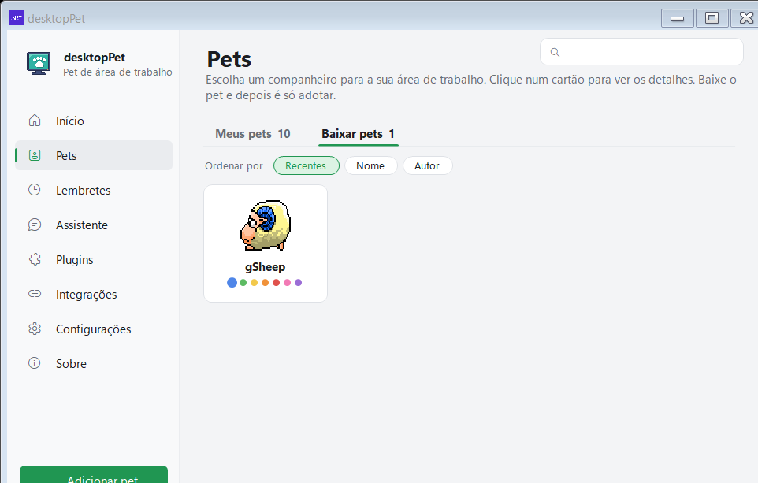
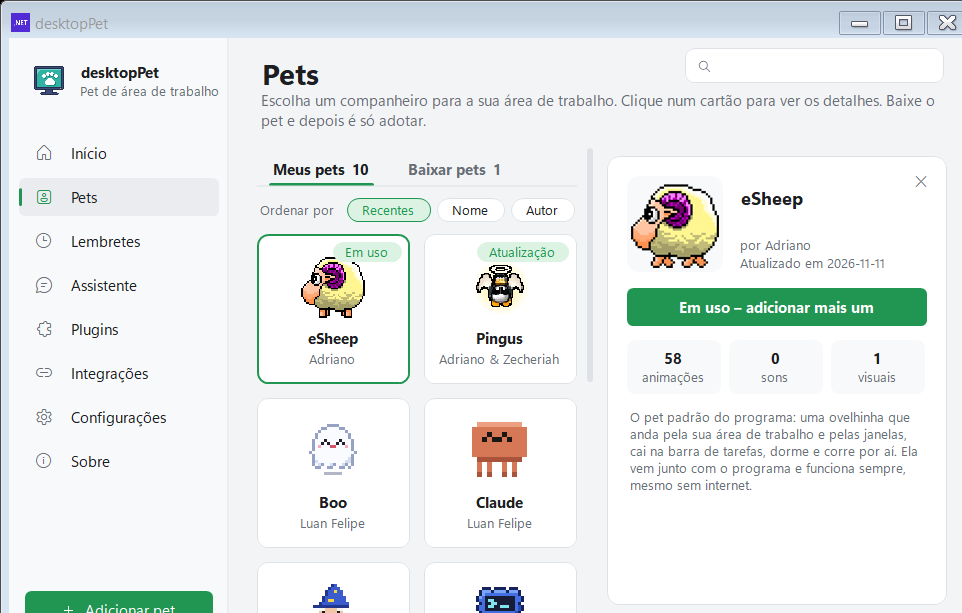
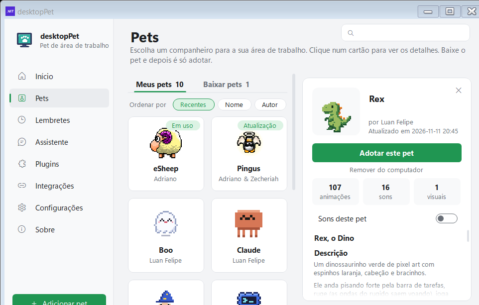
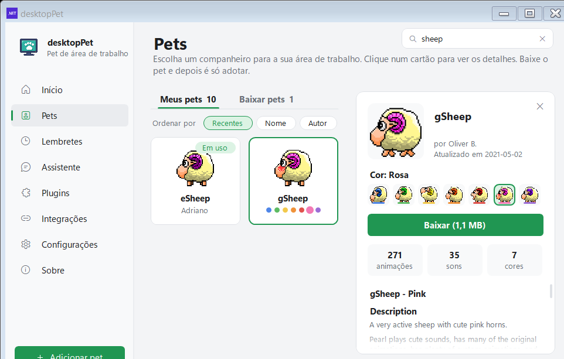
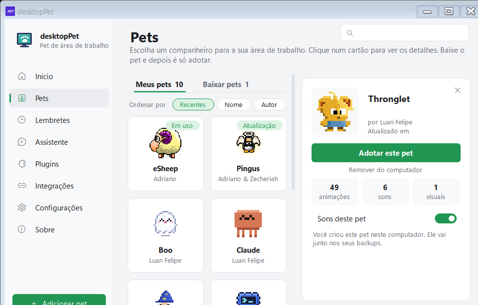

# Painel de pets

[Home](Home.md) · [Instalação](Instalacao.md) · [Primeiros passos](Primeiros-passos.md) · [Pergunte ao pet](Pergunte-ao-pet.md) · [Lembretes e Pomodoro](Lembretes-e-pomodoro.md) · [Agenda e e-mails](Agenda-e-e-mails.md) · [Pet virtual e brinquedos](Pet-virtual-e-brinquedos.md) · [Plugins e integrações](Plugins-e-integracoes.md) · [Crie o seu pet](Crie-o-seu-pet.md) · [Atalhos e comandos](Atalhos-e-comandos.md) · [Para desenvolvedores](Para-desenvolvedores.md) · [Perguntas frequentes](Perguntas-frequentes.md) · [Changelog](Changelog.md)

O painel de pets é a página **Pets** da janela de Configurações. É onde você escolhe o bichinho que vai passear pela área de trabalho: vê a galeria, baixa o que quiser, adota e depois tira do computador o que não usa mais.

Você chega nela pelo item **Pets** da barra lateral ou pelo item `Abrir &Painel` do menu do ícone na bandeja do sistema.

O botão `＋  Adicionar pet` no rodapé da barra lateral não abre o painel: ele coloca mais uma cópia do pet em uso na tela.

## As duas abas

A página tem duas abas, no formato de pivô do Windows 11, com a contagem entre parênteses:

- **Meus pets (n)** — o que já está neste computador.
- **Baixar pets (n)** — o que está na galeria publicada no repositório do projeto.

O que entra em cada aba:

| Aba | Conteúdo |
| --- | --- |
| Meus pets | O eSheep que vem embutido no executável, os pets já baixados e os pets que você mesmo criou neste computador. |
| Baixar pets | Os pets da galeria (repositório do projeto, pasta `Pets/`), que ainda não estão no disco. |

Alguns detalhes que talvez não fiquem óbvios:

- O eSheep (pasta `esheep64`) é o único pet que vem dentro do executável. Por isso ele é sempre o primeiro cartão da lista em "Meus pets" e funciona mesmo sem internet.
- Um pet que **saiu da galeria** (o autor o removeu do repositório) continua aparecendo em "Meus pets" enquanto estiver em uso, com a descrição *"Este pet saiu da galeria. Ele continua aqui enquanto estiver em uso."*
- Um pet **criado neste computador** aparece com *"Você criou este pet neste computador. Ele vai junto nos seus backups."* e o campo de data fica vazio.
- Quando o programa abre pela primeira vez e não há nenhum pet baixado, a página já abre na aba "Baixar pets".
- Um clique no cartão abre o painel de detalhes à direita. **Dois cliques** executam a ação principal do pet (baixar ou adotar) direto, sem precisar apertar o botão do painel.
- `Esc` fecha o painel de detalhes; se ele já estiver fechado, `Esc` fecha a janela de Configurações.

*Cartões da galeria com o selo "Em uso" no pet adotado e o selo "Atualização" quando a galeria tem versão nova.*

*A aba "Baixar pets" mostra apenas o que ainda não está no computador.*

## Busca e ordenação

- No alto da janela aparece o campo de busca **"Buscar pet ou autor…"**. `Ctrl+F` leva o cursor para ele.
- A busca compara o nome, a pasta do pet, o autor e, no caso do grupo de ovelhas, também o nome da cor escrito por extenso ("rosa") e o nome da pasta ("pink_sheep").
- Abaixo das abas ficam os chips **Ordenar por**: `Recentes` (padrão), `Nome` e `Autor`.

Quando a busca não encontra nada, a página avisa: *"Nenhum pet encontrado para "{0}"."* Se a aba "Baixar pets" está vazia porque você já tem tudo, a mensagem é *"Você já tem todos os pets da galeria."*

## O painel de detalhes

Clicando num cartão, abre-se um painel à direita (340 px) com:

- A **prévia animada** do pet (o `preview.gif`, que toca quadro a quadro).
- O nome, o autor (`por {autor}`) e a data (`Atualizado em {data}`).
- O **seletor de cores**, só no caso do grupo de ovelhas.
- O **botão principal**, que muda conforme o estado do pet.
- O link **"Remover do computador"**, quando o pet pode ser apagado.
- Três caixas de estatísticas: **animações**, **sons** e **visuais** (no grupo de ovelhas a terceira caixa conta as **cores**).
- A chave **"Sons deste pet"**, que liga e desliga os sons só daquele pet.
- O **README** do pet, interpretado como markdown (títulos, listas e links clicáveis) numa área com rolagem própria.

As estatísticas vêm do próprio `animations.xml` quando o pet já está no computador; antes de baixar, os números vêm do `pets.json` (o índice da galeria) e a terceira caixa mostra `1` visual. No grupo de ovelhas, a terceira caixa mostra quantas cores existem para escolher.

O botão principal é a parte mais importante do painel, porque ele muda de texto conforme a situação:

| Situação | Botão |
| --- | --- |
| O pet não está no computador | `Baixar` ou `Baixar (326 KB)` |
| O pet está, mas a galeria tem versão nova | `Baixar atualização` ou `Baixar atualização (326 KB)` |
| É o pet que está em uso | `Em uso – adicionar mais um` |
| Já está no computador | `Adotar este pet` |
| O último download falhou | `Tentar novamente` |

O tamanho mostrado vem do `pets.json` ou de uma requisição `HEAD` ao servidor — o arquivo ainda não é baixado para você saber o tamanho. O formato é KB abaixo de 1 MB e MB acima (por exemplo, `Baixar (1,1 MB)`).

*O detalhe do eSheep: o pet embutido, que não tem som e por isso não mostra a chave "Sons deste pet".*

*Pet já baixado: aparece o link de remoção e a chave que liga e desliga os sons dele.*

*As sete ovelhas coloridas são um cartão só; a cor escolhida é a que aparece na prévia.*

## Baixar: barra de progresso, cancelar e repetir

- Durante o download, o botão principal **vira a própria barra de progresso**: ele se preenche da esquerda para a direita e mostra `Baixando… 42%`.
- Ao lado da barra fica um botão **✕** que cancela o download. A barra de status da janela passa a mostrar *"Download de {pet} cancelado."*
- O arquivo baixado é conferido antes de ser gravado:
  - se vier incompleto: *"o download foi interrompido. Tente de novo."*;
  - se o tamanho for diferente do anunciado: *"o arquivo não confere com a galeria (tamanho diferente). Tente de novo daqui a alguns minutos."*;
  - se o conteúdo não for um pet: *"o arquivo não é um pet válido."*
- Nenhum desses casos grava alguma coisa no computador. Quando o download falha, o botão vira `Tentar novamente`.
- Depois de baixar, o botão vira `Adotar este pet` e a barra de status mostra *"{pet} baixado. Agora é só adotar!"*

**Baixar não adota.** O arquivo é só salvo em `%LocalAppData%\DesktopPet\pets\<pasta>\animations.xml`, junto de um `version.txt` com a data da galeria. É a adoção que troca o pet na tela; o arquivo baixado continua no disco para você adotar mais tarde, mesmo sem internet.

Ao adotar, o pet novo assume a tela na hora e cumprimenta: *"Oi! Eu sou {0}. Prazer em te conhecer!"*

## Aviso de pet com versão nova

O programa confere de tempos em tempos (15 segundos depois de abrir e depois a cada 6 horas) se algum pet já baixado ganhou versão nova na galeria, comparando o `version.txt` salvo com a data do `pets.json`.

Quando isso acontece:

- O cartão do pet ganha o selo **"Atualização"**.
- O item da bandeja passa a dizer `Abrir &Painel (1 atualização)` ou `Abrir &Painel ({n} atualizações)`.
- Aparece uma notificação do Windows (o balão do ícone na bandeja): **"Atualização de pet disponível"** (ou "{n} atualizações de pets disponíveis") com o texto *"{nomes}. Clique para abrir o painel."* — uma vez por versão, não a cada vez que o programa é aberto.

Na aba "Meus pets", o botão do pet passa a ser `Baixar atualização`, que substitui o arquivo velho pelo novo.

## Remover um pet do computador

- O link **"Remover do computador"** aparece no detalhe de um pet que foi baixado e **não** está em uso. O eSheep embutido nunca pode ser removido.
- O programa pede confirmação: *"Remover {pet} do computador?\n\nVocê pode baixar de novo quando quiser."*
- Depois: *"{pet} foi removido do computador."*

O cartão continua na galeria, então dá para baixar o mesmo pet outra vez a qualquer momento.

Pets que **saem** da galeria (deixam de aparecer no `pets.json`) também são apagados do computador sozinhos — com duas exceções: o pet que está em uso e os pets que você criou aqui.

## Exportar e importar seus pets

Para levar os seus pets para outro computador:

1. Abra **Configurações** → seção **Programa**.
2. Em **"Backup dos meus pets e configurações"**, clique em `Exportar…`. (Ao lado, em **"Importar pets"**, está o `Importar…`.)

O arquivo sai com a extensão `.desktoppet` (é um zip), nome padrão `meus-pets`, salvo na pasta Documentos, com o filtro *"Pets do DesktopPet (*.desktoppet)"*. Se você ainda não baixou nenhum pet, o programa avisa: *"Ainda não há pets baixados para exportar."*

O que vai dentro do arquivo:

| Parte | Conteúdo |
| --- | --- |
| `pets/<pasta>/` | O `animations.xml` e o `version.txt` de cada pet baixado. |
| `settings.txt` | O pet em uso, os pets com o som desligado e as configurações (tema, idioma, volume, atalhos do Pomodoro, pet virtual, monitor do PC, humor, agenda, balões do Claude Code…). |
| `data/` | `reminders.json`, `launchers.json`, `mood.json` e `needs.json`. |

A descrição da própria opção avisa: *"Ele também guarda o link da sua agenda: não compartilhe."* A chave do serviço de IA e a senha da API local **nunca** entram no backup.

Na importação, o programa é desconfiado com o arquivo:

- Só aceita entradas no formato `pets/<nome>/animations.xml`, com nome de pasta simples e arquivo de até 50 MB, e o XML tem que ser de fato um pet. Um arquivo corrompido nunca substitui o bom.
- Se o backup também trouxer lembretes, atalhos, histórico de humor e configurações, o programa pergunta: *"Este arquivo também tem lembretes, atalhos, histórico de humor e configurações.\n\nSubstituir os deste computador por eles?"*
- Se o pet que estava em uso no outro computador não for o que está em uso aqui, ele pergunta: *"{0}" era o pet em uso no outro computador. Adotar agora?"*

*Um pet criado aqui entra nos backups e não é apagado quando sai da galeria.*

## Sem internet

Quando o programa não consegue buscar a galeria, a aba "Baixar pets" mostra uma faixa:

> *"Sem conexão com a internet. Aparecem só os pets que já estão no computador: conecte-se para ver os pets para baixar."*

Com o botão **"Tentar de novo"** ao lado, que refaz a busca. A barra de status da janela confirma: *"Sem internet: mostrando só os pets do computador."*

Sem internet:

- A lista mostra apenas os pets que já estão no disco.
- O eSheep continua disponível, porque vem dentro do executável.
- O que já foi baixado continua utilizável: dá para adotar e usar um pet sem rede.

## A lista de pets do projeto

A galeria é o arquivo `Pets/pets.json` do repositório do projeto. Estes são os pets publicados e o número de animações e sons de cada um:

| Pet | Pasta | Autor | Animações | Sons | Tamanho do `animations.xml` |
| --- | --- | --- | --- | --- | --- |
| eSheep | `esheep64` | Adriano | 58 | 0 | 170 KB |
| Rex | `rex` | Luan Felipe | 107 | 16 | 326 KB |
| Pingo | `pingo` | Luan Felipe | 104 | 16 | 282 KB |
| Boo | `boo` | Luan Felipe | 86 | 15 | 262 KB |
| Mago | `mago` | Luan Felipe | 49 | 13 | 225 KB |
| Nuvi | `nuvi` | Luan Felipe | 45 | 14 | 202 KB |
| Claude | `claude` | Luan Felipe | 45 | 10 | 215 KB |
| Thronglet | `thronglet` | Luan Felipe | 49 | 6 | 1,0 MB |
| Pingus | `pingus` | Adriano & Zecheriah | 69 | 30 | 1,2 MB |
| gSheep Azul | `blue_sheep` | Oliver B. | 271 | 35 | 1,1 MB |
| gSheep Verde | `green_sheep` | Oliver B. | 271 | 35 | 1,1 MB |
| gSheep Amarelo | `yellow_sheep` | Oliver B. | 271 | 35 | 1,1 MB |
| gSheep Laranja | `orange_sheep` | Oliver B. | 271 | 35 | 1,1 MB |
| gSheep Vermelho | `red_sheep` | Oliver B. | 271 | 35 | 1,1 MB |
| gSheep Rosa | `pink_sheep` | Oliver B. | 271 | 35 | 1,1 MB |
| gSheep Roxo | `purple_sheep` | Oliver B. | 271 | 35 | 1,1 MB |

Observações sobre a tabela:

- As sete **gSheep** são o mesmo desenho em cores diferentes. Na galeria elas aparecem como **um cartão só**, com uma fileira de bolinhas coloridas; o painel de detalhes mostra *"Cor: Rosa"* (ou a cor escolhida) e a terceira caixa de estatísticas conta as **7 cores**.
- O tamanho é o do arquivo `animations.xml` como o GitHub serve (o valor do `pets.json`), e é ele que aparece no botão de download.
- O eSheep não tem som, por isso o número `0` — e o detalhe dele não mostra a chave "Sons deste pet".

## Ver também

- [Primeiros passos](Primeiros-passos.md) — o que fazer depois de instalar, incluindo como adotar o primeiro pet.
- [Crie o seu pet](Crie-o-seu-pet.md) — como transformar as suas imagens em um pet que entra nesta galeria.
- [Instalação](Instalacao.md) — instalar, reparar e desinstalar o programa.
- [Plugins e integrações](Plugins-e-integracoes.md) — as outras partes do painel (Plugins, Integrações, Assistente).
- [Para desenvolvedores](Para-desenvolvedores.md) — como a galeria é gerada e publicada.

## Onde fica no código

- `src/Portable/FormSettings.Pets.cs` — carrega a galeria, baixa, adota, remove, exporta e importa os pets.
- `src/Portable/FormSettings.PetsView.cs` — as abas, os cartões, os selos, o painel de detalhes e a barra de progresso.
- `src/Portable/FormOptions2.cs` — a classe `OptionsGit`: busca a lista, baixa os arquivos e pergunta o tamanho ao servidor.
- `src/Portable/FormOptions2.SurfacePets.cs` — a classe `OptionsPet` (nome, autor, data, tamanho, animações, sons) e o grupo de cores.
- `src/Portable/PetStore.cs` — a pasta `%LocalAppData%\DesktopPet\pets` onde os pets baixados ficam.
- `src/Portable/PetUpdates.cs` — a checagem de versão nova (15 s depois de abrir e depois a cada 6 h).
- `src/Portable/PetBackup.cs` — a exportação e a importação do arquivo `.desktoppet`.
- `src/Portable/BuiltInPets.cs` — o eSheep embutido no executável.
- `src/Portable/FormSettings.Options.cs` — os botões "Exportar…" e "Importar…" da seção "Programa".
- `src/lang/pt-BR.json` — os textos da interface citados nesta página.
- `Pets/pets.json` — o índice da galeria (pasta, nome, autor, data, tamanho, animações e sons).
