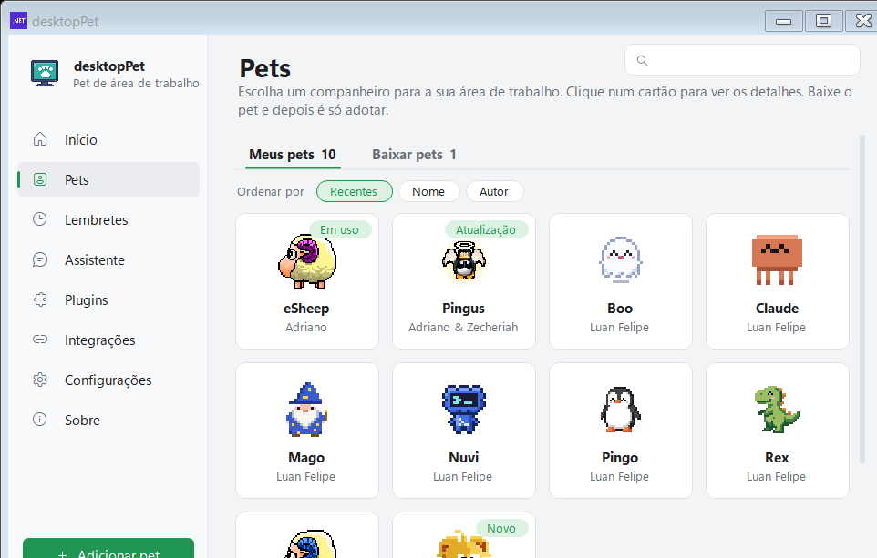
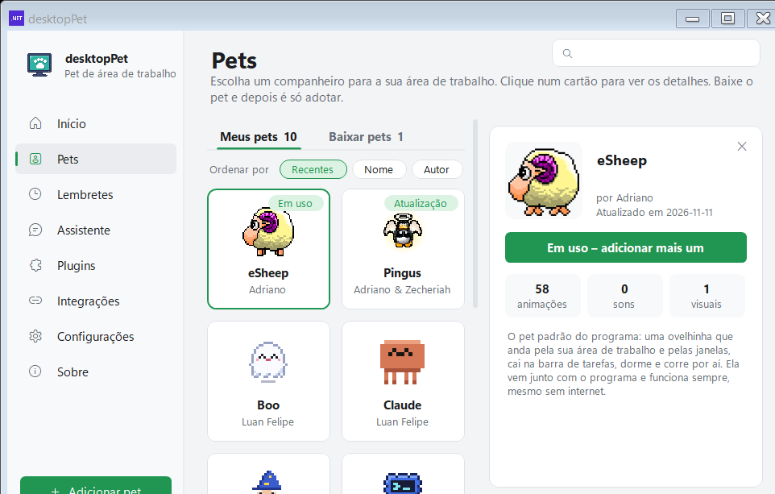
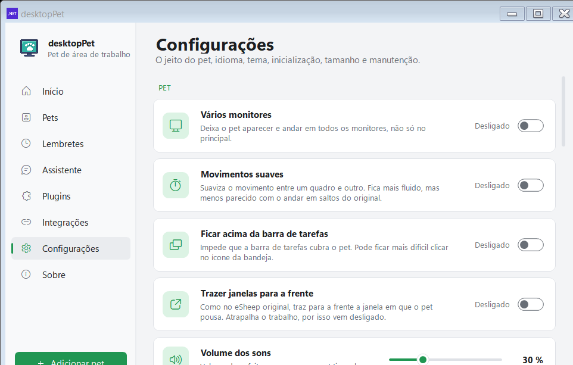
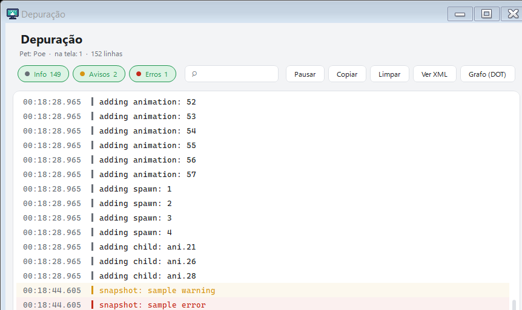
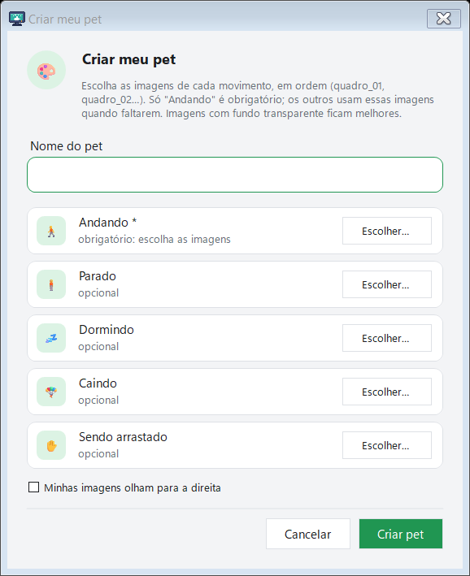
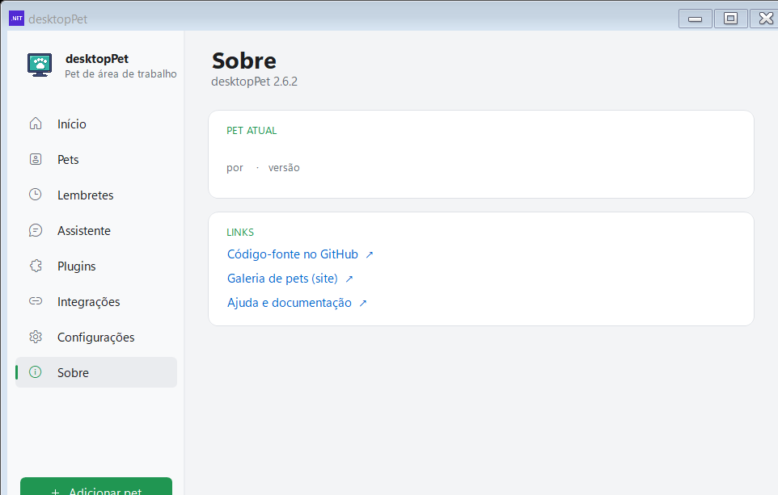

# Para desenvolvedores

[Home](Home.md) · [Instalação](Instalacao.md) · [Primeiros passos](Primeiros-passos.md) · [Painel de pets](Painel-de-pets.md) · [Pergunte ao pet](Pergunte-ao-pet.md) · [Lembretes e Pomodoro](Lembretes-e-pomodoro.md) · [Agenda e e-mails](Agenda-e-e-mails.md) · [Pet virtual e brincadeiras](Pet-virtual-e-brinquedos.md) · [Plugins e integrações](Plugins-e-integracoes.md) · [Crie o seu pet](Crie-o-seu-pet.md) · [Atalhos e comandos](Atalhos-e-comandos.md) · [Perguntas frequentes](Perguntas-frequentes.md) · [Changelog](Changelog.md)

Esta página é para quem quer compilar, testar e publicar o **Meu Pet** (o programa se chama **desktopPet**) ou quer colocar um pet novo na galeria. Ela descreve o que dá para fazer com o código que está no repositório, com os comandos exatos e os caminhos dos arquivos.

O projeto é escrito em C# com Windows Forms sobre **.NET 10** (`net10.0-windows`), alvo `win-x64`, e não usa nenhum pacote NuGet: o som sai pela API MCI do Windows (`src/dotNet/Mp3Player.cs`) e o JSON sai do `System.Text.Json` do próprio runtime (`src/Portable/JsonText.cs`). É por isso que o executável da release normal fica perto de 2,6 MB.

## Requisitos

| Item | Detalhe |
| --- | --- |
| Sistema | Windows 10 ou 11, 64 bits |
| SDK | .NET 10 SDK (`actions/setup-dotnet` com `dotnet-version: 10.0.x` no CI) |
| Visual Studio | Não é preciso para a build atual; só para os projetos legados em .NET Framework |
| Ferramentas extras | `ffmpeg` no PATH, só para gerar os `preview.gif` dos pets |

## Compilar e publicar

O projeto que é publicado hoje é **`src/DesktopPet.Net.csproj`** (SDK-style). Os projetos antigos `src/DesktopPet.csproj` e `src/DesktopPet_Portable.csproj` (solutions `src/DesktopPet.sln` e `src/DesktopPet_Portable.sln`) continuam no repositório, mas são o código .NET Framework 4.7.2 herdado do projeto original e **não** são a build liberada.

### Compilar

```powershell
dotnet build src/DesktopPet.Net.csproj -c Release
```

O executável sai em `src/bin/Release/net10.0-windows/win-x64/DesktopPet.exe` — é exatamente esse caminho que o workflow de CI usa.

### Publicar (build normal, precisa do .NET 10 Desktop Runtime)

```powershell
dotnet publish src/DesktopPet.Net.csproj -c Release -o ..\publish
```

Em `Release` o projeto liga `PublishSingleFile` e `IncludeNativeLibrariesForSelfExtract`, então sai um `.exe` único. A pasta `lang/` é copiada ao lado do executável (e não embutida nele) para que os idiomas possam ser editados sem recompilar.

### Publicar a build "completa" (não precisa de .NET instalado)

```powershell
dotnet publish src/DesktopPet.Net.csproj -c Release -o ..\publish-completo -p:SelfContained=true
```

Com `SelfContained=true` o projeto define a constante `SELFCONTAINED` e liga `EnableCompressionInSingleFile`. O arquivo resultante é o `DesktopPet-completo.exe` (cerca de 50 MB): funciona direto, sem instalar nada.

### A versão do programa

A versão não está no `.csproj`: ela vive em **`src/Properties/AssemblyInfoPortable.cs`**, nas linhas `AssemblyVersion` e `AssemblyFileVersion` (hoje `2.6.2.0`). O `Tools/release.ps1` reescreve esse arquivo sozinho e depois confere se a `FileVersion` do executável publicado é exatamente `<versão>.0`.

### Referência rápida de comandos

```powershell
# compilar
dotnet build src/DesktopPet.Net.csproj -c Release

# publicar a build normal
dotnet publish src/DesktopPet.Net.csproj -c Release -o ..\publish

# publicar a build completa (self-contained)
dotnet publish src/DesktopPet.Net.csproj -c Release -o ..\publish-completo -p:SelfContained=true

# autoteste
src\bin\Release\net10.0-windows\win-x64\DesktopPet.exe --selftest=C:\temp\resultado.txt

# testes de movimento
powershell -NoProfile -File tests\run-net-motion-tests.ps1 -Scales 1,3
```

## Autoteste (`--selftest`)

O autoteste roda as verificações **com o código de verdade**, sem janelas de mentira: cada check chama a classe real do programa. Ele é a rede de segurança principal do projeto.

```powershell
DesktopPet.exe --selftest=C:\temp\resultado.txt
```

- Cada linha do arquivo é `PASS  nome` ou `FAIL  nome  →  detalhe` (a seta e o detalhe só aparecem quando falha).
- A primeira linha é o cabeçalho: `DesktopPet self-test <data>  —  <n> failure(s)`.
- O **código de saída é o número de falhas** (`Environment.Exit(failures)`), então o CI só precisa checar se o processo terminou com 0.
- `--only=<texto>` roda só os checks cujo nome contém aquele texto — útil quando você está mexendo num recurso só.

Os 50 grupos de verificação, na ordem em que rodam:

| Área | Grupos |
| --- | --- |
| Lembretes e rotina | `reminder schedule`, `reminder json`, `smart reminders`, `activity` |
| Pet virtual e humor | `virtual pet decay`, `mood history text`, `sheep talk`, `pets chat`, `pets meet` |
| Textos e idiomas | `languages`, `games texts`, `colour emoji` |
| Menu e janelas | `bubble`, `hide hotkey`, `pet menu`, `pomodoro`, `dialogs hold the pets`, `chat`, `hover chat`, `ask the pet`, `anim picker`, `tour`, `quiet time`, `sky arrival`, `pet change`, `talking pet` |
| Configurações | `per-pet sound`, `settings pages`, `start with Windows (read)`, `log file`, `shortcut error`, `simple timer` |
| Backup | `backup export`, `backup import safety`, `backup of my things` |
| IA e integrações | `ai providers`, `claude hooks file`, `claude events`, `claude endpoint`, `mcp`, `new plugins`, `live plugins` |
| Recursos externos | `agenda`, `agenda online`, `outlook`, `weather`, `downloads`, `downloads watcher` |
| Criação de pets | `create pet`, `pet actions` |

O autoteste não mexe nos seus dados: lembretes, necessidades, humor e atalhos do usuário são preservados, e o que um check alterar é devolvido. Ele também desliga a apresentação inicial (`Onboarding.Disabled`) para não atrapalhar as verificações.

## Testes de movimento

São seis suítes que verificam a interpolação de posição, a troca de animação, a reação a bordas e a topologia de monitores, com o pet de verdade na tela:

| Suíte | Arquivo | O que confere |
| --- | --- | --- |
| `MotionTests` | `tests/MotionTests.cs` | a interpolação do `MotionTrack` e a velocidade de arremesso, sem abrir janela |
| `DisplayTopologyTests` | `tests/DisplayTopologyTests.cs` | monitor desconectado: o pet volta para o principal e não fica fora da área visível |
| `MotionAuditTests` | `tests/MotionAuditTests.cs` | auditoria do movimento em janela oculta |
| `RuntimeMotionTests` | `tests/RuntimeMotionTests.cs` | o movimento rodando, com o pet visível |
| `TransitionRuntimeTests` | `tests/TransitionRuntimeTests.cs` | publicação de quadros, criação de janelas filhas e mudança de opções ao vivo |
| `ContinuousTransitionTests` | `tests/ContinuousTransitionTests.cs` | transições emendadas, sem reiniciar os temporizadores |

Para rodar contra a build .NET 10 (a que é publicada), basta o SDK:

```powershell
powershell -NoProfile -File tests\run-net-motion-tests.ps1 -Scales 1,3
```

Parâmetros: `-Scales` (o padrão é `1,3`), `-Displays` (o padrão é todos os monitores conectados) e `-OutputDirectory`. O runner compila cada suíte com `tests/MotionTests.Net.csproj` passando `-p:TestName=<suíte>`, sempre x64, e falha se qualquer suíte devolver código diferente de zero.

> Feche o DesktopPet antes de rodar: as suítes mostram pets de verdade na tela e precisam de uma sessão de desktop ativa e desbloqueada.

A build legada em .NET Framework tem o runner `tests/run-motion-tests.ps1`, que precisa do Visual Studio Build Tools (MSBuild desktop), do NuGet e do pacote de referência do .NET Framework 4.7.2.

## Ferramentas em `Tools/`

| Ferramenta | O que faz | Como rodar |
| --- | --- | --- |
| `Tools/PetGen` | Desenha pixel a pixel os pets oficiais (Claude, Mago, Nuvi, Boo, Pingo e Rex) e grava cada um como uma pasta de pet: `animations.xml` (com a folha de sprites e o ícone em base64 dentro do XML), `icon.png` e `README.md` / `README.pt-BR.md`. Os sons saem de `PetSounds.cs`. | `dotnet run --project Tools/PetGen/PetGen.csproj -- Pets` |
| `Tools/PetPack` | Monta um pet a partir de quadros PNG prontos (por exemplo gerados no PixelLab), usando o mesmo modelo de XML do PetGen. Os quadros ficam em `Tools/PetPack/art/<pet>/<animação>/frame_NNN.png`. | `dotnet run --project Tools/PetPack/PetPack.csproj -- Pets` |
| `Tools/update-pets-json.ps1` | Reescreve em `Pets/pets.json` o campo `size` (o tamanho que o GitHub vai servir, já com LF) e as contagens `animations` e `sounds` de cada pet, lendo o `animations.xml` dele. Rode depois de mexer em um pet. | `powershell -ExecutionPolicy Bypass -File Tools\update-pets-json.ps1` |
| `Tools/make-previews.ps1` | Gera o `preview.gif` de cada pet (o pet andando mais uma de suas maracinhas, ~120 px, fundo transparente, 128 cores) com `ffmpeg`. O programa mostra esse GIF no painel de detalhes. | `powershell -ExecutionPolicy Bypass -File Tools\make-previews.ps1` — ou `-Only rex` para um pet só |
| `Tools/Setup` | O instalador em .NET Framework 4.8 (`DesktopPet-Instalador.exe`). Ele procura o .NET 10 Desktop Runtime, oferece o instalador oficial da Microsoft quando falta, cria os atalhos e instala em `%LocalAppData%\DesktopPet`. | `dotnet build Tools\Setup\Setup.csproj -c Release -p:AppExe=<caminho do exe> -p:Version=<versão>` |
| `Tools/release.ps1` | Monta a versão nova e publica a release no GitHub. Detalhado na seção seguinte. | `pwsh Tools\release.ps1 -Version 2.6.2` |

As duas primeiras ferramentas recebem a pasta de destino como primeiro argumento (`Pets`, por padrão). Depois de rodar o PetGen ou o PetPack, o passo obrigatório é rodar o `update-pets-json.ps1` e o `make-previews.ps1`, senão o painel mostra tamanho e contagens errados e a prévia não existe.

`Tools/PetEditor` e `Tools/PetTester` são ferramentas antigas em .NET Framework 4.8 (Windows Forms): o PetEditor abre e salva o XML de um pet e o PetTester abre um XML de animação para inspeção. Elas não fazem parte da build publicada.

## Publicar uma release: `Tools/release.ps1`

O script faz tudo em ordem, cada passo conferindo o anterior:

| Passo | O que acontece |
| --- | --- |
| 0 | Roda `update-pets-json.ps1` e confere a galeria: avisa se uma pasta em `Pets/` não está listada em `pets.json` e **falha** se o `pets.json` listar uma pasta sem `animations.xml` |
| 1 | Escreve a versão em `src/Properties/AssemblyInfoPortable.cs` (`AssemblyVersion` e `AssemblyFileVersion` como `<versão>.0`) |
| 2 | `dotnet publish` da build normal e conferência: a `FileVersion` do exe tem de ser exatamente `<versão>.0` |
| 2b | `dotnet publish -p:SelfContained=true` e renomeia o resultado para `DesktopPet-completo.exe` |
| 2c | Compila o instalador net48 em `Tools/Setup` com `-p:AppExe=<exe>` e `-p:Version=<versão>` |
| 3 | Empacota `src/lang/*.json` em `lang.zip` |
| 4 | Escreve `SHA256SUMS` no formato `hash  nome` (duas espaços, hex minúsculo, fim de linha LF), uma linha por artefato |
| 5 | Cria a release `v<versão>` no repositório com `gh release create`, alvo `master`, usando as notas de um arquivo `NOTES.md` |

```powershell
# só montar e ver os hashes, sem mandar nada para o GitHub
pwsh Tools\release.ps1 -Version 2.6.2 -NoUpload

# publicar de verdade (precisa de "gh auth login")
pwsh Tools\release.ps1 -Version 2.6.3 -Notes "- Novo pet: Rex"
```

As notas de versão vão por um arquivo (`NOTES.md`) e não pela linha de comando, porque aspas e quebras de linha quebrariam o comando do `gh`. Tudo é deixado em `release/<versão>/`.

### O que a release contém

Cada release `vX.Y.Z` publica cinco arquivos. Os tamanhos abaixo são os reais da 2.6.2:

| Arquivo | Tamanho | Para quê |
| --- | --- | --- |
| `DesktopPet.exe` | 2.750.643 bytes (~2,6 MB) | o programa; precisa do .NET 10 Desktop Runtime |
| `DesktopPet-completo.exe` | 52.672.112 bytes (~50 MB) | o programa com o runtime dentro; não precisa instalar nada |
| `DesktopPet-Instalador.exe` | 3.150.336 bytes (~3 MB) | instalador em .NET Framework 4.8: confere o runtime, instala e cria os atalhos |
| `lang.zip` | — | os arquivos de idioma, para quem baixou só o `.exe` |
| `SHA256SUMS` | — | o hash de cada um dos quatro arquivos acima |

O atualizador do programa (`src/Portable/Updater.cs`) consulta `https://api.github.com/repos/lfeliipeadv-stack/meu-pet/releases/latest`, mostra as novidades (limite de 1500 caracteres) e só troca o executável depois de conferir o SHA-256 de cada arquivo contra o `SHA256SUMS` da própria release. Hash ausente ou divergente cancela a atualização (`inst.hashMissing` / `inst.hashMismatch`). Só depois disso o executável em uso é renomeado para `DesktopPet_old.exe` e o programa se reinicia. A release não é assinada digitalmente: a garantia é o hash publicado junto dos arquivos.

Depois de publicar, comite a mudança de versão — o `release.ps1` avisa quando o `Pets/pets.json` mudou e ainda não foi enviado, porque a galeria lê esse arquivo do GitHub.

## Workflows do GitHub Actions

| Arquivo | Quando roda | O que faz |
| --- | --- | --- |
| `.github/workflows/build.yml` | todo push no `master`, pull requests e `workflow_dispatch` | compila com `dotnet build src/DesktopPet.Net.csproj -c Release`, roda o autoteste (com limite de 5 minutos: se não terminar, mata o processo e falha), roda os testes de movimento `.NET 10` com `-Scales 1,3` e guarda o `selftest.txt` como artefato **autoteste** |
| `.github/workflows/pages.yml` | push que muda `site/**`, `Pets/**`, `.github/readme/**` ou o próprio workflow | monta a pasta `_site` (copia `site/*`, o `Pets/pets.json`, o `preview.gif` de cada pet como `_site/pets/<pasta>.gif`, as imagens do README e o ícone do eSheep) e publica com `configure-pages`, `upload-pages-artifact` e `deploy-pages` |
| `.github/workflows/wiki.yml` | push que muda `wiki/**` ou o próprio workflow | publica a pasta `wiki/` no repositório do Wiki: clona o repositório `.wiki.git` com o token do GitHub, apaga as páginas antigas, copia as de `wiki/` e envia o commit |

O `build.yml` tem `timeout-minutes: 20` no job inteiro. O `wiki.yml` trata o primeiro envio (quando o repositório do Wiki ainda não existe e o clone devolve 404) criando o repositório do zero.

Ainda existem três workflows legados (`build_nosign.yml`, `dotnet-desktop-signpath.yml` e `dotnet-desktop.yml`) que assinam a build antiga em .NET Framework; eles não são usados no pipeline atual.

## Estrutura de pastas do repositório

| Pasta | O que guarda |
| --- | --- |
| `src/` | o código do programa |
| `src/Portable/` | o painel, o menu do pet, a IA, os plugins, o MCP, o autoteste e os utilitários do Windows |
| `src/dotNet/` | o motor do pet: `FormPet.cs` (movimento, colisão, janelas), `Animations.cs`, `Xml.cs`, `Mp3Player.cs`, `FormAnimPicker.cs`, `Program.cs` |
| `src/LocalData/` | o modelo desserializado do `animations.xml` (`AnimationXML.cs`) |
| `src/lang/` | `pt-BR.json` e `es.json` — os textos do programa |
| `src/Properties/` | `AssemblyInfoPortable.cs` (a versão) e o manifesto do aplicativo |
| `src/Resources/` | `animations.xsd` (o esquema XML do pet) e `animations.xml` (o pet de exemplo) |
| `Pets/` | a galeria: uma pasta por pet com `animations.xml`, `icon.png`, `preview.gif` e `README.md`, mais o índice `pets.json` |
| `Tools/` | `PetGen`, `PetPack`, `Setup`, `update-pets-json.ps1`, `make-previews.ps1`, `release.ps1` |
| `tests/` | as suítes de movimento e os runners (`run-net-motion-tests.ps1` e `run-motion-tests.ps1`) |
| `site/` | a página pública do projeto (a que o `pages.yml` publica) |
| `wiki/` | o conteúdo do Wiki; é a fonte da verdade das páginas |
| `.github/workflows/` | os workflows de build, da página e do Wiki |
| `docs/capturas/` | as capturas de tela usadas nas imagens do Wiki |
| `release/<versão>/` | o que foi gerado por cada versão publicada |
| `publish/` | saída do `dotnet publish` local |

## O formato de `Pets/pets.json`

É um objeto com a chave `pets`, que é uma lista de entradas — uma por pet da galeria:

```json
{
  "pets" : [
    {
      "folder" : "rex",
      "name" : "Rex",
      "author" : "Luan Felipe",
      "lastupdate" : "2026-11-11 20:45",
      "size" : 334102,
      "animations" : 107,
      "sounds" : 16
    }
  ]
}
```

| Campo | Para que serve |
| --- | --- |
| `folder` | nome da pasta em `Pets/`; é o que o programa baixa e o que identifica o pet no disco |
| `name` | nome de exibição no painel |
| `author` | quem fez o pet |
| `lastupdate` | data e hora da última versão, no formato `yyyy-MM-dd HH:mm`; é comparada com o `version.txt` local para avisar de versão nova |
| `size` | tamanho em bytes do `animations.xml`, **do jeito que o GitHub serve** (com LF). Aparece no botão de download antes de o arquivo chegar |
| `animations` | quantas animações o pet tem; aparece no painel de detalhes |
| `sounds` | quantos sons o pet tem; idem |

Os campos `size`, `animations` e `sounds` são reescritos pelo `Tools/update-pets-json.ps1` — não edite esses números à mão.

O programa lê a galeria de `https://raw.githubusercontent.com/lfeliipeadv-stack/meu-pet/master/Pets/` (constantes em `src/Portable/AppInfo.cs`) e, de cada pasta, baixa `animations.xml`, `icon.png`, `preview.gif` e o `README.md` (ou `README.pt-BR.md`, quando o programa está em português). O tamanho vem de uma requisição `HEAD` antes do download, e o arquivo recebido é descartado se não tiver o tamanho anunciado.

### Publicar um pet novo

1. Crie a pasta `Pets/<nome>/` com `animations.xml`, `icon.png` e `README.md`.
2. Rode `powershell -ExecutionPolicy Bypass -File Tools\update-pets-json.ps1` para incluir o pet no `pets.json`.
3. Rode `powershell -ExecutionPolicy Bypass -File Tools\make-previews.ps1` para gerar o `preview.gif`.
4. Confira que `pets.json` não lista nenhum pet sem pasta — o `release.ps1` falha se isso acontecer.
5. Envie para o `master`: a galeria do programa e a página do site leem o repositório.


*O painel lê a galeria de `Pets/pets.json` no repositório; cada cartão traz o nome, o autor e o selo de estado.*


*O painel de detalhes mostra o `preview.gif`, o README interpretado como markdown e as contagens de animações e sons.*

## Como adicionar um idioma novo

Os textos vivem em arquivos JSON comuns na pasta `src/lang/` (hoje `pt-BR.json` e `es.json`). O inglês fica embutido no código (`Lang.BuiltInEnglish`) e é a reserva para qualquer chave que falte.

1. Crie `src/lang/xx.json`.
2. A primeira chave precisa ser `"language.name"` — é ela que aparece na lista de idiomas:

   ```json
   {
     "language.name": "Español",
     "opt.language.title": "Idioma",
     "opt.language.desc": "Idioma do programa. \"Auto\" segue o idioma do Windows. Os arquivos ficam na pasta lang, ao lado do programa."
   }
   ```

3. Traduza as chaves que quiser. As que faltarem caem no inglês embutido.
4. Recompile. O `.csproj` copia `lang\*.json` para a pasta `lang` ao lado do executável e também embute uma cópia como recurso (`EmbeddedResource` com o nome lógico `lang/%(Filename)%(Extension)`), para o caso de o usuário baixar só o `.exe`.

O arquivo aparece sozinho na lista de idiomas da página **Configurações** — `Lang.Available()` varre `lang/*.json` e junta com o inglês embutido. Em "Auto", o programa segue o idioma de exibição do Windows (`CurrentUICulture`), aceitando tanto o nome exato (`pt-BR`) quanto o idioma neutro (`pt`). A troca é instantânea, sem reiniciar.

Para gerar o modelo com todas as chaves, use:

```powershell
DesktopPet.exe --export-lang=C:\temp\modelo.json
```

Para instalar um idioma numa cópia portátil já em uso, basta soltar o `.json` na pasta `lang` ao lado do `.exe`.

### O check de idiomas do autoteste

O grupo `languages` do `--selftest` confere, para cada idioma listado em `SelfTest.Languages` (`src/Portable/SelfTest.cs`), três coisas:

- tem **todas** as chaves que o programa usa;
- não tem chave **desconhecida**;
- os **placeholders** `{0}`, `{1}` batem com os do inglês.

Hoje ele verifica `pt-BR` e `es`. Ao adicionar um idioma novo, inclua o código dele nessa lista para que o autoteste passe a cobri-lo:

```csharp
foreach (string code in new[] { "pt-BR", "es", "xx" })
```

## Argumentos de linha de comando de desenvolvedor

| Argumento | Para que serve |
| --- | --- |
| `--selftest=<arquivo>` | roda os checks e grava as linhas PASS/FAIL; o código de saída é o número de falhas |
| `--only=<texto>` | roda só os checks cujo nome contém o texto |
| `--ai-check=<arquivo>` | confere os provedores de IA de verdade, com a chave na variável de ambiente `DESKTOPPET_AI_KEY` e o serviço em `DESKTOPPET_AI_PROVIDER` (padrão `gemini`) |
| `--snapshot=<pasta>` | grava as capturas de todas as janelas do painel em PNG e fecha (é o que gera as imagens do Wiki) |
| `--export-lang=<arquivo>` | grava o modelo em inglês das traduções |
| `--gallery=<url>` | aponta a galeria para outro endereço (`--gallery=https://nowhere.invalid/` testa o painel sem internet) |
| `--write-hooks=<arquivo>` | escreve os hooks do Claude Code num `settings.json` diferente do do usuário |
| `--mcp` | sobe o servidor MCP do Claude Code em stdin/stdout, sem janela e sem pet |
| `--agent=<evento>` | outro agente de IA avisa o pet em execução (`done`, `stop`, `thinking`, `start`, `waiting`, `input`, `error`, `edit`, `run`, `read`) |
| `--clean-memory=<arquivo>` | arrumada completa de memória, num processo elevado |

Dois deles precisam de atenção em ambiente de CI: o `--selftest` abre janelas de verdade e o `--snapshot` também, então os dois devem rodar numa sessão de desktop interativa.


*Configurações › Programa: idioma, tema, inicialização, tamanho do pet, backup, depuração e instalação.*


*A janela de depuração mostra ao vivo a animação que o pet está tocando; ela também abre segurando CTRL ao iniciar o programa.*


*"Criar meu pet" transforma imagens suas em um pet completo, sem passar pelo código.*


*A página Sobre mostra a versão do programa e os links do projeto.*

## Ver também

- [Instalação](Instalacao.md) — os arquivos da release e o que cada um faz
- [Crie o seu pet](Crie-o-seu-pet.md) — o criador dentro do programa e o formato do XML do pet
- [Painel de pets](Painel-de-pets.md) — a galeria, as abas e os selos
- [Plugins e integrações](Plugins-e-integracoes.md) — o canal local, os hooks e o MCP com o Claude Code
- [Changelog](Changelog.md) — o que mudou em cada versão

## Onde fica no código

- `src/DesktopPet.Net.csproj` — o projeto publicado (.NET 10, WinForms, x64, sem NuGet)
- `src/DesktopPet.csproj`, `src/DesktopPet_Portable.csproj`, `src/DesktopPet.sln`, `src/DesktopPet_Portable.sln` — os projetos legados em .NET Framework
- `src/Properties/AssemblyInfoPortable.cs` — a versão do programa
- `src/dotNet/Program.cs` — os argumentos de linha de comando e o ponto de entrada
- `src/dotNet/FormPet.cs`, `src/dotNet/FormPet.Motion.cs`, `src/dotNet/MotionTrack.cs` — o motor do pet
- `src/dotNet/Animations.cs`, `src/dotNet/Xml.cs`, `src/LocalData/AnimationXML.cs` — as animações e o XML do pet
- `src/dotNet/Mp3Player.cs` — os sons pela API MCI do Windows
- `src/Portable/SelfTest.cs` — o autoteste
- `src/Portable/Lang.cs` — os idiomas (carregar, listar, exportar o modelo)
- `src/lang/pt-BR.json`, `src/lang/es.json` — os textos do programa
- `src/Portable/Updater.cs`, `src/Portable/AppInfo.cs` — a atualização automática e os endereços do repositório
- `src/Portable/FormSettings.Snapshots.cs` — as capturas das janelas (`--snapshot`)
- `src/Portable/PetCreator.cs` — o criador de pet dentro do programa
- `src/Resources/animations.xsd` — o esquema do `animations.xml`
- `Pets/pets.json` — o índice da galeria
- `Tools/PetGen/Program.cs`, `Tools/PetGen/PetModel.cs`, `Tools/PetGen/PetSounds.cs` — o gerador de pets
- `Tools/PetPack/Program.cs`, `Tools/PetPack/PngPet.cs` — o montador de pets a partir de PNG
- `Tools/update-pets-json.ps1` — reescreve o `pets.json`
- `Tools/make-previews.ps1` — gera os `preview.gif`
- `Tools/Setup/Setup.csproj`, `Tools/Setup/SetupForm.cs` — o instalador
- `Tools/release.ps1` — a publicação da release
- `tests/run-net-motion-tests.ps1`, `tests/MotionTests.Net.csproj`, `tests/README.md` — os testes de movimento
- `.github/workflows/build.yml`, `.github/workflows/pages.yml`, `.github/workflows/wiki.yml` — os workflows
