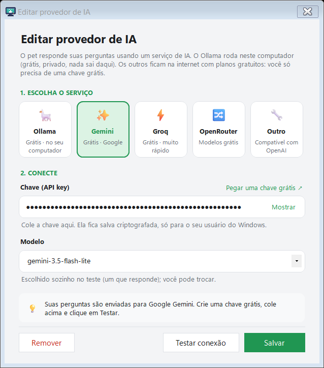
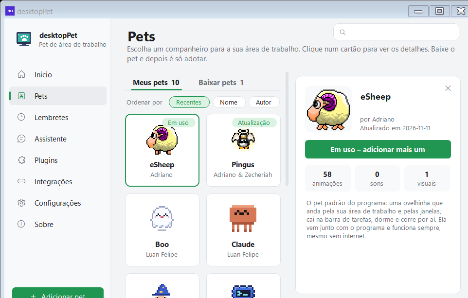
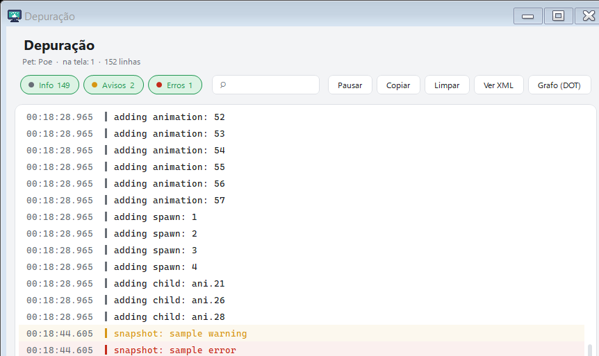
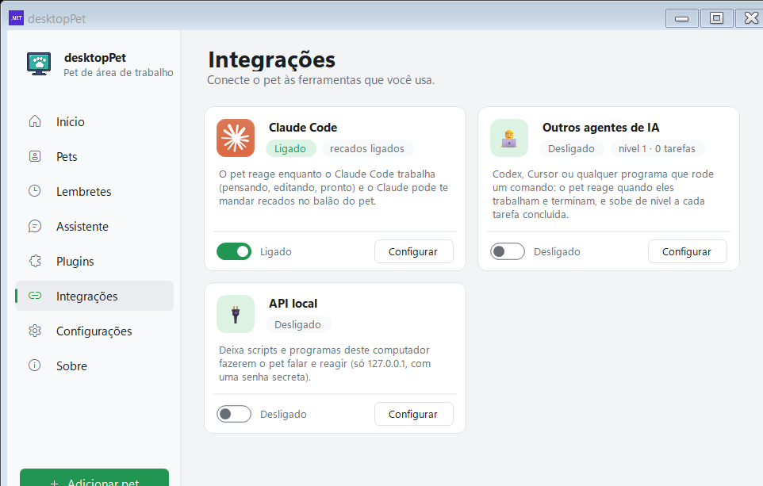

# Perguntas frequentes

[Home](Home.md) · [Instalação](Instalacao.md) · [Primeiros passos](Primeiros-passos.md) · [Painel de pets](Painel-de-pets.md) · [Pergunte ao pet](Pergunte-ao-pet.md) · [Lembretes e Pomodoro](Lembretes-e-pomodoro.md) · [Agenda e e-mails](Agenda-e-e-mails.md) · [Pet virtual e brincadeiras](Pet-virtual-e-brinquedos.md) · [Plugins e integrações](Plugins-e-integracoes.md) · [Crie o seu pet](Crie-o-seu-pet.md) · [Atalhos e comandos](Atalhos-e-comandos.md) · [Para desenvolvedores](Para-desenvolvedores.md) · [Changelog](Changelog.md)

Reunidas aqui as dúvidas que aparecem mais no dia a dia: se o programa é seguro, o que fazer quando o Windows reclama do executável, por que um pet some depois de uma atualização, como levar tudo para outro computador e o que cada palavra do jargão significa.

## O programa é seguro?

O programa **não pede administrador**, **não instala serviço**, **não abre porta na rede** e **não manda estatísticas de uso**. O que ele faz com os seus dados está descrito logo abaixo, para você conferir em vez de acreditar.

### Onde ficam os seus dados

Tudo fica dentro da sua conta do Windows, na pasta `%LocalAppData%\DesktopPet`:

| Arquivo ou pasta | O que guarda |
| --- | --- |
| `pets\` | Os pets baixados da galeria, cada um na sua pasta (`animations.xml` e `version.txt`) |
| `reminders.json` | Os lembretes, inclusive os quatro prontos |
| `mood.json` | O histórico do humor, uma entrada por dia |
| `notes.json` | Notas, tarefas e a contagem regressiva |
| `launchers.json` | Os atalhos de pastas, programas e sites |
| `needs.json` | Fome, carinho e energia de cada pet |
| `agent.json` | A porta e o segredo do canal local (usado pelas integrações) |
| `logs\` | Os arquivos de registro, `desktoppet-AAAA-MM-DD.log`, guardados por 7 dias |

A configuração do programa fica no arquivo `DesktopPet.config` — na versão portátil o nome do arquivo é fixo e o caminho é relativo, então ele aparece na pasta em que o programa roda, normalmente ao lado do executável.

### O que sai do computador

Os endereços que o programa acessa na rede são estes:

| Endereço | Para que serve | O que sai |
| --- | --- | --- |
| `api.github.com` e `raw.githubusercontent.com` | Conferir versão nova do programa e baixar pets da galeria | Nada sobre o que você faz |
| `geocoding-api.open-meteo.com` e `api.open-meteo.com` | Plugin Clima | Só a sua cidade |
| O serviço de IA que você configurar (Gemini, Groq, OpenRouter ou outro compatível com a API da OpenAI) | Responder perguntas em modo livre | A sua pergunta e o histórico da conversa |
| O link iCal da sua agenda | Ler os horários das reuniões | O link do calendário, para buscar o arquivo `.ics` |

O **Ollama** fica de fora dessa lista: ele roda no seu próprio computador, sem chave e sem mandar nada para fora.

O plugin **Cuidar de você** olha só a hora da última tecla ou movimento do mouse e o nome do programa que está na frente — nunca o que foi digitado. O plugin **E-mails novos** do Outlook lê apenas a quantidade de mensagens (total e não lidas), nunca o remetente nem o texto.


*Na página "Configurações" ficam as opções do pet e do programa, entre elas o backup, os arquivos de registro e a instalação.*

### A chave da IA

A chave do serviço de IA não é guardada em texto puro. Ela é gravada com a criptografia do próprio Windows (DPAPI, no escopo do seu usuário), com uma entropia fixa do programa. Na prática: **só a sua conta do Windows, neste computador, consegue ler essa chave**. Copiar o arquivo de configuração para outro computador não leva a chave junto.



*A chave é gravada criptografada pelo Windows e nunca aparece em texto puro.*

### O canal local e os hooks

A integração com o Claude Code (e com outros agentes de IA) funciona por um canal local, e ele é restrito:

- escuta **só** no endereço de loopback `127.0.0.1` — nunca na rede;
- aceita **só** requisições `POST`;
- recusa qualquer requisição que venha com o cabeçalho `Origin`, ou seja, de uma página da web;
- compara o segredo do cabeçalho `X-DesktopPet` em **tempo fixo**, para não dar tempo de descobrir o valor testando.

Os hooks são gravados no arquivo de usuário do Claude Code, `%USERPROFILE%\.claude\settings.json`. Antes de escrever, o programa guarda uma cópia em `settings.json.desktoppet-backup` e mantém o resto do arquivo como estava. Cada hook é um comando só, que manda **o nome do evento** — o hook nunca lê o que o Claude está fazendo:

```
curl.exe -s -m 2 -X POST -d x -H "X-DesktopPet: <segredo>" http://127.0.0.1:<porta>/hook/<evento>; exit 0
```

Pelo mesmo canal, o `pet_say` (a ferramenta MCP) recusa textos com caminhos, links, blocos de código ou sequências longas que pareçam chave: a resposta ao Claude é *"Not shown: the pet never shows file paths, links, code or keys. Say it in plain words."*

### O backup

O arquivo de backup (`.desktoppet`) **não** leva a chave da IA nem o segredo do canal local. Ele **leva** o link da sua agenda — por isso o próprio programa avisa: *"Um arquivo só com seus pets, lembretes, atalhos, histórico de humor e configurações, para levar para outro computador. Ele também guarda o link da sua agenda: não compartilhe."*

## Por que o Windows avisa que o editor é desconhecido?

As releases **não são assinadas digitalmente**. Um executável sem assinatura não tem um nome de editor registrado no Windows, então o Windows pode mostrar o aviso de que o Windows protegeu o seu PC (o texto varia: "O Windows protegeu seu PC", "Editor não reconhecido" ou "Aplicativo não publicado"). O caminho é: **"Mais informações"** → **"Executar assim mesmo"**.

A garantia de integridade nesse caso é o **SHA-256**: cada release publica um arquivo `SHA256SUMS` com uma linha por artefato, e é exatamente o mesmo hash que o atualizador do programa confere antes de trocar o executável. Se o hash não bater ou o arquivo `SHA256SUMS` não estiver lá, a atualização é recusada.

Para conferir na mão, abra um Prompt de Comando na pasta do download e rode:

```
certutil -hashfile DesktopPet.exe SHA256
```

O resultado tem que ser igual ao hash da linha correspondente do `SHA256SUMS`. Veja [Conferir o download](Instalacao.md#conferir-o-download).

## Por que o pet sumiu depois de uma atualização?

São quatro motivos diferentes, e nenhum deles é perda de arquivo sem explicação.

**1. O pet saiu da galeria.** Quando um pet é removido do `Pets/pets.json`, o programa apaga do disco a pasta dele — é o que a rotina `ForgetRemovedPets` faz, ignorando o pet que está em uso e os pets que você mesmo criou. Na versão 2.6.2 nove pets saíram da galeria: Sábio, Twin Shot, Skywire Bean, Mareep, Pikachu, Shiny Sylveon, Neko, Buster Bunny e SSJ Goku. Se o que você usava era um deles, ele continua na tela e aparece com o aviso **"Este pet saiu da galeria. Ele continua aqui enquanto estiver em uso."** — até você adotar outro.

**2. A pasta do pet mudou de nome.** O "Pingus" e o "Rex" foram unificados: as pastas `pingus_expansion` e `tico` viraram `pingus` e `rex`. O programa procura as pastas pelo nome novo, então a pasta antiga deixa de ser reconhecida.

**3. O eSheep embutido foi atualizado junto.** O eSheep não vem de arquivo nenhum: ele fica dentro do executável e é relido a cada inicialização (`RefreshBuiltInPet`). Depois de uma atualização, ele "muda de cara" — as animações e o som são os da nova versão. Isso é o comportamento esperado.

**4. O pet está escondido, não sumido.** O atalho **Ctrl+Alt+P** (a opção "Esconder pets com Ctrl+Alt+P") esconde todos os pets de qualquer programa. A página Início do painel avisa: **"Escondido (Ctrl+Alt+P para mostrar)."** O mesmo acontece com o plugin "Tela cheia", enquanto um jogo ou vídeo ocupa a tela.


*Na página "Início" fica o pet em uso, os botões de ação e a mensagem "Escondido (Ctrl+Alt+P para mostrar)" quando os pets estão escondidos.*

E há um quinto caso, mais raro: se o arquivo de configuração `DesktopPet.config` não for encontrado — o que acontece, por exemplo, ao abrir uma cópia do executável a partir de outra pasta — o programa não acha o XML do seu pet e assume o eSheep embutido (`src/dotNet/StartUp.cs`).

## Como instalo em outro computador?

O programa tem um backup próprio, feito dentro dele.

**No computador de origem** — Painel → **Configurações** → **"Backup dos meus pets e configurações"** → botão **"Exportar…"**. Escolha o lugar e o nome: o programa sugere `meus-pets.desktoppet` na pasta Documentos, e a extensão do arquivo é `.desktoppet`.

**No computador de destino** — Painel → **Configurações** → **"Importar pets"** → botão **"Importar…"** → escolha o arquivo `.desktoppet`. O programa pergunta se pode substituir lembretes, atalhos, humor e configurações, e em seguida oferece recuperar o pet que estava em uso:

> "{0}" era o pet em uso no outro computador. Adotar agora?

O que vai junto no backup:

| Vai junto | Não vai junto |
| --- | --- |
| Os pets baixados e os criados por você | A chave do serviço de IA (ela é criptografada para o seu usuário do Windows) |
| Tema, idioma, volume, atalhos de teclado e tempos do Pomodoro | O segredo do canal local (`agent.json` é criado de novo) |
| Os lembretes, atalhos, humor e necessidades dos pets | — |

Só um cuidado: como o arquivo guarda o link da sua agenda, **não mande o backup por e-mail ou mensagem** sem tirar esse link antes.

O link da agenda pode ser conferido em [Agenda e e-mails](Agenda-e-e-mails.md).

## Dá para usar sem internet?

Dá. O programa continua inteiro:

- o **eSheep** vem embutido no executável, então existe um pet funcionando mesmo nunca tendo conectado;
- os pets que você já baixado continuam rodando;
- o painel, os plugins locais (Pomodoro, lembretes, notas, atalhos, pet virtual, brincadeiras) e a conversa do pet com o que o próprio programa sabe (lembretes, próxima reunião, CPU e memória, ajuda) funcionam sem rede;
- o **Ollama** também funciona offline, porque ele roda no seu computador.

O que precisa de internet:

| Recurso | Por quê |
| --- | --- |
| Aba "Baixar pets" | A galeria é lida do repositório no GitHub |
| Procurar versão nova do programa | A consulta vai para `api.github.com` |
| Plugin Clima | Consulta o Open-Meteo |
| Plugin Agenda | Busca o arquivo `.ics` da sua agenda |
| Perguntas em modo livre com IA na nuvem | A pergunta vai para o provedor configurado |

Sem conexão, a galeria mostra a faixa *"Sem conexão com a internet. Aparecem só os pets que já estão no computador: conecte-se para ver os pets para baixar."*, com o botão **"Tentar de novo"** para refazer a busca quando a rede voltar.

## Como desinstalo e apago meus pets?

**Desinstalar o programa** — duas formas, as duas usam o mesmo script (`uninstall.cmd`):

- **Windows** → *Configurações* → *Aplicativos* → **desktopPet** → **Desinstalar**.
- **Pelo programa:** bandeja → **"Reparar ou desinstalar..."** → **"Desinstalar"**; ou Painel → **Configurações** → **"Reparar ou desinstalar"**.

O script fecha o programa, apaga os atalhos e as chaves de registro e pergunta:

> Apagar tambem seus pets, lembretes, humor, atalhos e configuracoes? [S]im / [N]ao (em 30 s: Nao)

- **S**im: apaga a pasta `%LocalAppData%\DesktopPet` inteira — pets, lembretes, humor, notas, atalhos, necessidades, o `agent.json` e os logs.
- **N**ão (ou 30 segundos sem resposta): só os arquivos do programa são removidos (o executável, as bibliotecas e a pasta `lang`). **Os seus dados ficam guardados e voltam intactos se você instalar de novo.**

**Apagar um pet só** — aba **"Meus pets"** → clique no cartão do pet → **"Remover do computador"** → a confirmação *"Remover {0} do computador? Você pode baixar de novo quando quiser."*. Duas coisas não podem ser removidas assim: o pet que está em uso (troque de pet antes) e o eSheep embutido — para voltar ao original, use **"Restaurar o pet original"**.



*O detalhe do pet traz o link "Remover do computador", que apaga a pasta dele da pasta de pets.*

## Por que o .NET 10 é necessário?

Porque o `DesktopPet.exe` publicado é **dependente do runtime**: ele não carrega o .NET dentro de si e precisa do **.NET 10 Desktop Runtime** instalado no Windows (é o `Microsoft.WindowsDesktop.App` versão 10.x, 64 bits). Sem ele, o Windows mostra um erro dizendo que o framework necessário está faltando.

Dá para contornar de duas formas:

| Arquivo | O que é | Precisa do .NET 10? |
| --- | --- | --- |
| `DesktopPet.exe` (2.750.643 bytes, ≈ 2,6 MB) | Só o programa | **Sim** |
| `DesktopPet-completo.exe` (52.672.112 bytes, ≈ 50,2 MB) | O mesmo programa com o runtime embutido (*self-contained*) | Não |
| `DesktopPet-Instalador.exe` (3.150.336 bytes, ≈ 3 MB) | O instalador, escrito em .NET Framework 4.8 | Não — o 4.8 já vem no Windows 10 e 11 |

É por isso que o instalador abre mesmo num computador sem o .NET 10: ele é .NET Framework 4.8. E é por isso que ele funciona como conferidor: ele procura o `Microsoft.WindowsDesktop.App` versão 10.x em quatro lugares (`DOTNET_ROOT\shared\Microsoft.WindowsDesktop.App`, `%ProgramFiles%\dotnet`, `C:\Program Files\dotnet` e a chave de registro `HKLM\SOFTWARE\dotnet\Setup\InstalledVersions\x64\sharedfx\Microsoft.WindowsDesktop.App`). Se não achar, mostra o botão **"Instalar o .NET 10"**, que baixa o instalador oficial da Microsoft.

O runtime oficial está em <https://dotnet.microsoft.com/download/dotnet/10.0>. Os detalhes de instalação estão em [Instalação](Instalacao.md).

## O que muda entre as versões?

Cada release traz notas de versão. Depois de atualizar, o programa mostra um balão com o título **"Novidades da versão {0}:"** e o botão **"Ver tudo"**, que abre as notas daquela versão no GitHub. O histórico completo está no [Changelog](Changelog.md) e na aba **Releases** do repositório.

O que costuma mudar de uma versão para a outra:

- **A lista de pets da galeria.** Pets podem entrar, sair ou trocar de pasta (foi o que aconteceu com o Pingus e o Rex na 2.6.2).
- **O estado dos plugins.** Numa instalação **nova**, todos os 22 plugins começam desligados. Num computador que **já usava** uma versão anterior, o programa liga de volta os plugins que antigamente eram ligados por padrão (lembretes, foco, brincadeiras, atalhos, notas, cuidado com você, pets se cumprimentam, reações ao computador, e-mails do Outlook, tela cheia, avisos, música e visitas) e mantém o estado dos outros.
- **O eSheep embutido**, que é relido a cada inicialização e pode ganhar animações novas.
- **As traduções.** O arquivo `lang.zip` da release traz os idiomas extras; o português e o espanhol já vêm embutidos no executável.

Os pets têm versão própria: o programa confere a galeria de tempos em tempos (a primeira consulta acontece 15 segundos depois de abrir, e depois a cada 6 horas) e marca o cartão do pet com o selo **"Atualização"** quando há uma versão nova.

## Como reporto um bug?

Abra uma *issue* em <https://github.com/lfeliipeadv-stack/meu-pet/issues>. Ajude a encontrar a causa com duas ferramentas que o programa já tem:

**Os arquivos de registro** — Painel → **Configurações** → **"Arquivos de registro"** → **"Abrir pasta"**. Abre `%LocalAppData%\DesktopPet\logs`, com um arquivo por dia (`desktoppet-AAAA-MM-DD.log`) e histórico de 7 dias. Anexar o arquivo do dia em que o problema aconteceu ajuda muito.



*A janela de depuração mostra o que o programa está fazendo, útil para descrever o que aconteceu.*

**A janela de depuração** — Painel → **Configurações** → **"Janela de depuração"** → **"Abrir"**. Também dá para abri-la iniciando o programa com **CTRL** ou **SHIFT** pressionado.

Na descrição, vale colocar: a versão do programa (página **"Sobre"**), o que você fez, o que esperava que acontecesse e o que aconteceu de verdade. Se o problema envolve um pet, diga também o nome da pasta dele em `%LocalAppData%\DesktopPet\pets`.

## Como peço um pet novo?

São dois caminhos, dependendo do que você quer.

**Um pet só para você** — o botão **"Criar meu pet"** (na aba "Meus pets") transforma as suas imagens PNG, GIF ou JPG em um pet que anda, dorme e cai como os outros. Ele é gravado em `%LocalAppData%\DesktopPet\pets` com o prefixo `meu-`, aparece em "Meus pets" com o aviso **"Você criou este pet neste computador. Ele vai junto nos seus backups."** e não é apagado quando a galeria muda. O passo a passo está em [Crie o seu pet](Crie-o-seu-pet.md).

**Um pet para a galeria, para todo mundo** — o processo é o do repositório:

1. Crie a pasta do pet em `Pets/`, com `animations.xml`, `icon.png`, `preview.gif` e o `README.md` (o `README.pt-BR.md` é opcional, mas o modelo está em `Pets/README.md`).
2. Rode `Tools/update-pets-json.ps1` para que o pet entre no `Pets/pets.json` e apareça na aba "Baixar pets".
3. Abra uma *issue* (ou um *pull request*) no repositório com a pasta do pet.

As capturas de tela dos pets saem do próprio programa: `DesktopPet.exe --snapshot=<pasta>` grava as telas do programa e dos pets.

## Glossário rápido



*Na página "Integrações" ficam as pontes com o Claude Code e a API local, que são os termos explicados abaixo.*

| Palavra | O que significa |
| --- | --- |
| **Claude Code** | O programa de terminal para se trabalhar com código com um assistente de IA. O pet se liga a ele de duas formas: por *hooks* (o pet reage: pensando, editando, rodando, pronto) e por MCP (o Claude fala pelo balão do pet). |
| **MCP** (*Model Context Protocol*) | Protocolo aberto pelo qual um programa oferece ferramentas a um assistente de IA. Aqui o Meu Pet é o servidor MCP: ele fala JSON-RPC 2.0 (protocolo `2025-06-18`) e oferece três ferramentas — `pet_say`, `pet_react` e `pet_status`. |
| **hook** | Comando que o Claude Code roda quando um evento acontece (sessão iniciada, pergunta enviada, arquivo editado, comando rodado, erro, fim do turno). Aqui cada hook é um `curl.exe` de um POST para `127.0.0.1`, e o pet transforma o evento em animação e balão. |
| **iCal** | Formato de arquivo de calendário (`.ics`). O plugin Agenda lê o link secreto da agenda do Google ou do Outlook e avisa antes de cada reunião. O programa só aceita link que comece com `https://` ou `webcal://`. |
| **Ollama** | Programa que roda modelos de IA dentro do seu próprio computador. Sem chave, sem conta e sem enviar pergunta para fora. Na página Assistente ele aparece com o selo **"Grátis · no seu computador"**. |
| **API local** | O canal que o programa abre em `127.0.0.1` para outros scripts do seu computador falarem com o pet: `POST /say`, `POST /react` e `POST /hook/<evento>`, com o segredo no cabeçalho `X-DesktopPet`. |
| **DPAPI** | A parte do Windows que criptografa dados vinculados à conta do usuário. É o que protege a chave da IA no computador. |
| **Self-contained** | Build que carrega o runtime do .NET dentro do próprio executável. É o caso do `DesktopPet-completo.exe`. |

## Ver também

- [Instalação](Instalacao.md) — os arquivos da release, o aviso do Windows e a conferência do SHA-256.
- [Painel de pets](Painel-de-pets.md) — adotar pets, esconder e mostrar, e o que acontece quando um pet sai da galeria.
- [Plugins e integrações](Plugins-e-integracoes.md) — os 22 plugins, o canal local, os hooks e o MCP em detalhe.
- [Crie o seu pet](Crie-o-seu-pet.md) — transformar as suas imagens em um pet.
- [Changelog](Changelog.md) — o que mudou em cada versão.

## Onde fica no código

- `src/Properties/app.net.manifest` — `requestedExecutionLevel level="asInvoker"`: o programa nunca pede administrador.
- `src/Portable/LocalData.cs` — o arquivo `DesktopPet.config` e o `Save()` das configurações.
- `src/Portable/PetBackup.cs` — o que entra e o que não entra no arquivo `.desktoppet` (`SettingKeys` e `DataFiles`).
- `src/Portable/FormSettings.Pets.cs` — `ForgetRemovedPets`, a rotina que apaga do disco o pet que saiu da galeria, e o texto "Este pet saiu da galeria…".
- `src/Portable/PetStore.cs` — a pasta `%LocalAppData%\DesktopPet\pets` e o `version.txt` de cada pet.
- `src/Portable/PetCreator.cs` — o prefixo `meu-` dos pets criados no computador.
- `src/Portable/AgentBridge.cs` — o canal em `127.0.0.1`, a comparação do segredo em tempo fixo e o filtro que recusa caminhos, links, código e chaves.
- `src/Portable/AiAssistant.cs` — a criptografia DPAPI da chave (`DataProtectionScope.CurrentUser`).
- `src/Portable/ClaudeHooks.cs` — os hooks do Claude Code, o `settings.json` e a cópia `settings.json.desktoppet-backup`.
- `src/Portable/McpServer.cs` — as ferramentas `pet_say`, `pet_react` e `pet_status` do MCP.
- `src/Portable/Updater.cs` — a conferência do SHA-256 e a troca do executável.
- `src/Portable/UninstallScript.cs` — o texto do `uninstall.cmd` e a pergunta "Apagar tambem seus pets…".
- `src/Portable/LogFile.cs` — a pasta `logs`, o nome `desktoppet-AAAA-MM-DD.log` e a limpeza dos arquivos com mais de 7 dias.
- `src/Portable/Weather.cs` — `PluginSwitch`, o estado dos plugins em instalações novas e antigas.
- `src/Portable/PetUpdates.cs` — a conferência da galeria (15 segundos depois de abrir, depois a cada 6 horas).
- `src/dotNet/StartUp.cs` — a volta ao eSheep embutido quando o XML do pet não é encontrado.
- `src/dotNet/Program.cs` — `RefreshBuiltInPet()`, que relê o eSheep de dentro do executável, e o `--snapshot`.
- `src/DesktopPet.Net.csproj` — `net10.0-windows`, `win-x64`, `SelfContained=false` e a build *self-contained*.
- `Tools/Setup/SetupForm.cs` — a conferência do .NET 10 nos quatro lugares e o download do instalador oficial.
- `Tools/update-pets-json.ps1` — a inclusão de um pet novo no `Pets/pets.json`.
- `release/2.6.2/NOTES.md` — as notas da versão, com a lista dos pets removidos da galeria.
- `src/lang/pt-BR.json` — os textos citados aqui (`pets.notInGallery`, `pets.removeLink`, `pets.removeConfirm`, `pets.createdHere`, `opt.export.*`, `opt.import.*`, `opt.logs.*`, `opt.debug.*`, `opt.install.*`, `opt.restore.title`, `home.hidden`, `agenda.httpsOnly`, `ai.tag.ollama`, `whatsnew.*`).
