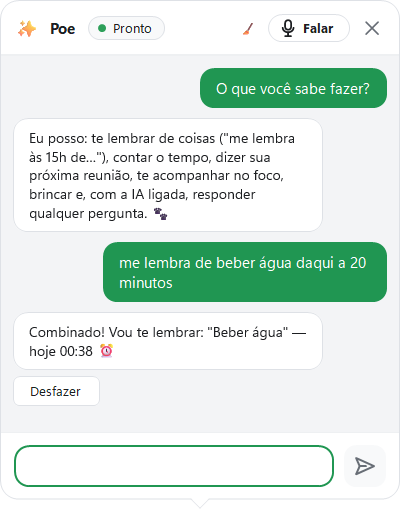
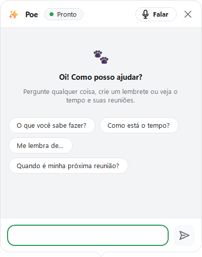
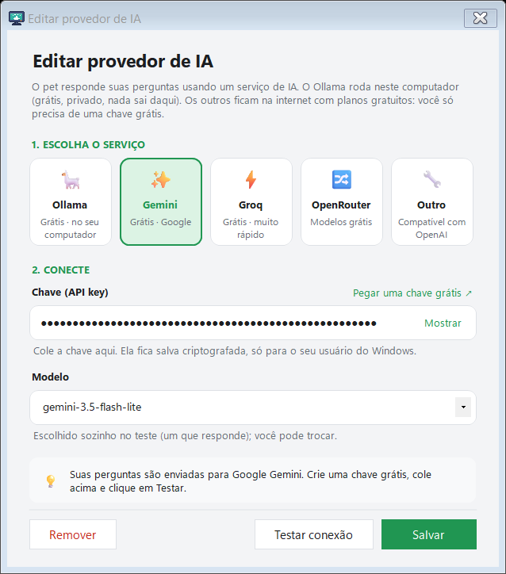
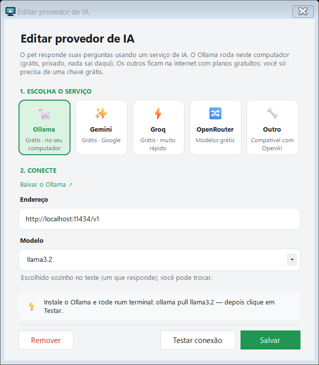
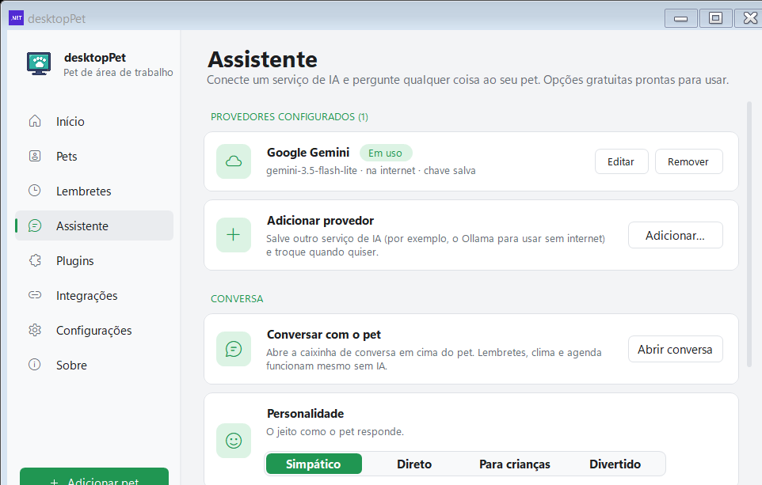

# Pergunte ao pet

[Home](Home.md) · [Instalação](Instalacao.md) · [Primeiros passos](Primeiros-passos.md) · [Painel de pets](Painel-de-pets.md) · [Lembretes e Pomodoro](Lembretes-e-pomodoro.md) · [Agenda e e-mails](Agenda-e-e-mails.md) · [Pet virtual e brinquedos](Pet-virtual-e-brinquedos.md) · [Plugins e integrações](Plugins-e-integracoes.md) · [Crie o seu pet](Crie-o-seu-pet.md) · [Atalhos e comandos](Atalhos-e-comandos.md) · [Para desenvolvedores](Para-desenvolvedores.md) · [Perguntas frequentes](Perguntas-frequentes.md) · [Changelog](Changelog.md)

O pet entende perguntas. A conversa acontece num balão que abre em cima dele, e funciona em dois níveis:

- **Sem IA**, o próprio programa responde o que dá para responder no seu computador: lembretes escritos como frase, o tempo, a próxima reunião e o estado do computador.
- **Com IA**, o pet manda a pergunta para um serviço de IA e responde com o que ele disse — com a personalidade que você escolheu.

## Como abrir a conversa

São cinco caminhos, e todos chegam na mesma janela de conversa:

| Caminho | Onde fica |
| --- | --- |
| `Perguntar ao pet…` | Menu do botão direito no pet (item em negrito). |
| Botão do balão azul | Passando o mouse sobre o pet, aparece um botão redondo azul ao lado da cabeça dele. |
| `💬 Perguntar` | Botão do cartão "SEU PET" na página **Início** do painel. |
| `Abrir conversa` | Configurações → **Assistente** → seção **Conversa**. |
| Atalho de teclado | `Ctrl+Alt+Espaço`, depois de ligado em Configurações → **Assistente**. |

*O item "Perguntar ao pet…" fica no menu do próprio pet, logo abaixo das ações do pet virtual.*

*A conversa em balões: a pergunta do usuário à direita, a resposta do pet à esquerda.*

*Quando a conversa está vazia, o pet sugere por onde começar.*

### A janela de conversa

- Abre **em cima do pet**, com a ponta do balão apontando para a cabeça dele. Se não couber acima (o pet está no topo da tela), o balão abre embaixo, sem a ponta.
- No cabeçalho: o nome do pet, uma pílula de estado que fica **Pronto** (ou **Pensando…** enquanto o pet trabalha, com o ponto verde quando há um serviço de IA configurado), o botão `🎤 Falar`, o botão `🧹` (limpar a conversa, que aparece quando há mensagens) e o `✕` para fechar.
- O campo de texto aceita até 1000 caracteres; `Enter` envia.
- Enquanto a janela está aberta, **todos os pets param de andar** (a janela segura o movimento, como as outras do programa).
- Clicar fora fecha a janela — exceto enquanto o Windows está ditando ou enquanto o pet está pensando.

### O balão pequeno (botão do mouse sobre o pet)

Passando o mouse sobre o pet, aparecem dois botões redondos ao lado da cabeça:

- **Azul (balão)** — abre o balão pequeno para escrever. A dica do botão é *"Mandar mensagem"*.
- **Verde (microfone)** — abre o mesmo balão já com a voz ligada. A dica do botão é *"Falar (ditado do Windows)"*.

Os dois somem cerca de 700 ms depois que o mouse sai do pet. O balão pequeno tem o campo de texto, o botão de enviar (que vira microfone quando não há texto), o botão que **abre a conversa completa** e o `✕`. A resposta do pet nesse balão aparece no balão de fala normal, com os botões **Responder** e **Abrir a conversa** — e a pergunta também entra na conversa completa.

O par de botões é ligado por padrão. Para desligar: Configurações → **Assistente** → **Botão "Perguntar" no pet**.

### O atalho de teclado

Em Configurações → **Assistente** → **Atalho para perguntar** você escolhe entre:

- `Desligado` (padrão)
- `Ctrl+Alt+Espaço`
- `Ctrl+Shift+Espaço`
- `Ctrl+Alt+A`
- `Ctrl+Alt+Q`

O atalho é global: funciona em qualquer programa e abre a conversa em cima do pet. Se outro programa já estiver usando o atalho escolhido, o programa avisa na barra de status (*"{atalho} já está sendo usado por outro programa."*) e, depois de um tempo, o pet diz no balão: *"O atalho {0} já é usado por outro programa, então ele não abre minhas perguntas. Escolher outro?"*, com o botão **Escolher outro**.

## O que o pet responde sem IA

Antes de chamar qualquer serviço, o programa tenta responder sozinho. Estas perguntas são resolvidas pelo próprio programa, **sem precisar de IA** — e sem mandar nada para a internet:

| Pergunta | O que o pet responde |
| --- | --- |
| "me lembra de beber água daqui a 20 minutos" | Cria o lembrete na hora: *"Combinado! Vou te lembrar: "Beber água" — hoje 00:38 ⏰"*, com o botão **Desfazer**. |
| "Como está o tempo?" | A previsão da cidade configurada no plugin Clima (a consulta ao serviço de tempo usa a internet). |
| "Quando é minha próxima reunião?" | A próxima reunião da agenda (Google ou Outlook), usando os eventos já lidos. |
| "como está o computador?" / "memória" / "CPU" | *"O computador: CPU em {0}%, memória em {1}%. Você tem {2} lembrete(s) ligado(s). 💻"* |
| "O que você sabe fazer?" | A lista do que ele dá conta de fazer. |

O pet reconhece a pergunta por palavra-chave, em português, inglês e espanhol (por exemplo, "tempo", "clima", "chuva", "guarda-chuva" para o clima; "reunião", "agenda", "meeting" para a agenda).

Quando a frase pede um lembrete e o tempo não fica claro ("me lembra de comprar pão"), o pet explica o que precisa: *"Não entendi quando. Tente "às 15h", "daqui a 20 minutos", "amanhã às 9" ou "todo dia às 8"."*

### Lembrete escrito como frase

O pet entende o tempo em português por expressões regulares, sem depender de IA: "às 15h", "às 15:30", "as 3 da tarde", "daqui a 20 minutos", "em meia hora", "em 2 horas", "amanhã às 9:30", "todo dia às 8", "a cada 30 minutos". "Às 3" dito às 14h vira 15h, e um horário que já passou hoje vira amanhã.

A IA entra só como reforço: quando o programa não consegue ler o horário da frase, e há um serviço configurado, a IA reescreve a frase num dos formatos aceitos e o programa **lê o horário de novo, localmente**. A IA nunca decide o horário do lembrete.

### Pergunta livre sem IA configurada

Se você perguntar algo livre e não houver serviço de IA configurado, a conversa responde:

> *"Eu respondo perguntas livres depois que um serviço de IA estiver configurado (é grátis). Lembretes, clima e reuniões já funcionam aqui."*

Com o botão **Configurar IA**, que abre a página **Assistente** do painel.

## Os provedores de IA

Configurações → **Assistente** → **Adicionar…** abre a janela **Adicionar provedor de IA**, em dois passos: **1. Escolha o serviço** e **2. Conecte**.

Os serviços vêm prontos, com endereço e modelo já preenchidos:

| Cartão | Endereço | Modelo padrão | Chave | Onde roda |
| --- | --- | --- | --- | --- |
| 🦙 Ollama | `http://localhost:11434/v1` | `llama3.2` | não precisa | neste computador |
| ✨ Gemini | `https://generativelanguage.googleapis.com/v1beta/openai` | `gemini-flash-lite-latest` | precisa | na internet |
| ⚡ Groq | `https://api.groq.com/openai/v1` | `llama-3.3-70b-versatile` | precisa | na internet |
| 🔀 OpenRouter | `https://openrouter.ai/api/v1` | `openrouter/free` | precisa | na internet |
| 🔧 Outro | você digita (começa em `https://`) | você digita | o campo aparece, mas é opcional | você decide |

Todos falam o mesmo formato de requisição (`chat/completions` da OpenAI), então o cartão "Outro" serve para qualquer serviço compatível.

O campo **Endereço** aparece só nos cartões que deixam você mudar o endereço (Ollama e "Outro"); nos demais, o endereço é fixo. No cartão "Outro" o campo da chave aparece, mas é opcional — muitos serviços compatíveis aceitam requisição sem chave.

*O passo "2. Conecte": a chave, o endereço e o modelo.*

*Ollama é local: o campo da chave some e aparece o endereço da porta.*

### Onde colocar a chave e como ela fica guardada

1. Configurações → **Assistente** → **Adicionar…**
2. Escolha o serviço no passo **1. Escolha o serviço**.
3. No passo **2. Conecte**, cole a chave no campo **Chave (API key)**.

Ao lado do campo há o link **Pegar uma chave grátis** (no Ollama, **Baixar o Ollama**) e o botão **Mostrar** / **Ocultar**, que revelam o que está escrito.

A chave **nunca é gravada em texto puro**. O programa criptografa com DPAPI (`ProtectedData`), no escopo do usuário do Windows (`DataProtectionScope.CurrentUser`), e guarda o resultado em base64 na chave `AiKey` do `DesktopPet.config`. Na prática:

- Só a mesma conta do Windows, neste computador, consegue ler a chave.
- A chave **não entra no backup** (`.desktoppet`) quando você exporta seus pets e configurações.
- Ao remover um provedor, a chave guardada dele é apagada junto (o programa pergunta: *"Remover {0}? A chave salva também é apagada."*).

### Testar conexão

O botão **Testar conexão** faz três coisas antes de salvar:

1. **Lista os modelos** que o serviço oferece (`GET /models`).
2. **Faz uma pergunta de prova** ("Oi") em até 6 candidatos — o modelo salvo, os preferidos do serviço e os demais, do mais novo para o mais velho, ignorando modelos de imagem, voz e embedding.
3. **Guarda o primeiro que responde** e preenche a lista de modelos com os candidatos.

Só depois de um teste bem-sucedido o serviço é salvo. Se você mexer na chave ou no endereço depois de testar, o teste é refeito na hora de salvar. A faixa colorida da janela mostra o que está acontecendo: azul conferindo, verde *"Conectado! {n} modelo(s) disponíveis. Usando: {modelo}"*, vermelha com o motivo da falha.

Serviços na internet precisam de endereço `https://` (ou `localhost`); com outro esquema, o programa recusa com *"o endereço precisa começar com https:// (ou ser neste computador)"*.

### Vários provedores ao mesmo tempo

Você pode salvar quantos quiser — por exemplo, Gemini na internet e Ollama local. A lista **Provedores configurados (n)** mostra, para cada um: o nome, `modelo · neste computador` ou `· na internet`, e `· chave salva` quando há chave; o selo **Em uso** no serviço atual; e os botões **Usar**, **Editar** e **Remover**.

Trocar de serviço (botão **Usar**) faz o pet **esquecer a conversa** que estava em andamento.

*A página Assistente: os provedores salvos em cima, as opções de conversa embaixo.*

### A personalidade

Em Configurações → **Assistente** → **Personalidade** você escolhe um de quatro jeitos de responder. A escolha entra na instrução enviada ao serviço:

| Personalidade | Instrução enviada |
| --- | --- |
| **Simpático** (padrão) | "Seja simpático e carinhoso." |
| **Direto** | "Seja direto e objetivo, sem brincadeiras." |
| **Para crianças** | "Explique como se fosse para uma criança de 8 anos, com palavras simples e um exemplo." |
| **Divertido** | "Seja bem divertido e brincalhão, com uma piadinha quando couber, mas sem errar a informação." |

O resto da instrução é fixo: o pet responde como o próprio bichinho, em no máximo 3 frases curtas, sem markdown, listas ou títulos, e diz quando não sabe.

## A memória da conversa

O pet lembra do que foi dito antes, por isso o "**e depois?**" funciona:

- O programa guarda as **6 últimas trocas** (pergunta e resposta) e as reenvia na chamada seguinte, como mensagens de usuário e de assistente.
- A conversa é esquecida **depois de 15 minutos de silêncio**.
- O botão `🧹` no cabeçalho limpa o histórico: o pet começa do zero.
- Trocar o provedor de IA em uso também limpa a conversa.

O histórico fica **só na memória do programa**: nada é gravado em disco.

## Ditado por voz

Há dois caminhos de voz:

**1. O botão `🎤 Falar` da conversa, e o botão de microfone do balão pequeno** usam o reconhecedor de fala do próprio Windows, **sem abrir nenhuma janela**. O programa grava um script PowerShell em `%LocalAppData%\DesktopPet\ouvir.ps1`, roda `powershell.exe -NoProfile -NonInteractive -ExecutionPolicy Bypass -File` e lê a frase pelo teclado ("microfone pronto", o texto, ou o motivo da falha). O botão fica verde enquanto escuta, um segundo clique cancela, e o que foi ouvido vira a mensagem.

Os textos que aparecem nesse caminho:

- *"Preparando o microfone…"*
- *"Ouvindo… pode falar"*
- *"Ouvindo"* (no botão)
- *"Parar de ouvir"*
- *"Não ouvi nada. Clique no microfone para tentar de novo."*

**2. O ditado do Windows (Win+H)** aparece como saída quando o microfone falha. O pet oferece **Usar o ditado** (abre o balão pequeno e aciona o `Win+H` do Windows, que escreve o que você fala no campo) e, no caso da privacidade, **Abrir a configuração** (`ms-settings:privacy-speech`).

O reconhecimento por microfone precisa do **"Reconhecimento de fala online"** ligado no Windows (Configurações → Privacidade → Fala). Sem isso, o pet avisa: *"Para entender o que você fala, o Windows precisa do "Reconhecimento de fala online" ligado (Configurações → Privacidade → Fala). Ou use o ditado do Windows (Win+H)."*

## O aviso de privacidade

Na **primeira** pergunta enviada para um serviço na internet, aparece um aviso:

> *"Suas perguntas serão enviadas para {serviço} para serem respondidas.*
>
> *Não escreva senhas nem dados pessoais. Continuar?"*

A resposta fica guardada na configuração e o aviso não se repete. Ele **não aparece** para o Ollama, porque nada sai do computador. Se você recusar, a conversa responde *"Tudo bem, nada foi enviado."*

## Sem internet

- **Sem serviço de IA configurado:** a conversa continua funcionando no nível local (lembretes, clima, agenda, estado do computador) e avisa que perguntas livres esperam a configuração de uma IA.
- **Clima sem internet:** o pet responde *"Não consegui ver o tempo agora (sem internet?)."*
- **Com IA na internet e sem conexão:** a conversa mostra *"Não consegui responder: {motivo}"*. Quando o serviço responde com um erro, o motivo vem traduzido:
  - chave recusada (401/403): *"a chave foi recusada: confira"*
  - modelo inexistente (404): *"esse modelo não existe lá"*
  - limite do plano grátis (429): *"o limite grátis do serviço acabou por agora: tente mais tarde"*
  - serviço sobrecarregado (500/502/503): *"o serviço está sobrecarregado agora: tente de novo daqui a pouco"*
- **Serviço local parado (Ollama) ou demora demais:** aqui o motivo é a mensagem do erro do próprio Windows/.NET. O tempo limite é de 45 s para serviço na internet e 120 s para o serviço local. Na janela de configuração do provedor, o botão **Testar conexão** traduz esses dois casos: *"Ollama não está rodando neste computador. Instale em ollama.com (ou abra ele) e tente de novo."* e *"o serviço demorou demais para responder"*.
- **Ollama local** é a saída para conversar sem internet: ele roda no seu computador e nenhuma pergunta sai da máquina.

## Modelo que se conserta sozinho

Se o serviço devolve erro 404, 400, 500 ou 503, o programa lista os modelos de novo, tenta outros candidatos e refaz a pergunta. Quando o modelo salvo foi aposentado pelo serviço (404/400), a troca é guardada para as próximas perguntas.

## Detalhes que podem passar batido

- A resposta da IA é limpa antes de aparecer: blocos de raciocínio, blocos de código, títulos e negrito são removidos, e as listas viram "• ".
- O envio usa o formato `chat/completions`, com `temperature` 0,6 e no máximo 800 tokens por resposta.
- O modelo é escolhido pelo teste de conexão; depois disso você pode trocar à mão na lista de modelos.
- Enquanto o pet pensa, a animação muda para as de "pensar"; quando a resposta chega, ele表示感谢 com uma animação de alegria.

## Ver também

- [Plugins e integrações](Plugins-e-integracoes.md) — a página Assistente dentro do painel e as integrações com o Claude Code.
- [Lembretes e Pomodoro](Lembretes-e-pomodoro.md) — os lembretes criados por frase e o que mais o pet avisa.
- [Agenda e e-mails](Agenda-e-e-mails.md) — de onde vêm o tempo e a próxima reunião que o pet responde.
- [Atalhos e comandos](Atalhos-e-comandos.md) — a lista completa de atalhos, incluindo o de perguntar.
- [Para desenvolvedores](Para-desenvolvedores.md) — como o pedido ao serviço de IA é montado.

## Onde fica no código

- `src/Portable/Chat.cs` — a janela de conversa (`FormChat`), o balão pequeno (`QuickChat`) e o reconhecedor de voz (`VoiceInput`, com o script `ouvir.ps1`).
- `src/Portable/FormAi.cs` — a janela de provedor de IA (`FormAiSettings`), a janela de pergunta de uma só vez (`FormAsk`), o `Win+H` (`VoiceTyping`) e o aviso de privacidade (`PrivacyOk`).
- `src/Portable/AiAssistant.cs` — a lista de provedores, a criptografia da chave (DPAPI), o histórico da conversa, a personalidade e o pedido ao serviço; `AiProfiles` guarda os provedores salvos.
- `src/Portable/FormSettings.Extras.cs` — a página **Assistente** do painel (lista de provedores, conversa, personalidade, botão "Perguntar" e atalho).
- `src/Portable/HoverAsk.cs` — os dois botões redondos que aparecem sobre o pet.
- `src/Portable/HideHotkey.cs` — o atalho global de perguntar e as opções de atalho.
- `src/Portable/PetMenu.cs` — o item `Perguntar ao pet…` do menu do pet.
- `src/Portable/SmartReminder.cs` — a leitura das frases de lembrete e o texto em português das horas.
- `src/Portable/PetBackup.cs` — a lista de configurações do backup (a chave de IA não está nela).
- `src/lang/pt-BR.json` — os textos da interface citados nesta página.
