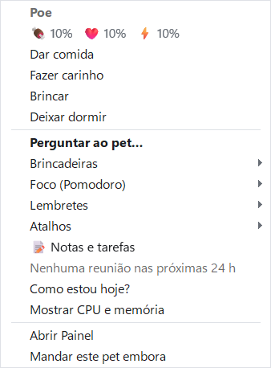
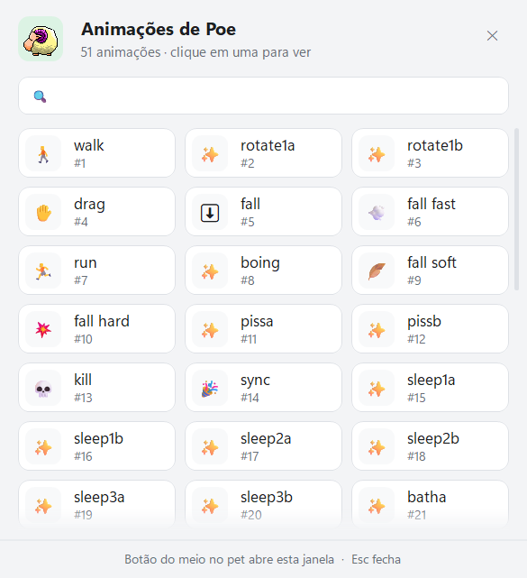
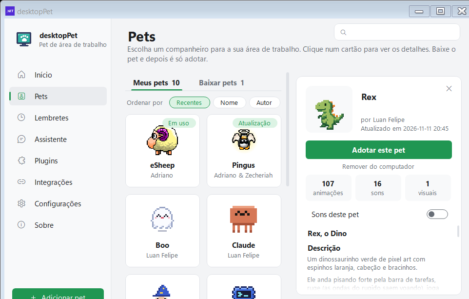
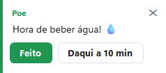
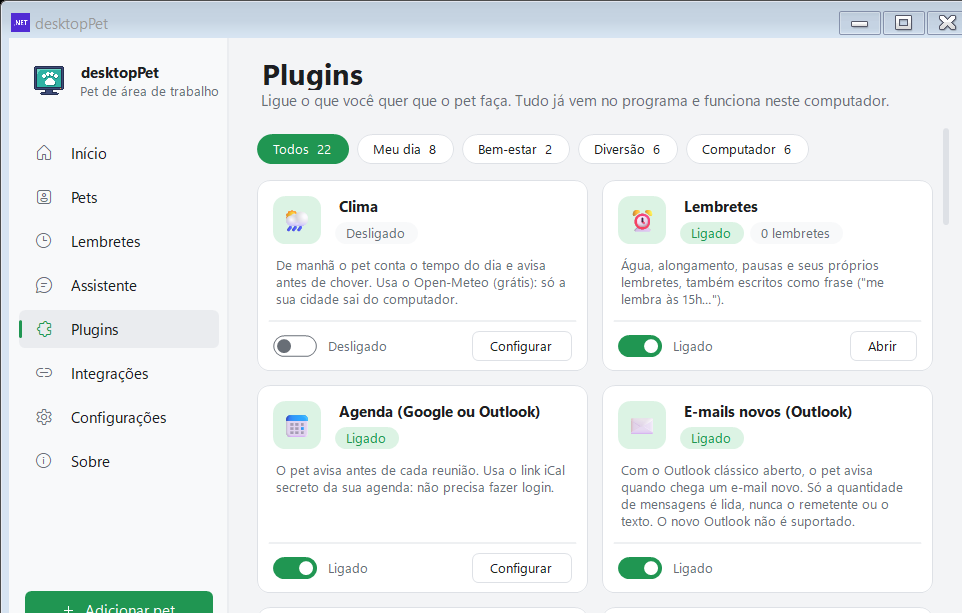

# Pet virtual e brincadeiras

[Home](Home.md) · [Instalação](Instalacao.md) · [Primeiros passos](Primeiros-passos.md) · [Painel de pets](Painel-de-pets.md) · [Pergunte ao pet](Pergunte-ao-pet.md) · [Lembretes e Pomodoro](Lembretes-e-pomodoro.md) · [Agenda e e-mails](Agenda-e-e-mails.md) · [Plugins e integrações](Plugins-e-integracoes.md) · [Crie o seu pet](Crie-o-seu-pet.md) · [Atalhos e comandos](Atalhos-e-comandos.md) · [Para desenvolvedores](Para-desenvolvedores.md) · [Perguntas frequentes](Perguntas-frequentes.md) · [Changelog](Changelog.md)

O menu do botão direito sobre o pet é o painel de controle dele: as necessidades do bicho, as brincadeiras, o check-in de humor, o monitor do computador e mais. Esta página explica o que tem em cada item e como cada um se comporta.

*O menu do pet: no topo, o nome dele e a régua "🍖 80%   ❤️ 80%   ⚡ 80%" (só aparece com o pet virtual ligado), depois os itens de cada recurso.*

## O pet virtual: fome, carinho e sono

Com o plugin **🍖 Pet virtual** ligado, cada pet passa a ter três necessidades independentes, guardadas em `%LocalAppData%\DesktopPet\needs.json`, uma entrada por pet:

| Necessidade | Queda por hora | De 80 a 0 (o valor inicial) |
| --- | --- | --- |
| Fome | 8 pontos | 10 h |
| Carinho | 6 pontos | cerca de 13 h |
| Energia (sono) | 5 pontos | 16 h |

As três começam em 80 e nunca passam de 100 nem de 0. Quando o programa fica fechado mais de 30 minutos, a queda é mais suave: nesse período nenhuma necessidade desce abaixo de 10.

### As quatro ações

O menu do pet ganha quatro itens logo abaixo da régua:

| Item do menu | O que muda | O que o pet diz |
| --- | --- | --- |
| **Dar comida** | fome +35, energia +5 | "Hmm, que delícia! Valeu!" |
| **Fazer carinho** | carinho +30 | "Hehe, adoro carinho!" |
| **Brincar** | carinho +15, energia −12, fome −5 | "Que divertido!" |
| **Deixar dormir** | energia +45 | "Zzz… agora sim, que soneca boa!" |

"Deixar dormir" é a única que fala depois da animação: o recado aparece quando o pet acorda, porque só depois de uma boa soneca faz sentido dizer isso.

### Quando o pet pede

Um temporizador de 1 minuto confere as necessidades. Quando alguma fica baixa, o pet pede uma vez — no máximo uma vez por hora:

| Necessidade baixa | Aviso | Botão da ação |
| --- | --- | --- |
| Fome abaixo de 25 | "Estou com fome… 🍖" | Dar comida |
| Carinho abaixo de 25 | "Estou com saudade… me faz um carinho? ❤️" | Fazer carinho |
| Energia abaixo de 20 | "Que cansaço… posso tirar um cochilo? 💤" | Deixar dormir |

Todos os avisos trazem ainda a opção **"Depois"**, que apenas adia o pedido.

### A animação certa para cada ação

Cada ação roda a primeira animação que o pet realmente tem, numa lista que muda de pet para pet. Os pets de outros autores usam os nomes usuais ("eat", "love", "dance", "sleep"…). Exemplos:

| Pet | Comer | Carinho | Brincar | Dormir |
| --- | --- | --- | --- | --- |
| Rex | eat meat, pizza, popcorn, drink | in love, love, tail wag, wink | soccer, dance, juggle, basketball, guitar, party | sleep |
| Pingo | eat fish, hold fish | love, blow kiss, giggle | dance, ice skate, juggle fish, belly drum, hop hop | sleep |
| Boo | ice cream, bubble gum, jelly | hearts, wink kiss, blow kiss, giggle | yo-yo, dance, juggle, spin, bounce | sleep |
| Mago | potion, brew | rabbit, owl, bow | juggle, fireworks, dance, bubbles | sleep |
| Nuvi | coffee, download | love, happy, wink | dance, matrix, happy | sleep |
| Claude | eat, coffee, chef | flower, wave | dance, skate, music, confetti, spin | sleep |
| eSheep (ovelha original) | eat | flower, boing | jump, boing, run | sleep1a, sleep2a, sleep3a |

*O seletor de animações (botão do meio do mouse) mostra o que o pet tem: 51 animações no pet da captura.*

*Os números do painel de detalhes dizem quanto cada pet traz: o Rex tem 107 animações, 16 sons e 1 visual.*

## Brincadeiras

O submenu **Brincadeiras** tem três itens e só aparece quando o plugin **🥠 Brincadeiras** está ligado. Os textos das frases ficam no arquivo de idioma, separados por "|", e o programa sorteia um:

- **Biscoito da sorte** — o pet come (uma das animações "eat", "eat fish", "eat meat", "cookie", "happy") e mostra um biscoito 🥠 com uma das 10 frases de `fun.fortunes`, por 14 segundos.
- **Bola 8 mágica** — o pet pergunta "Pense numa pergunta de sim ou não… e chacoalhe a bola!" e o balão fica na tela até você apertar **"Chacoalhar"**. Aí ele roda "think", "spin" ou "dizzy" e mostra uma das 12 respostas de `fun.ballAnswers` ("Sim!", "Não.", "Com certeza.", "Os sinais dizem que sim…"), por 10 segundos.
- **Conte uma piada** — uma das 6 piadas de `fun.jokes`, como "Qual é o café mais perigoso do mundo? O ex-presso.", por 14 segundos.

*Os balões do pet trazem o nome dele, a frase e até dois botões de ação.*

## Como estou hoje?

O item **"Como estou hoje?"** do menu pergunta na hora. O plugin **😊 Como estou hoje** (categoria Bem-estar) também faz a pergunta sozinha, uma vez por dia, a partir do horário escolhido (15h por padrão).

A pergunta é "Como você está hoje?" e a resposta são cinco carinhas:

| Carinha | Resposta do pet | Animação |
| --- | --- | --- |
| 😄 | "Que maravilha! Vamos manter essa energia! ✨" | happy, cheer, dance, jump |
| 🙂 | "Que bom! Tenha um ótimo dia." | happy, cheer, dance, jump |
| 😐 | "Ok. Que tal uma voltinha ou um copo d'água?" | — |
| 😕 | "Sinto muito. Vai com calma, uma coisa de cada vez. Estou aqui." | love, hearts, hug, wave |
| 😢 | "Sinto muito que você esteja mal. Converse com alguém de confiança e seja gentil com você. ❤️" | love, hearts, hug, wave |

A resposta fica guardada em `%LocalAppData%\DesktopPet\mood.json`, com a data no formato `yyyy-MM-dd`. O botão **"Meu humor" › "Ver"** mostra as últimas duas semanas como uma fileira de carinhas, da mais antiga para a mais recente, com "·" nos dias sem resposta. Na página Início do painel, o cartão **Humor** mostra a carinha de hoje.

*A página Início mostra o pet em uso e os números do dia: Foco hoje, Pausas, Lembretes e Humor.*

## Pets que conversam entre si

Com o plugin **🐑 Pets se cumprimentam** ligado, o programa procura pets que estejam lado a lado na tela. A cada 700 milissegundos ele confere as posições: dois pets estão "junto" quando a distância entre os centros é menor que 80% da metade da soma das duas larguras, a base de um está a menos de 24 pixels da base do outro e os centros estão a mais de 4 pixels de distância. O mesmo par não se cumprimenta de novo por 90 segundos.

Em 40% dos encontros os dois conversam; nos outros, apenas acenam, dançam ou trocam carinho:

| Tipo | Animações |
| --- | --- |
| Cumprimento | wave, hello, happy |
| Comemoração | dance, jump, cheer, spin |
| Carinho | love, in love, hearts, blow kiss, wink |

### A conversa

Quando conversam, um dos dois fala primeiro e o outro responde 2,2 segundos depois, com a frase que faz par com a primeira. São 8 pares de frases guardados em `chat.first` e `chat.answer`, como "Oi! Dia bonito, né?" e "Perfeito para passear na barra de tarefas!".

Cada frase sai num balão próprio do pet que falou, ao lado do balão principal, sem botões, e some sozinho depois de 4 segundos. Só há uma conversa por vez (uma janela de 8 segundos entre elas), e a conversa não acontece em horário de silêncio nem por cima de um balão que esteja falando com você.

## Monitor de CPU e memória

O plugin **📊 Monitor do PC** mede o computador; o item **"Mostrar CPU e memória"** do menu do pet liga e desliga o mesmo recurso (e fica marcado quando está ligado).

O programa mede a cada 2 segundos: a CPU com `GetSystemTimes`, a memória com `GlobalMemoryStatusEx` e o espaço livre do disco onde o Windows está instalado. A plaquinha com as barras de **CPU** e **RAM** e o texto do espaço livre ("C: 128 GB livres") aparece ao lado do pet **só enquanto o mouse está sobre ele** — ela é transparente para o clique, então o pet continua usável.

Se a CPU ficar acima de 90% por 1 minuto, o pet comenta: "Ufa, o computador está trabalhando muito: CPU em {0}%!". Esse aviso sai no máximo uma vez a cada 30 minutos.

## Onde ligar cada coisa

Tudo isso se liga na página **Plugins** do painel, e os itens do menu do pet somem quando o plugin correspondente está desligado:

| Cartão | Categoria | O que liga |
| --- | --- | --- |
| 🍖 Pet virtual | Diversão | fome, carinho e sono |
| 🐑 Pets se cumprimentam | Diversão | a conversa entre os pets |
| 🥠 Brincadeiras | Diversão | biscoito, bola 8 e piadas |
| 😊 Como estou hoje | Bem-estar | a pergunta diária e o histórico |
| 📊 Monitor do PC | Computador | a plaquinha de CPU, RAM e disco |
| 🔋 Reações ao computador | Computador | bom dia, boa noite, bateria e downloads |

*Na página Plugins, os cartões trazem o nome, a descrição, o estado e o botão Configurar; no topo ficam os filtros por categoria.*

## Ver também

- [Primeiros passos](Primeiros-passos.md) — o primeiro uso do programa e a tela de apresentação.
- [Painel de pets](Painel-de-pets.md) — a galeria de pets e o painel de detalhes de cada um.
- [Lembretes e Pomodoro](Lembretes-e-pomodoro.md) — os lembretes, o foco e as notas que dividem o menu do pet.
- [Plugins e integrações](Plugins-e-integracoes.md) — todos os cartões da página Plugins e as pontes com o Claude Code.
- [Atalhos e comandos](Atalhos-e-comandos.md) — os atalhos de teclado e os argumentos de linha de comando.

## Onde fica no código

- `src/Portable/VirtualPet.cs` — as três necessidades, o decaimento, o arquivo `needs.json` e os avisos de fome, saudade e cansaço.
- `src/Portable/PetActions.cs` — a lista de animações de cada ação, por pet, e a lista comum dos pets de outros autores.
- `src/Portable/PetMenu.cs` — o menu do botão direito: a régua das necessidades, as quatro ações, as brincadeiras, "Como estou hoje?" e "Mostrar CPU e memória".
- `src/Portable/Fun.cs` — o biscoito da sorte, a bola 8 e as piadas.
- `src/Portable/Companions.cs` — `PetsMeet` (a regra de proximidade, o sorteio da conversa e os pares de frases) e `ComputerEvents`.
- `src/Portable/Mood.cs` — as cinco carinhas, as respostas, o arquivo `mood.json` e o histórico de 14 dias.
- `src/Portable/PcMonitor.cs` — a leitura da CPU, da RAM e do disco, a plaquinha ao lado do pet e o aviso de computador ocupado.
- `src/Portable/SpeechBubble.cs` — os balões, o balão de conversa entre pets (`SpeechBubble.Chat`) e o horário de silêncio.
- `src/Portable/FormSettings.Plugins.cs` — os cartões da página Plugins e o botão "Meu humor › Ver".
- `src/Portable/Weather.cs` — `PluginSwitch`, a chave que liga e desliga cada plugin.
- `src/lang/pt-BR.json` — os textos (`vpet.*`, `fun.*`, `mood.*`, `mon.*`, `chat.first`, `chat.answer`, `menu.games`, `menu.fortune`, `menu.ball`, `menu.joke`, `menu.mood`, `menu.monitor`).
