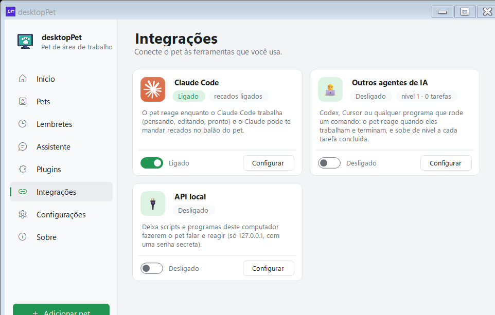
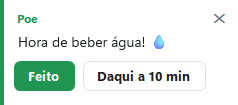
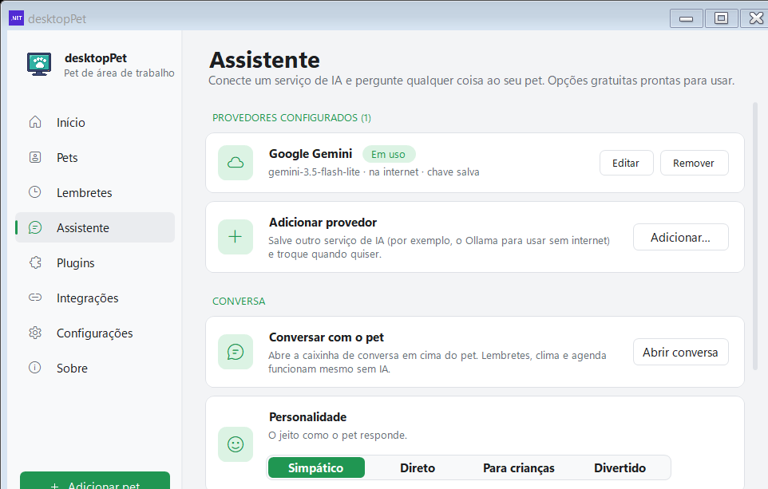

# Plugins e integrações

[Home](Home.md) · [Instalação](Instalacao.md) · [Primeiros passos](Primeiros-passos.md) · [Painel de pets](Painel-de-pets.md) · [Pergunte ao pet](Pergunte-ao-pet.md) · [Lembretes e Pomodoro](Lembretes-e-pomodoro.md) · [Agenda e e-mails](Agenda-e-e-mails.md) · [Pet virtual e brinquedos](Pet-virtual-e-brinquedos.md) · [Crie o seu pet](Crie-o-seu-pet.md) · [Atalhos e comandos](Atalhos-e-comandos.md) · [Para desenvolvedores](Para-desenvolvedores.md) · [Perguntas frequentes](Perguntas-frequentes.md) · [Changelog](Changelog.md)

A janela de Configurações tem duas páginas que ligam o pet ao que você faz no dia: **Plugins** (os recursos que já vêm no programa) e **Integrações** (as pontes com programas de fora, como o Claude Code). Esta página explica o que tem em cada uma e como ligar, desligar e configurar.

## A página Plugins

Cada recurso do programa é um cartão com um ícone, o nome, uma frase explicando o que ele faz, o estado (Ligado/Desligado) e um botão **Configurar** quando há alguma opção a escolher. Nada é baixado: os plugins já estão no executável e rodam neste computador.


*Os 22 plugins ficam em cartões, filtrados pelas categorias "Meu dia", "Bem-estar", "Diversão" e "Computador".*

### As categorias

Os chips no topo filtram os cartões e mostram a contagem:

| Categoria | Quantos | O que entra |
| --- | --- | --- |
| Todos | 22 | Todos os cartões |
| Meu dia | 8 | Clima, Lembretes, Agenda, E-mails, Foco, Notas, Avisos, Timer |
| Bem-estar | 2 | Cuidar de você, Como estou hoje |
| Diversão | 6 | Pet virtual, Pets se cumprimentam, Brincadeiras, Música e jogos, Visitas, Empurrar janelas |
| Computador | 6 | Monitor do PC, Reações ao computador, Atalhos, Tela cheia e Não perturbe, Área de transferência, Memória |

### Os 22 plugins

| Plugin | O que faz |
| --- | --- |
| Clima | De manhã o pet conta o tempo do dia e avisa antes de chover. Usa o Open-Meteo (grátis): só a sua cidade sai do computador. |
| Lembretes | Água, alongamento, pausas e os seus próprios lembretes, também escritos como frase ("me lembra às 15h…"). |
| Agenda (Google ou Outlook) | Avisa antes de cada reunião. Usa o link iCal secreto da sua agenda: não precisa fazer login. |
| E-mails novos (Outlook) | Com o Outlook clássico aberto, avisa quando chega um e-mail novo. Só a quantidade de mensagens é lida, nunca o remetente ou o texto. O novo Outlook não é suportado. |
| Foco (Pomodoro) | Blocos de foco com pausas. Durante o foco o pet fica em silêncio e guarda os avisos para depois. |
| Notas e tarefas | Um bloco de notas, uma lista de tarefas e uma contagem regressiva, guardados pelo pet. Abre pelo menu dele. |
| Avisos | Com os pets escondidos (Ctrl+Alt+P), os avisos viram notificações do Windows. O horário de silêncio deixa tudo quieto à noite. |
| Timer | Um timer que fica junto do pet: tempo restante, barra de progresso, Pausar, +5 min e Cancelar. |
| Cuidar de você | Sugere uma pausa depois de muito tempo sem parar, fica feliz quando você volta e comemora quando você fecha um programa usado por horas. Só usa a hora da última tecla ou movimento do mouse e o nome do programa na frente. |
| Como estou hoje | Uma vez por dia o pet pergunta como você está e guarda o histórico das últimas duas semanas. |
| Pet virtual | O pet sente fome, quer carinho e fica cansado. Dê comida, carinho, brinque e deixe dormir pelo menu do pet. |
| Pets se cumprimentam | Quando dois pets se encontram na tela, eles batem um papo rápido, acenam, dançam ou trocam carinho. |
| Brincadeiras | Biscoito da sorte, bola 8 mágica e piadas, pelo menu do pet. |
| Música e jogos | O pet dança quando começa uma música nova no Spotify e pergunta como foi o jogo quando você volta de uma partida longa. |
| Visitas | De vez em quando um bichinho visita o pet: borboleta, passarinho, abelha ou joaninha. |
| Empurrar janelas | Um pet andando que esbarra numa janela pequena apoiada no mesmo chão empurra a janela. Janelas grandes e maximizadas nunca se movem. |
| Monitor do PC | Passe o mouse sobre o pet para ver CPU, memória e espaço livre. O pet também comenta quando o computador está muito ocupado. |
| Reações ao computador | Dá bom dia e boa noite, avisa quando a bateria está acabando e comemora downloads concluídos. |
| Atalhos | Pastas, programas e sites para abrir pelo menu do pet. |
| Tela cheia e Não perturbe | Enquanto um jogo, vídeo ou apresentação ocupa a tela, os pets se escondem e voltam depois. No Não perturbe do Windows, ficam quietos. |
| Área de transferência | Quando você copia um link ou um texto longo, o pet oferece abrir, resumir ou traduzir. As últimas cópias ficam só na memória, nunca no disco. |
| Memória | Quando a RAM fica cheia por alguns minutos, o pet oferece uma arrumada. Libera memória por um tempo; o Windows volta a ocupá-la aos poucos. |


*Os itens do menu do pet que vêm de um plugin (Brincadeiras, Foco, Lembretes, Atalhos, Notas e tarefas, Timer) somem do menu quando o plugin está desligado.*

### Como ligar e desligar

- **O interruptor do cartão** liga e desliga o plugin na hora. O estado do plugin é guardado na configuração do programa e vale para as próximas sessões.
- **O botão "Configurar"** abre uma janela pequena só com as opções daquele plugin. Quando não há nada a escolher, o botão não aparece.
- **Uma instalação nova começa com todos os plugins desligados.** Num computador que já usava uma versão anterior, o programa liga de volta os plugins que antigamente eram ligados por padrão (lembretes, foco, brincadeiras, atalhos, notas, cuidado com você, pets se cumprimentam, reações ao computador, e-mails do Outlook, tela cheia, avisos, música e visitas) e mantém o estado dos outros. Isso vale para plugins como Clima, Pet virtual, Monitor do PC e Memória: todos ficam desligados até você ligar.

### O que dá para configurar

| Plugin | Opções |
| --- | --- |
| Clima | Cidade (escolher…), Tempo do dia, Aviso de chuva, Tempo agora |
| Agenda | Link iCal (Configurar…) e Aviso de reunião (5, 10 ou 15 min) |
| Foco (Pomodoro) | Tempo de foco: 15, 25, 45 ou 50 min (padrão 25). Tempo de pausa: 5, 10 ou 15 min (padrão 5) |
| Como estou hoje | Horário da pergunta: 10h, 13h, 15h ou 17h (padrão 15h) e "Meu humor" (as últimas duas semanas) |
| Reações ao computador | Aviso de bateria fraca: 15%, 20%, 30% ou 40% (padrão 20%) e Carregador ligado e desligado |
| Avisos | Notificações quando escondido, Silêncio a partir de (desligado, 21h, 22h, 23h, 0h) e Silêncio até (6h, 7h, 8h, 9h) |
| Área de transferência | Oferecer ações e Últimas cópias |
| Música e jogos | Dizer a música |
| Memória | Quando oferecer (70%, 80%, 85%, 90%; padrão 85%), Arrumar sozinho, Arrumada simples e Arrumada completa |

O botão **Abrir** em vez de **Configurar** leva a outra página do painel: os lembretes abrem a página "Lembretes" e as notas e tarefas abrem o caderno do pet.

### Onde cada plugin guarda o que é dele

Os dados ficam em `%LocalAppData%\DesktopPet`, um arquivo por assunto:

| Arquivo | Conteúdo |
| --- | --- |
| `reminders.json` | Lembretes (inclusive os quatro prontos: água, alongamento, descanso dos olhos e pausa do almoço) |
| `mood.json` | Histórico do humor, uma entrada por dia |
| `notes.json` | Notas, tarefas e contagem regressiva |
| `launchers.json` | Atalhos de pastas, programas e sites |
| `needs.json` | Fome, carinho e energia de cada pet |
| `agent.json` | Porta e senha do canal local (usado pelas integrações) |

## A página Integrações

Integrações são pontes com programas de fora do pet. A página tem três cartões: **Claude Code**, **Outros agentes de IA** e **API local**.



*O cartão do Claude Code mostra o logo oficial e o estado dos recados (MCP).*

## Claude Code

A janela do Claude Code é dividida em quatro seções: **Conexão**, **Reações (hooks)**, **Recados (MCP)** e **Avançado**.

### Conexão

Duas linhas de status, com um botão **Atualizar** para reler:

- **Claude Code neste computador** — o programa procura o `claude.exe` (ou `claude.cmd`) no PATH e depois na pasta do aplicativo Claude. Se achar, mostra "Encontrado: {caminho}"; se não, "Não encontrado. Instale o Claude Code ou use o comando manual abaixo."
- **Ouvinte do pet** — mostra "Ouvindo o Claude Code na porta {0} (só neste computador)." quando o canal local está no ar, ou "Desligado: ligue as reações abaixo."

### Reações (hooks)

O pet reage enquanto o Claude Code trabalha: pensa, digita, roda comandos, pesquisa na web, chama outro agente e comemora quando termina.

Ligar a opção **Reagir ao Claude Code** faz três coisas:

1. Liga o ouvinte local do pet (o canal em `127.0.0.1`).
2. Pede confirmação mostrando o arquivo que vai ser mudado e o nome da cópia de segurança.
3. Escreve os hooks no arquivo de usuário do Claude Code, `%USERPROFILE%\.claude\settings.json`. Antes de escrever, o programa guarda uma cópia em `settings.json.desktoppet-backup` e mantém todo o resto do arquivo como estava.

Cada hook é um comando só:

```
curl.exe -s -m 2 -X POST -d x -H "X-DesktopPet: <segredo>" http://127.0.0.1:<porta>/hook/<evento>; exit 0
```

O tipo de ferramenta vem do endereço (um "matcher" por tipo), então o hook nunca lê o que o Claude está fazendo: só o nome do evento. O segredo é o token guardado em `%LocalAppData%\DesktopPet\agent.json`, e o `; exit 0` mantém o Claude Code quieto quando o pet não está rodando.

Os eventos gravados são dez:

| Evento do Claude Code | Endereço do hook | Reação do pet |
| --- | --- | --- |
| SessionStart | `/hook/SessionStart` | "Oi! Vamos programar juntos? 👋" |
| UserPromptSubmit | `/hook/UserPromptSubmit` | "O Claude está pensando… 🤔" |
| PreToolUse (Edit, Write, MultiEdit, NotebookEdit) | `/hook/PreToolUse/edit` | "Editando arquivos… ✏️" |
| PreToolUse (Bash, PowerShell) | `/hook/PreToolUse/run` | "Rodando um comando… ⚙️" |
| PreToolUse (Read, Grep, Glob) | `/hook/PreToolUse/read` | "Lendo o código… 📖" |
| PreToolUse (WebFetch, WebSearch) | `/hook/PreToolUse/web` | "Pesquisando na web… 🔎" |
| PreToolUse (Task, Agent) | `/hook/PreToolUse/agent` | "Chamando um agente ajudante…" |
| PostToolUseFailure | `/hook/PostToolUseFailure` | "Opa, algo falhou. O Claude está resolvendo." |
| Notification | `/hook/Notification` | "O Claude precisa de você! 👀" |
| Stop | `/hook/Stop` | "Pronto! ✅ O Claude terminou." |

Dois detalhes de comportamento:

- **Balões de progresso.** Os balões "pensando", "editando", "rodando" só aparecem se a opção **Balões de progresso do Claude Code** estiver ligada. O fim ("Pronto!") e o "precisa de você" aparecem sempre.
- **As animações não piscam.** O pet só troca de animação quando o tipo de trabalho muda, ou de 8 em 8 segundos.

O botão **Testar** roda um exemplo curto pela porta real: pensando → editando → rodando → pronto.



*Os recados aparecem no balão do pet, que acompanha o bichinho pela tela.*

### Recados (MCP)

A opção **Deixar o Claude falar pelo pet (MCP)** registra o programa como servidor MCP do Claude Code. O registro é feito pelo próprio comando do Claude Code (`claude mcp add`), então nenhum arquivo de configuração é editado à mão:

```
claude mcp add --scope user desktoppet -- "C:\...\DesktopPet.exe" --mcp
```

Se o Claude Code não for encontrado no computador, o programa copia esse comando para a área de transferência e mostra a caixa com ele, para você colar num terminal.

O servidor MCP fala JSON-RPC 2.0 por entrada e saída padrão (protocolo `2025-06-18`) e oferece três ferramentas:

| Ferramenta | O que faz |
| --- | --- |
| `pet_say` | Mostra uma frase de até 140 caracteres no balão do pet. |
| `pet_react` | Toca uma reação: thinking, working, editing, running, reading, searching, waiting, success, error, celebrating, waving. |
| `pet_status` | Confirma que o pet está rodando e ouvindo. |

Filtro importante: o `pet_say` recusa textos com caminhos, links, blocos de código ou sequências longas que pareçam chave. A resposta ao Claude é "Not shown: the pet never shows file paths, links, code or keys. Say it in plain words." — o recado fica escrito para quem está olhando a tela.


*O MCP usa o mesmo canal local do chat: a mensagem vai para o balão do pet e também entra na conversa.*

### Avançado

O botão **Abrir pasta** abre a pasta `%USERPROFILE%\.claude`, onde ficam o `settings.json` com os hooks e a cópia de segurança `settings.json.desktoppet-backup`.

## Outros agentes de IA

O segundo cartão cobre quem não é o Claude Code, com quatro linhas:

| Item | O que faz |
| --- | --- |
| Codex | Coloca o pet no `notify` do Codex, em `.codex\config.toml`. Se o Codex já tinha um notify próprio, ele é preservado (com uma cópia da linha original) e roda depois do pet. |
| Cursor | Adiciona hooks de arquivo editado e de resposta concluída em `.cursor\hooks.json`, sem apagar os hooks que você já tinha. |
| Qualquer outro programa | Um comando para rodar quando uma tarefa terminar (também `thinking`, `waiting`, `error`, `edit`, `run`). |
| Subir de nível | Cada tarefa que um agente de IA conclui vale um ponto; o pet comemora cada nível novo. |

O comando do item "Qualquer outro programa" é:

```
"C:\...\DesktopPet.exe" --agent=done
```

Ele avisa o pet que já está rodando e não falha se o pet estiver fechado. O nível começa em 1 e sobe de 3, 8, 15, 24… tarefas; a cada nível novo o pet comemora com "Nível {0}! Obrigado por todo o trabalho juntos 🎉".



*Os provedores de IA (Ollama, Gemini, Groq, OpenRouter) ficam na página Assistente, não em Plugins.*

## API local

O terceiro cartão deixa scripts e programas deste computador falarem com o pet. A escuta fica só em `127.0.0.1` (nunca na rede), protegida por uma senha aleatória guardada em `%LocalAppData%\DesktopPet\agent.json`, junto com a porta.

Endpoints disponíveis:

| Endpoint | O que faz |
| --- | --- |
| `POST /say` | Mostra um texto curto no balão do pet. |
| `POST /react` | Toca uma reação pelo nome da atividade. |
| `POST /hook/<evento>` | O mesmo caminho usado pelos hooks do Claude Code. |

O cabeçalho `X-DesktopPet` traz o segredo. A janela tem o botão **Copiar**, que copia um exemplo em PowerShell já pronto para funcionar:

```powershell
$c = Get-Content "$env:LOCALAPPDATA\DesktopPet\agent.json" | ConvertFrom-Json
Invoke-RestMethod -Method Post -Uri "http://127.0.0.1:$($c.port)/say" -Headers @{ 'X-DesktopPet' = $c.token } -Body 'Oi do PowerShell!'
```

O botão **Abrir pasta** mostra onde fica o `agent.json` com a porta e a senha.

## Como o canal local se protege

O servidor do pet escuta só no endereço de loopback e recusa qualquer requisição que não seja:

- um `POST` de `127.0.0.1` ou `localhost` na porta certa;
- sem cabeçalho `Origin` (isto é, não vindo de uma página da web);
- com o segredo `X-DesktopPet` comparado em tempo fixo.

As chamadas que passam viram reação do pet: cada evento do Claude Code vira uma animação e, em alguns casos, um balão.

## Ver também

- [Primeiros passos](Primeiros-passos.md) — o primeiro uso do programa e a tela de apresentação.
- [Lembretes e Pomodoro](Lembretes-e-pomodoro.md) — os plugins de lembretes, foco e notas em detalhe.
- [Agenda e e-mails](Agenda-e-e-mails.md) — os plugins de agenda e de e-mail do Outlook.
- [Pergunte ao pet](Pergunte-ao-pet.md) — a conversa com o pet e os provedores de IA.
- [Atalhos e comandos](Atalhos-e-comandos.md) — os atalhos de teclado e os argumentos de linha de comando.

## Onde fica no código

- `src/Portable/FormSettings.Plugins.cs` — os cartões das duas páginas, as categorias, os botões e a janela do Claude Code.
- `src/Portable/MorePlugins.cs` — tela cheia e Não perturbe, avisos e horário de silêncio, área de transferência, Codex/Cursor e o nível do pet, API local, música e jogos, visitas, empurrar janelas, memória.
- `src/Portable/ClaudeHooks.cs` — a lista de hooks, o arquivo do Claude Code e a cópia de segurança.
- `src/Portable/ClaudeMcp.cs` — o registro do servidor MCP no Claude Code.
- `src/Portable/McpServer.cs` — o servidor MCP (`pet_say`, `pet_react`, `pet_status`) e o filtro de texto do balão.
- `src/Portable/AgentBridge.cs` — o canal local em `127.0.0.1`, o token e as reações.
- `src/Portable/FormSettings.Extras.cs` — ligar/desligar as reações, registrar o MCP e o botão de teste.
- `src/Portable/Weather.cs` — `PluginSwitch`, a chave que liga e desliga cada plugin.
- `src/Portable/PetMenu.cs` — os itens do menu do pet que dependem dos plugins ligados.
- `src/dotNet/Program.cs` — os argumentos `--mcp` e `--agent=`.
- `src/lang/pt-BR.json` — os textos de todos os cartões e opções (`plug.*`, `int.*`, `opt.claude*`, `agent.*`, `agents.*`, `mcp.*`, `claude.*`).
