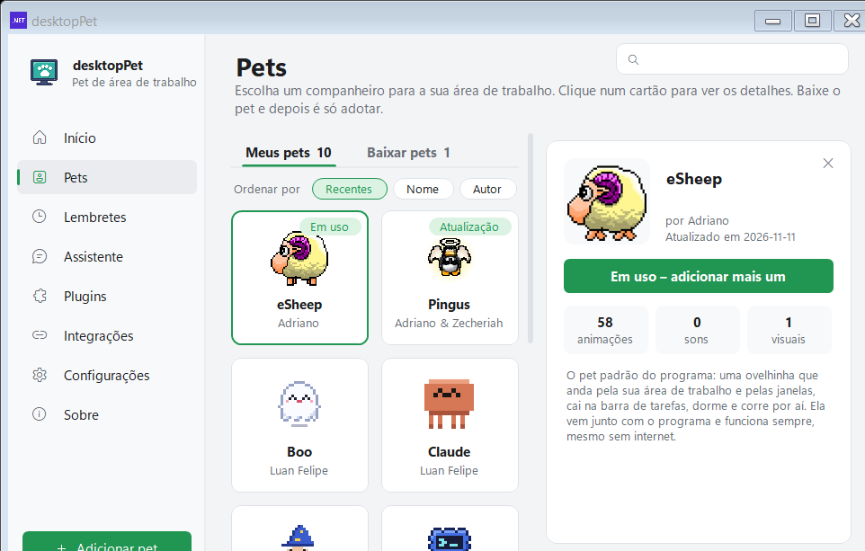
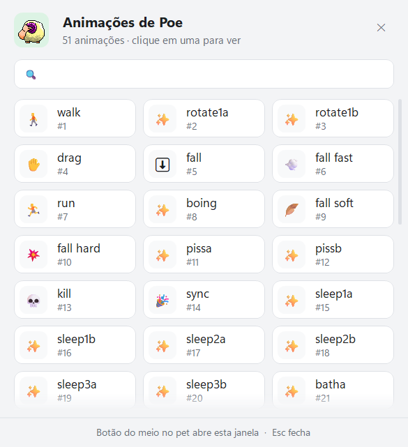

# Primeiros passos

[Home](Home.md) · [Instalação](Instalacao.md) · [Painel de pets](Painel-de-pets.md) · [Pergunte ao pet](Pergunte-ao-pet.md) · [Lembretes e pomodoro](Lembretes-e-pomodoro.md) · [Agenda e e-mails](Agenda-e-e-mails.md) · [Pet virtual e brincadeiras](Pet-virtual-e-brinquedos.md) · [Plugins e integrações](Plugins-e-integracoes.md) · [Crie o seu pet](Crie-o-seu-pet.md) · [Atalhos e comandos](Atalhos-e-comandos.md) · [Para desenvolvedores](Para-desenvolvedores.md) · [Perguntas frequentes](Perguntas-frequentes.md) · [Changelog](Changelog.md)

Este é o tour do programa depois de instalar: o que acontece na primeira execução, como escolher e adotar um pet, como mexer com o mouse nele, o que fica na bandeja do sistema, como é a janela de Configurações e o que o pet conta quando o programa é atualizado.

## A primeira execução

### O pet chega do céu

Na primeira vez que o programa abre, o primeiro pet **cai do céu** (a animação de queda do próprio `animations.xml`) e espera pousar. O programa acompanha o pouso: quando o pet fica em cima de alguma coisa por um instante, ele para e se apresenta.

O Painel (a janela de Configurações) **não** abre sozinho nessa hora. Ele é aberto depois, pelo item **Abrir &Painel** do ícone da bandeja ou pelo botão direito no pet (**Abrir Painel**). A página **Início** mostra o nome do pet em uso, a linha de estado ("Pronto para te fazer companhia.") e os números do dia (Foco hoje, Pausas, Lembretes e Humor).

*Página Início: o nome do pet em uso, a linha de estado e os botões Trocar pet, Perguntar e Adicionar outro.*

### A apresentação

Depois de pousar, o pet se apresenta em balões. O primeiro diz:

> Oi! Eu sou {0}. Posso te mostrar o que eu sei fazer? Leva um minutinho.

Com os botões **Mostrar** (começa o tour) e **Agora não** (pula tudo). Se você escolher mostrar, vêm mais cinco passos, um por balão:

| Passo | O que o balão diz |
| --- | --- |
| 1 | "Clique com o botão direito em mim para abrir meu menu: brincadeiras, foco, lembretes, atalhos e mais." |
| 2 | "Você pode me arrastar com o mouse e me soltar. O botão do meio (rodinha) escolhe uma das minhas animações." |
| 3 | "Eu te lembro de beber água e fazer pausas (Lembretes), e te faço companhia enquanto você foca (Pomodoro)." |
| 4 | "Em reunião? Ctrl+Alt+P me esconde e me deixa em silêncio. Aperte de novo para eu voltar." |
| 5 | "Passe o mouse em mim e clique em \"Perguntar\" para conversar: lembretes, clima e agenda já funcionam. Para perguntas livres, configure a IA (é grátis)." |

O quinto passo muda um pouco conforme o seu programa:

- **Com IA configurada e atalho de pergunta ligado** — "Passe o mouse em mim e clique em \"Perguntar\" (ou aperte {0}) para me perguntar qualquer coisa.", com {0} sendo o atalho escolhido.
- **Com IA configurada e sem atalho** — "Passe o mouse em mim e clique em \"Perguntar\" para me perguntar qualquer coisa. Nas configurações você também pode ligar um atalho de teclado para isso."
- **Sem IA** — o balão é o texto original e o botão vira **Configurar a IA**, que abre a página Assistente.

O botão de avançar é **Próximo (n/5)** e o último balão traz **Entendi!**; em qualquer passo dá para pular com **Pular**. Durante a apresentação os pets ficam parados onde estão.

**Para ver a apresentação de novo:** Painel → **Configurações** → seção **Programa** → **Apresentação** → botão **Mostrar**.

### Os quatro lembretes prontos

Na primeira execução o programa também cria quatro lembretes de exemplo, **todos desligados** para você escolher:

- "Hora de beber água! 💧" — a cada 60 min, das 9h às 18h, seg a sex
- "Vamos alongar um pouco? Levante e se mexa!" — a cada 90 min, das 9h às 18h, seg a sex
- "Descanse os olhos: olhe para algo longe por 20 segundos." — a cada 30 min, das 9h às 18h, seg a sex
- "Hora do almoço! Faça uma pausa de verdade." — todo dia às 12:00, seg a sex

Eles ficam na página **Lembretes** do painel, com o interruptor de cada um ao lado. Os detalhes estão em [Lembretes e pomodoro](Lembretes-e-pomodoro.md).

## Escolher um pet e adotar

O único pet que vem dentro do executável é o **eSheep** original. Todo o resto vem da galeria publicada no repositório, e o caminho é o mesmo para todos.

### Os passos

1. **Abra o Painel** — botão direito no pet → **Abrir Painel**, ou o item **Abrir &Painel** do ícone da bandeja. Ou o botão **＋ Adicionar pet** no rodapé da barra lateral, que adiciona outro pet da mesma jeito.
2. **Vá até a página Pets** (segundo item da barra lateral).
3. **Escolha a aba**: **Meus pets** (o que já está no computador) ou **Baixar pets** (o que está na galeria do GitHub). Cada aba mostra a contagem entre parênteses.
4. **Clique no cartão** do pet. Abre à direita o painel de detalhes, com a prévia animada, o nome, "por {autor}", "Atualizado em {data}" e três caixas: **animações**, **sons** e **visuais**.
5. **Baixe, se precisar.** O botão vira "Baixar (850 KB)" — o tamanho é o do arquivo `animations.xml`. Durante o download o próprio botão vira barra de progresso ("Baixando… 42%") e há um ✕ para cancelar.
6. **Adote.** O botão principal vira **Adotar este pet** e o pet substitui o anterior na tela. Na hora, o novo pet diz "Oi! Eu sou {0}. Prazer em te conhecer!".

*Aba Meus pets: cada cartão mostra o ícone em pixel art, o nome, o autor e um selo no canto — "Em uso", "Novo" ou "Atualização".*

*O painel de detalhes à direita: prévia animada, autor, data de atualização, o botão principal e as três caixas de estatísticas.*

**Atalhos da galeria:** **Ctrl+F** dentro da página Pets leva o cursor para o campo "Buscar pet ou autor…"; **Esc** fecha o painel de detalhes (e, se ele já estiver fechado, fecha a janela); **duplo clique num cartão** já executa a ação principal dele, sem abrir os detalhes — baixar o arquivo, adotar o pet, ou, se for o pet que já está em uso, colocar mais uma cópia na tela.

### Os pets que já estão no computador

O arquivo `Pets/pets.json` na raiz do repositório é o índice da galeria. Os pets baixados ficam em `%LocalAppData%\DesktopPet\pets\<pasta>\animations.xml`, com um `version.txt` ao lado, e continuam funcionando sem internet. Sem conexão, a aba Baixar pets mostra uma faixa "Sem conexão com a internet" e só os pets do disco aparecem.

Mais detalhes da galeria (selos, cores do grupo de ovelhas, download, remoção) estão em [Painel de pets](Painel-de-pets.md).

## Mexer com o pet

### Arrastar e arremessar

**Botão esquerdo + arrastar** pega o pet: ele passa para a animação "drag" e segue o cursor, com o cálculo de movimento reiniciado a cada tique. Ao soltar:

- **Soltar com força** (velocidade maior que 5 na medição dos últimos 80 ms de arrasto) → o pet é **arremessado**: animação "toss" e física própria, com gravidade de 1,5 por passo de 30 ms. Ele bate nas bordas da tela e nas laterais das janelas, quica (a força horizontal é invertida e reduzida à metade) e ao aterrissar escolhe entre "fall soft" e "fall hard" conforme a velocidade vertical.
- **Soltar devagar** → o pet simplesmente cai, com a animação "fall".

Se você soltar o pet em outro monitor, ele passa a ficar naquele monitor.

**Arrastar um arquivo `.xml` (ou um texto XML) sobre o pet** troca o pet carregado por aquele arquivo.

### Botão do meio: o seletor de animações

**Botão do meio** (a rodinha) sobre o pet abre a janela **"Animações de {nome do pet}"**, com todas as animações do pet em blocos — cada bloco com um emoji e o nome, e o número da animação embaixo.

*O seletor: busca "Buscar animação…", o contador "51 animações · clique em uma para ver" e a marca "tocando" na animação em execução.*

- **Buscar animação…** filtra por nome enquanto você digita. A janela abre sem o campo em foco (para o texto de ajuda aparecer), mas basta digitar qualquer tecla para a busca começar.
- Clicar num bloco toca a animação na hora; a janela fica aberta para você testar várias em sequência.
- **Esc** fecha a janela.

### Botão direito: o menu do pet

**Botão direito** sobre o pet abre o menu dele, montado na hora. O primeiro item é o nome do pet (desativado, em negrito) e, se o Pet virtual estiver ligado, vêm as barras de necessidades e as ações **Dar comida**, **Fazer carinho**, **Brincar** e **Deixar dormir**.

*O menu do botão direito no pet: necessidades, brincadeiras, foco, lembretes, atalhos e, no fim, "Abrir Painel" e "Mandar este pet embora".*

Depois: **Perguntar ao pet…** (em negrito), **Brincadeiras**, **Foco (Pomodoro)**, **Como está o tempo?** (só com o clima ligado), **Lembretes**, **Atalhos**, **Timer**, **📝 Notas e tarefas**, **📋 Últimas cópias**, a linha da agenda ("Próximo: {0} {1}" ou "Nenhuma reunião nas próximas 24 h"), **Como estou hoje?**, **Mostrar CPU e memória**, e no fim **Abrir Painel** e **Mandar este pet embora**.

Itens de plugins desligados (Brincadeiras, Foco, Lembretes, Atalhos, Notas, Timer) somem do menu. Enquanto o menu está aberto, todos os pets param de andar.

**Para mandar um pet embora**, use o item **Mandar este pet embora**, no fim do menu. (O código do projeto ainda tem, do eSheep original, um duplo clique com o botão direito que removeria o pet, mas hoje o primeiro clique já abre este menu e o duplo clique não chega a acontecer.)

## A bandeja do sistema

O ícone do programa fica na bandeja, ao lado do relógio. O **botão direito** abre o menu principal:

| Item | O que faz |
| --- | --- |
| **Abrir &Painel** (primeiro item, em negrito) | Abre o painel na página Início. Vira "Abrir &Painel (1 atualização)" quando há pet desatualizado. |
| **&Adicionar outro {nome do pet}** | Põe mais um pet na tela (até 16). |
| **&Esconder pets** / **&Mostrar pets** | Esconde ou mostra todos os pets. Mostra o atalho Ctrl+Alt+P ao lado. |
| **&Lembretes** | Submenu: "Lembrar daqui a {0} min" (5, 10, 15, 30 e 60 min), separador, "Lembrete por texto…", "Gerenciar lembretes…". |
| **&Instalar o programa...** | Só na versão portátil. Vira "Reparar ou &desinstalar..." quando o programa já está instalado. |
| **&Tocar sons** / **&Sons de {nome do pet}** | Liga e desliga o som do pet da tela. |
| **&Sobre** | Abre a página Sobre do painel. |
| **Aj&uda** | Abre a documentação do programa no navegador. |
| **&Remover o pet e fechar** | Fecha o programa (na versão com pet: "&Remover {nome do pet} e fechar"). |

Com o **botão esquerdo** no ícone da bandeja, os pets voltam para a frente de todas as janelas. **Clique duplo** no ícone da bandeja **adiciona outro pet**.

## A janela de Configurações

O Painel é uma janela de 980×660 (mínimo 760×520) com barra lateral à esquerda (220 px) e oito páginas, nesta ordem:

**Início** · **Pets** · **Lembretes** · **Assistente** · **Plugins** · **Integrações** · **Configurações** · **Sobre**

No rodapé da barra lateral fica o botão **＋ Adicionar pet**.

*A página Configurações, seção "Pet": as opções que mudam o jeito do pet andar e o volume dos sons.*

### A página Configurações

Ela é dividida em duas seções, **Pet** e **Programa**.

**Seção Pet**

| Opção | O que faz | Padrão |
| --- | --- | --- |
| **Vários monitores** | Deixa o pet aparecer e andar em todos os monitores, não só no principal. | Desligado |
| **Movimentos suaves** | Suaviza o movimento entre um quadro e outro. Fica mais fluido, mas menos parecido com o andar em saltos do original. | Desligado |
| **Ficar acima da barra de tarefas** | Impede que a barra de tarefas cubra o pet. Pode ficar mais difícil clicar no ícone da bandeja. | Desligado |
| **Trazer janelas para a frente** | Como no eSheep original, traz para a frente a janela em que o pet pousa. Atrapalha o trabalho, por isso vem desligado. | Desligado |
| **Volume dos sons** | Volume dos efeitos sonoros, se o pet tiver algum. Valor 0 silencia tudo. | 30 % |

**Seção Programa**

| Opção | O que faz | Padrão |
| --- | --- | --- |
| **Idioma** | "Auto" segue o idioma do Windows. Os arquivos ficam na pasta `lang`, ao lado do programa. | Auto |
| **Tema** | Automático, Claro ou Escuro. "Automático" segue o que está configurado no Windows. | Automático |
| **Iniciar com o Windows** | Abre o programa (e os seus pets) automaticamente quando você entra no Windows. | Desligado |
| **Pets ao iniciar** | Quantos pets aparecem quando o programa abre (de 1 a 16). | 1 pet |
| **Tamanho do pet** | 1×, 2× ou 4×. O programa reinicia para aplicar. | 1× |
| **Restaurar o pet original** | Volta para a ovelha original que vem com o programa. | ação pontual |
| **Esconder pets com Ctrl+Alt+P** | O atalho esconde todos os pets (e os sons) ou mostra de novo, de qualquer programa. Útil em reuniões. | Ligado |
| **Backup dos meus pets e configurações** | Exporta tudo num arquivo `.desktoppet`. | Exportar… |
| **Importar pets** | Traz de volta os pets de um arquivo exportado. | Importar… |
| **Criar meu pet** | Transforma as suas próprias imagens (PNG, GIF, JPG) em um pet. | Criar… |
| **Janela de depuração** | Mostra ao vivo o que o pet está fazendo. Também abre se você segurar CTRL ao iniciar o programa. | Abrir |
| **Apresentação** | Mostra de novo o que o pet sabe fazer. | Mostrar |
| **Arquivos de registro** | Avisos e erros dos últimos 7 dias. | Abrir pasta |
| **Instalar neste computador** | Só na versão portátil. Copia o programa para a sua pasta de usuário e cria os atalhos. | Abrir… |

### Iniciar com o Windows

A chave liga um item em `HKCU\Software\Microsoft\Windows\CurrentVersion\Run` (sem precisar de administrador) apontando para o executável. O atalho antigo da pasta de inicialização do Windows é apagado, para o programa nunca abrir duas vezes. Se o Windows recusar a alteração, a barra de status da janela avisa: "O Windows não permitiu mudar a inicialização automática."

## Esconder tudo na hora de uma reunião

**Ctrl+Alt+P** (a opção "Esconder pets com Ctrl+Alt+P") esconde **todos** os pets e os sons, de qualquer programa, e mostra de novo no segundo aperto. O atalho é global, registrado no Windows, e vem ligado por padrão.

Enquanto os pets estão escondidos, o pet também cala a boca: nenhum balão aparece, nenhum som toca e os recados que ele teria dado ficam guardados (até 30). Quando você mostra os pets de novo, o pet avisa "Durante o silêncio, chegou 1 aviso." (ou "Durante o silêncio, chegaram {0} avisos.") com os botões **Mostrar**, **Próximo ({0})** e **Dispensar**.

O item da bandeja mostra o estado: "&Esconder pets" quando eles estão na tela e "&Mostrar pets" quando estão escondidos. A página Início do painel também muda a linha de estado para "Escondido (Ctrl+Alt+P para mostrar).".

Se outro programa já estiver usando o Ctrl+Alt+P, o painel avisa na barra de status: "Ctrl+Alt+P já está sendo usado por outro programa."

## O que o pet conta depois de uma atualização

Quando o programa é atualizado para uma versão nova, o pet avisa no balão com o resumo da versão:

> Novidades da versão {0}:

seguido do texto escrito para aquela versão (2.6.0, 2.6.1, 2.6.2… — o que existir no arquivo de idioma). Os botões são **Ver tudo** (abre as notas completas da versão no GitHub) e **OK**.

Esse aviso aparece cerca de 6 segundos depois de o programa abrir, e só quando a versão é realmente diferente da última rodada. Na primeira execução não é esse aviso que aparece, e sim a apresentação do pet.

## Ver também

- [Painel de pets](Painel-de-pets.md) — a galeria inteira: selos, cores, download, remoção e backup.
- [Instalação](Instalacao.md) — instalar, reparar e desinstalar, e as duas builds (.NET 10 e "completa").
- [Atalhos e comandos](Atalhos-e-comandos.md) — a lista completa de atalhos de teclado e de mouse.
- [Pergunte ao pet](Pergunte-ao-pet.md) — a conversa em balão e a configuração da IA.
- [Lembretes e pomodoro](Lembretes-e-pomodoro.md) — os lembretes prontos e o Foco (Pomodoro).

## Onde fica no código

- `src/Portable/Onboarding.cs` — a apresentação (tour), a chegada do céu e o aviso de novidades.
- `src/dotNet/StartUp.cs` — a criação dos pets no arranque (e o limite de 16).
- `src/dotNet/FormPet.cs` — o mouse sobre o pet: arrasto, arremesso, botão do meio, botão direito e o *drop* de XML.
- `src/dotNet/FormPet.Motion.cs` — a física do arremesso e a detecção de bordas.
- `src/dotNet/MotionTrack.cs` — a classe `DragVelocity`, que mede a força do arremesso.
- `src/dotNet/FormAnimPicker.cs` — o seletor de animações (botão do meio).
- `src/Portable/PetMenu.cs` — o menu de contexto do pet.
- `src/dotNet/ContextMenus.cs` — o menu do ícone da bandeja.
- `src/dotNet/ProcessIcon.cs` — o ícone da bandeja (clique, clique duplo e menu).
- `src/Portable/HideHotkey.cs` — o Ctrl+Alt+P e o atalho de perguntar.
- `src/Portable/FormSettings.cs` — a janela do painel (barra lateral, páginas, Esc e Ctrl+F).
- `src/Portable/FormSettings.Sidebar.cs` — a ordem das páginas e o botão "＋ Adicionar pet".
- `src/Portable/FormSettings.Options.cs` — a página Configurações (seções "Pet" e "Programa").
- `src/Portable/FormSettings.Pets.cs` e `src/Portable/FormSettings.PetsView.cs` — a galeria, o download e a adoção.
- `src/Portable/Reminders.cs` — os quatro lembretes prontos da primeira execução.
- `src/Portable/WindowsStartup.cs` — "Iniciar com o Windows".
- `src/Portable/SpeechBubble.cs` — o balão de fala e o silêncio (que o Ctrl+Alt+P liga).
- `src/lang/pt-BR.json` — os textos da interface citados nesta página.
